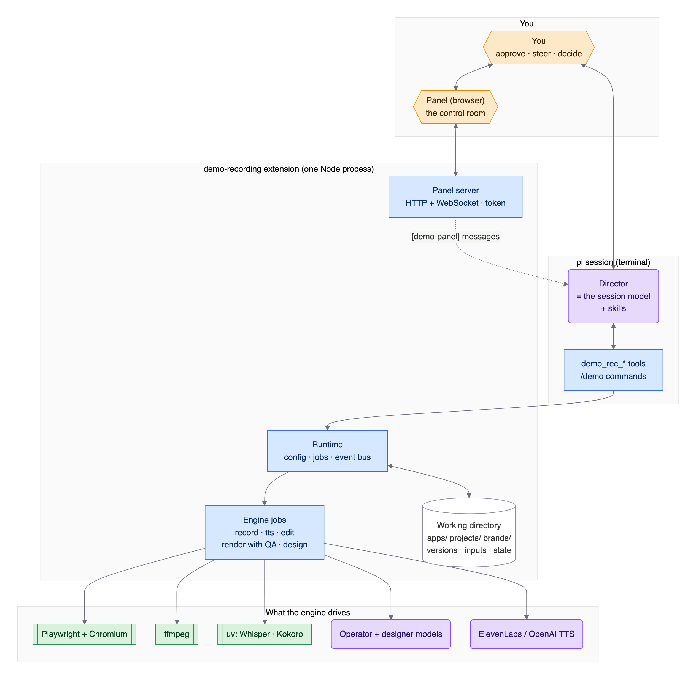

# demo-recording

> **Status: S4 done.** It produces a narrated, in-sync video from pi: take analysis, a voice-over written from the actual run, panel approval, ElevenLabs (your voice) / OpenAI / local Kokoro, and an audio-led edit with per-scene MP4s plus the full video. Polish and automatic quality checks come next (S5). Progress is tracked in the [implementation plan](docs/IMPLEMENTATION_PLAN.md#6-vertical-slices).

Automated PoC and demo video recorder for web apps (SPAs, read-mostly):

1. **Brief → discover → storyboard.** The agent explores the app, finds the demo-worthy use cases, and writes a storyboard that reacts to real screen content. You review and approve it in a local side panel.
2. **Record.** One continuous, human-looking take: virtual cursor with realistic motion, realistic typing, and live `improvise` inputs for search and chat.
3. **Analyse → voice-over.** A dense, opinionated, anchored narration written from the actual run. Reviewed in the panel.
4. **Voice, edit, export.** ElevenLabs (custom voice) with OpenAI/Kokoro fallbacks, an audio-led edit, selective zoom, step callouts, and a title card. Per-scene videos plus one combined video.

**Start here to understand it:**

- **How it works, end to end** (the flow, the principles and their reasons, the stage chain, the files, the panel and the agent bridge, with diagrams): [docs/ARCHITECTURE.md](docs/ARCHITECTURE.md)
- **Who does what**: the cast (you, models, engine, scripts), each role's inputs, outputs, decisions and model, and how work is handed over: [docs/ACTORS.md](docs/ACTORS.md)
- Decisions and the alternatives we turned down: [docs/VISION.md](docs/VISION.md)
- Implementation plan (vertical slices S0–S8): [docs/IMPLEMENTATION_PLAN.md](docs/IMPLEMENTATION_PLAN.md)



## Workflow in pi (S2)

1. `/demo new <project> <app-url> [app name]`: creates the project, opens the panel, and starts the **demo-brief** skill (it drafts `brief.md` with you).
2. `/demo discover [notes]`: the **demo-recording** skill explores the app with `demo_rec_browser`. You can watch it live in the panel: current screen, budget, and a safety feed.
3. The agent writes a storyboard (`demo_rec_storyboard`). The panel **Storyboard** tab shows scene cards. Mark each scene *Approve / Request changes / Re-run*, add notes, then **Send review to agent**. You get one consolidated `[demo-panel]` message, and the agent writes the next version, with a diff shown.
4. **Approve vN** in the panel. This is the only way to approve; the agent cannot.
5. Ask the agent to record: `demo_rec_record` starts a **background** take of the approved version. The panel shows a per-scene progress bar with ETA, and pi's footer shows the current step. The agent gets a `[demo-recording]` message with the result.

6. After the take, the agent analyzes it (`demo_rec_take`) and writes the voice-over (`demo_rec_vo`, **demo-voiceover** skill). It's written from the actual run and quotes real on-screen values.
7. The panel **Voice over** tab shows each section with a speech-vs-footage timing bar. You can edit inline (each save is a new version), mark sections, send the review, and **Approve**. Approval unlocks the paid voice synthesis.
8. `demo_rec_tts` generates the voice and `demo_rec_edit` syncs the take to it (`edit/timeline.vN.json`) and renders a **draft**. Finals come from the Render stage: `projects/<p>/render/vN/<flavor>/<project>_final-vN_<flavor>.mp4`, per-scene clips, transcripts and a poster. See [docs/RENDER.md](docs/RENDER.md).

### Voice-over and edit (S4)

- **Script:** markdown sections per scene, plus `_intro`, `_bridge:<scene>` and `_outro` for the full video only.
  - `[@mark]` pins the following phrase to that event.
  - `{{dom:mark|regex}}` fills in a value from the page text captured at that mark.
- **Voices** (`ttsChain`, keys **from the environment only**):

  | Engine | Needs | Timings |
  |---|---|---|
  | `elevenlabs` | `ELEVENLABS_API_KEY`; voice **by name** from the brief's *Voice* field or `voiceName` | provider character timings (`eleven_v4`, falls back to `eleven_multilingual_v2`) |
  | `openai` | `OPENAI_API_KEY`; `gpt-4o-mini-tts`, voice `ash`, tone instructions | Whisper |
  | `kokoro` | `uv` (local, offline; ~124 MB of models on first use) | Whisper |
  | `say` | macOS (dev/tests only) | Whisper |

  One engine is used for the whole video; if it fails mid-way, the voice-over restarts with the next engine. Audio is cached by content, so re-renders only pay for changed sections. `demo_rec_tts check` shows which engine and voice will be used, for free.
- **Word timings for the non-ElevenLabs engines:** faster-whisper `base.en` via `uv` (~145 MB of models on first use) plus energy-onset refinement.
- **Sync editor:**
  - **Cuts first:** dead time (spinners) goes, keeping a 0.4 s beat.
  - **Then speed:** static stretches up to 1.6×, streamed answers up to 1.3×, in-app video and animation up to 1.15×.
  - **Then trim:** static stretches are trimmed.
  - **If the narration is longer:** static stretches are slowed (≥ 0.85×), then a settled frame is held.
  - **Never touched:** typing and clicks.
  - **If the video can't shrink:** the narrator pauses instead of drifting.

  The result message lists per-scene cuts, holds, pauses and any off-sync anchors.
- **Output:** 1920×1080, 30 fps H.264, AAC, loudness-normalized to −16 LUFS.

### Stages, working line and project memory (S5)

- **Stages:** storyboard → recording (take) → voice-over → annotations → render.
- **Versions:** every version is based on exactly one parent version, read from the files themselves.
- **Accepting:** several versions per stage can be accepted, so lines branch. A take of storyboard v2 can get two voice-overs, and two good takes can each get their own. Accepting resets nothing; a version can only be accepted when its parent is accepted.
- **Un-accepting:** never deletes or resets anything. Accepted versions built on the un-accepted one are flagged **orphaned** and can't be used until it's accepted again.
- **Working line:** one line per project (e.g. storyboard v2 → take-006 → voice-over v3), shared by the panel and the agent.
  - **Default per stage:** the most recently accepted version on the line's input.
  - **Agent tools:** they use the working line unless given an explicit version.
  - **Status:** `demo_rec_project status` shows it, plus all accepted versions with their lineage.
- **Project memory:** `inputs.jsonl` records every directional input: `/demo discover` and `/demo voiceover` notes, submitted panel reviews, inline edits, brief versions, and chat directions, sources and assets the agent notes with `demo_rec_project note`. Withdrawn directions are marked outdated, never deleted. `demo_rec_project context` returns the brief, the working line, the lineage and the active inputs; `/demo open` and a session restore put that into the agent's next turn.

### Project tab (S5)

The first step, with three views:

- **Facts:** title, subtitle, persona, **depth** (poc / showcase / sales), stance, target length (min–max), goal, app URL and extra URLs, plus the login state (never its contents).
  - **Storage:** the facts are fields of `brief.md`. Each save shows the diff and writes a new brief version; `Audience:` in older briefs is read as Persona.
  - **Depth defaults:** depth sets the default stance and length:

    | Depth | Stance | Length |
    |---|---|---|
    | poc | evaluator | 3–5 min |
    | showcase | teacher | 2–3 min |
    | sales | champion | 60–90 s |

  - **Not here:** tool settings, including project-only overrides, live under ⚙ Config.
- **Findings:** one list from two sources.
  - **Agent findings** come from discovery and analysis (`demo_rec_project finding` with evidence: strength, weakness, friction, value, use case, length).
  - **Engine findings** are detected: error toasts, improvise fallbacks, retries, dead time, blocked and state-changing discovery actions, and the edited length vs. the target.
  - **States:** each finding is **auto** (the director decides), **use** (always in the recording *and* the narration; storyboard scenes list the findings they cover, and uncovered *use* findings produce a warning) or **ignore** (never brought up). Evidence shows as thumbnails.
- **Memory:** the working line, the brief with versions and diffs, the input log (mark outdated / restore), and sources and assets.

### ⚙ Config (S5)

- **Settings:** every setting grouped (Voice, Models, Recording & capture, Output & look, Discovery budgets, General), the most important first.
  - **Per setting:** the effective value, a source badge (default / global / project / env), the docs, and the value in each layer.
  - **Override notes:** e.g. "overridden by project kc", or "env DEMO_REC_VOICE overrides the files".
  - **Scope:** switch between **Global** and **This project**, so project-only overrides live here too, never in the Project tab.
  - **Saving:** inputs follow the type: number, toggle, select (brand, alignment model), a reorderable TTS engine chain, the model list. **Save** and **reset** go through a diff confirmation and are validated by the real config resolver. `root` is global-only. Secret-looking keys are refused, and `_comment` is kept.
- **Raw files:** the global and project `config.json` are shown **read-only** beside the form, with *open in editor* and *reload*.
- **API keys:** only `ELEVENLABS_API_KEY: set / not set` and the same for OpenAI. Keys come from the environment only.
- **Brands:** the brand editor (preview, tweaks, save, save as copy, set default).

### Style tile (UX0)

[docs/ux/](docs/ux/README.md) holds the design-system proof for the control room redesign: tokens with measured WCAG contrast in Macchiato and Latte, a showcase of every shared component, four mock screens (Voice over, Render, Config, Map), with working map and settings-search prototypes. Open `docs/ux/tile.html` in a browser. `test/ux-tile.test.ts` keeps it honest. The design system (`src/panel/public/ds/`) is the panel's own since UX1 ([report](docs/ux/UX1.md)); `scripts/panel-audit.ts` (axe-core, focus, target sizes), `scripts/ux-ratchet.ts` and `scripts/panel-shots.ts` measure and guard it.

### Dialogs, errors and cost warnings (S5)

- **Decisions** (accept, un-accept with its orphan list, saving config or brands with a diff, deleting renders, discarding changes, naming a copy, giving a reason) are in-panel dialogs: Escape cancels, Enter confirms, a destructive one starts on *Cancel*. **Errors** are non-blocking toasts that stay until dismissed, with *Copy*. No native `alert` / `confirm` / `prompt` is used.
- **Ask first** before money and long jobs: *Generate voice & render* (cached vs billed characters, credits and money; never skippable), *Request a new take* (improvise steps, their models and whether those have credentials, the last take's length) and a *separate designer run* (the input pack in tokens and its models). The last two offer "Don't ask again this session".
- **Hints:** buttons that start an agent turn say so ("starts the Director · claude-opus-4-5"); the cost of a turn can't be estimated, so no number is shown.
- **`POST /api/estimate`** is the free dry run behind the dialogs, and every panel route has a cost class that a test enforces. `demo_rec_tts check` prints the voice cost for the working line too.

### Panel: the control room (S5)

- **Opening:** `/demo panel` starts the panel and opens it in your default browser (macOS `open`, Linux `xdg-open`, Windows `start`). Set `DEMO_REC_NO_OPEN=1` to only print the URL.
- **Top bar:** the process steps form a stepper on the left (Storyboard › Recording › Voice over › Annotations › Render). **⚙ Config** sits at the far right, apart from the steps, and holds all tool configuration (see below). The **Project** tab at the far left is step one (see below).
  - **Input picker:** every stage tab except Storyboard has one, listing each accepted, usable version of the previous stage with its lineage (e.g. "take-006 · storyboard v2"). It defaults to the working line; changing it switches the working line, and the agent is told.
  - **Shared header:** each tab shows how many versions are on the selected input, which are accepted, the working line's version, orphan flags, and "→ you: …" when the project waits for you. A dot on the tab marks the stage that needs you.
  - **Per-version actions:** *Accept* (several allowed, resets nothing), *Un-accept* (the confirmation lists what becomes orphaned), and *Work on this* (put it on the working line).
- **Recording tab:** the takes of the selected storyboard, newest first, with status, duration, analysis state, a keyframe per scene and the raw take as video. *Request a new take* asks the agent for a take of that storyboard.
- **Live panel:** a collapsible right-hand panel; below 1100 px wide it becomes a bottom drawer.
  - **Contents:** one progress row per running activity, a frame preview (the live frame of a running take, or the current discovery screen), safety, the working line and the log.
  - **Collapsed:** a one-line strip with stage, activity or "waiting for you", and a mini progress bar.
  - **Per tab:** sections can be toggled and are remembered.

### Brands (S5)

Every render uses a **brand package**, which sets:
- the footage inset on a backdrop (rounded corners, soft shadow, an automatic rim when the app blends into the backdrop);
- a title card (app, demo title, date) that dissolves into the first frame;
- the callout colors;
- an optional logo bug in the backdrop margin.

| | |
|---|---|
| built-in | `neutral` (dark slate, soft-blue accent, no logo) |
| user brands | `<root>/brands/<name>/`, outside this repo, so company logos never end up in a public package |
| create | `/demo brand new path/to/brand.zip`: the `demo-brand` skill inspects logos (rendered, luminance-checked) and colors, proposes a mapping, creates the brand, and shows a preview |
| default | config `brand` (`/demo brand use <name> [--project]`, diff-confirmed) |
| switch | the **Render** tab (tick one or several brands), `/demo render final <name>`, or `/demo brand rerender <name>` (a draft). Same timeline, `raw.mp4` and voice; no LLM, no TTS. Output in `render/vN/<brand>/` |

The panel **⚙ Config** brand editor previews tweaks (colors, inset, corners, shadow, title timing, logo bug) on a real keyframe before saving. Built-in brands are read-only, so use "Save as copy".

Full reference, with every option, the automatic decisions and the render chain: [docs/BRANDS.md](docs/BRANDS.md).

### Recording inputs for annotations (S5)

- **Layout snapshots:** every take writes `takes/take-NNN/layout.jsonl`, the positions of the visible elements. They're captured after each step once the page is quiet, and at every mark, in the background, so the cursor never waits.
  - **Contents:** the text (≤ 200 chars), role, accessible name and box (CSS px) of each element. Covers headings, cells and rows, buttons and links, inputs, and images by alt text.
  - **Limits:** at most 400 elements per snapshot, and at most one after-step snapshot per 500 ms.
  - **Never captured:** password, one-time-code and credential values, hidden elements, and the cursor overlay.
  - **Cost:** about 3–4 KB per snapshot; a 22 s fixture take has 15.
- **Settled targets:** after each step that acts on an element, a `target-settled` event logs that element's box again once the page has settled, with `moved: true` when it shifted (a banner appeared, a list re-sorted). Highlights then use where the element really is.
- **`emphasis:`** on a step or scene is the director's intent ("the EMEA outlier is the story"). It's only a hint: the Annotation designer chooses zooms and callouts later. Old `zoom:` / `callout:` flags still parse, become emphasis hints, and produce a warning on storyboard write.
- **Recording tab:** each take card shows how many layout snapshots it has. Takes recorded before this change have none, so re-record a project to get them.

### Annotations (S5)

Zooms, highlights, spotlights, callouts, chapter titles and redactions, burned into the render. Each one is anchored to a storyboard mark (or a scene start), so it lands exactly on its moment in the edited video. It points at a step's element, a text on screen, or a box.

- **Motion:** nothing pops in. Overlays fade with a small entrance motion: highlights settle, callouts rise, chapters slide in. Zooms ease in and out, and redactions are instant.
- **Spaces:** page-space types (redact, highlight, spotlight) are drawn on the recorded page and follow a zoom. Callouts and chapters sit on the finished frame.
- **Output:** annotations are burned in by the Render stage; which types a render includes is a render option ([docs/RENDER.md](docs/RENDER.md)).
- **Suggested for you:** after each sync edit, the Annotation designer (the agent, `demo-annotations` skill) suggests about twice as many as needed. The engine places and weighs them, switches the best half on and adds privacy redactions, which stay off until you confirm. Config: `annotations.autoSuggest`.
- **Annotations tab:**
  - a card per suggestion, with its still (▶ plays a clip);
  - on/off switches, inline texts, ±½ s nudges and other targets;
  - a budget meter, filters, and "Play scene with enabled annotations";
  - **Re-suggest with instructions**, which keeps everything you changed.
- **Saving and accepting:** edits are a draft until **Save as vN**. **Accept** a version, and a final render becomes possible; the agent offers one.
- **By hand:** the same files via the CLI (`annotate add|check|preview|suggest|import`).

Full reference, with an example of every type: [docs/ANNOTATIONS.md](docs/ANNOTATIONS.md).

### Review help: confidence and voice direction (S5)

- **Confidence:** every storyboard scene, voice-over section and annotation is rated **high / medium / low** from measured signals, with the reasons on the card:
  - unseen or css targets, failed takes;
  - a number the page never shows, speech vs footage;
  - redactions, fixed boxes;
  - changes since the last version.

  The agent can add its own doubt, which only lowers a level. The tabs show "N need your eyes" (chips jump to the item), riskiest first, collapse high, and **Approve high-confidence…** (a popup lists what it approves and skips).
- **Voice direction:** the Voice over tab's **Direction** box (stance, tone, length, focus, notes) asks the agent for a new complete version from the same take. You review a word diff against its base, then **Generate voice & render**, which shows the cost (cached sections are free, ElevenLabs credits, `tts.pricePer1kChars`) and then runs TTS, the edit and a draft render.

Full reference: [docs/CONFIDENCE.md](docs/CONFIDENCE.md).

### Render (S5)

The last stage: drafts to watch, and finals to hand over. Every render is a version (`render/vN/`), and the panel's **Render** tab is where they're made, watched, accepted and deleted.

- **Draft:** any annotations (or unsaved changes). Full video only, 960×540, with a small DRAFT tag. Every sync edit makes one.
- **Final:** needs accepted annotations. Full quality, per-scene clips, a transcript (VTT) and the callouts (SRT), and a poster.
- **Per render:**
  - which annotation types to include (none, chapters only, …);
  - several brands at once;
  - optional burned-in subtitles, as extra files;
  - the logo bug on or off.
- **QA** checks every final automatically: values said vs. shown, error toasts, sync drift (Whisper), frozen, black or silent stretches, and redaction gaps. Blocking items gate **Accept**; you either **Apply fixes** (a new final with mechanical fixes) or confirm each with a reason. See [docs/QA.md](docs/QA.md).
- **Accept** a final: it becomes the deliverable.
- **Disk space:** old drafts are pruned (`render.keepDrafts`), and **Delete files** keeps the record.

Full reference: [docs/RENDER.md](docs/RENDER.md).

**Try the whole pipeline on the bundled fixture** (free macOS voice, temp workspace, no model needed; ends in the panel):

```fish
fish extensions/demo-recording/scripts/fixture-walkthrough.fish        # --no-pi: skip the panel · --keep: keep the workspace
```

### Recording (S3)

- **Motion:** curved paths with a natural speed profile (slow start, fast middle, slow landing), occasional overshoot-and-correct, and a small hand drift while dwelling. Seeded per take, so it can be reproduced.
- **Typing:** variable per-key rhythm with pauses between words. Typos are optional: `"recording": { "typoRate": 0.02 }`.
- **`improvise` steps:** a fast model invents the input (search/chat) from the live screen while the cursor travels. Default chain: `anthropic/claude-haiku-4-5` → `openai/gpt-5.4-mini`, using pi's configured auth (`"improvise": { "models": [...] }` or `DEMO_REC_IMPROVISE_MODELS`). If the model is late, the cursor hesitates for up to `hesitateMs` (3 s), then the step's `fallback` text is typed.
- **Page watchers:** route changes, toasts and alerts (with text), and loading spinners are logged. Spinner time is recorded as dead time for the editor to cut.
- **Resume:** a failing scene is retried (`"recording": { "maxRetriesPerScene": 2 }`). The take is cut at that scene's start, the app is restored off-camera (via `deep_link`, or by replaying the earlier scenes fast; a crashed browser is reopened), and the good footage before it is kept. Failed attempts are kept in `attempts.jsonl`.
- **Panel:** progress bars for discovery (the agent's declared areas plus budget) and recording, in Catppuccin **Macchiato** (default) or **Latte**. Toggle in the header.

**Tools:** `demo_rec_project`, `demo_rec_browser`, `demo_rec_storyboard`, `demo_rec_record`. **Skills:** `demo-brief`, `demo-recording`.

### Discovery safety net (D6)

- **Blocked before the click:** destructive, financial, sharing and session-ending actions (delete, pay, share, invite, publish, sign out, …), plus navigation off the app's origin.
- **Allowed but audited:** state changes (send, save, submit, chat messages). They are flagged in the panel and written to `apps/<app>/discovery/<session>/audit.jsonl`.
- **Overrides:** `apps/<app>/policy.json`, for example `{"allow": ["Send"], "deny": ["Export"], "allowOrigins": ["https://sso.example.com"]}`. `allow` beats the built-in denylist.

## What works today (S0–S4)

| In pi | Does |
|---|---|
| `/demo new [<project> <app-url> [app name…]]` | creates a project, opens the panel, starts the brief skill |
| `/demo open [<project>]` | sets the active project (persisted in the session) |
| `/demo status` | root, config sources, phase, approvals, panel URL |
| `/demo discover [notes]` | start discovery + storyboard (demo-recording skill) |
| `/demo panel` | starts the side panel and opens it in your browser (URL with token; `DEMO_REC_NO_OPEN=1` to only print it) |
| `/demo doctor` | prerequisite check |
| `/demo brand [list \| use <name> \| new [zip] \| rerender [name]]` | brand packages (S5) |
| `/demo config`, `/demo voices`, `/demo voiceover`, `/demo render` | settings, voice picker, voice-over, render (S5) |

Engine CLI (no model needed):

```bash
node extensions/demo-recording/cli.ts doctor
node extensions/demo-recording/cli.ts fixture serve            # Acme Pulse test app (?slow=1, ?flaky=1)
node extensions/demo-recording/cli.ts project new --name "Churn PoC" --url https://app.example.com --app "Example"
node extensions/demo-recording/cli.ts panel --ticker           # standalone panel with test events

# S1 walking skeleton: fixture + fixtures/storyboards/s1-search.yaml → out/take-NNN-naive.mp4
node extensions/demo-recording/cli.ts run-s1 --fixture [--seed 7] [--headed]
node extensions/demo-recording/cli.ts run-s1 --url https://app.example.com --app Example --storyboard my.yaml
node extensions/demo-recording/cli.ts spike capture            # capture resolution comparison
node extensions/demo-recording/cli.ts record --fixture          # S3 take with live progress (uses pi's model auth; --no-model to skip)
node extensions/demo-recording/cli.ts fixture-demo             # S4: full narrated demo of the fixture with your voice chain
node extensions/demo-recording/cli.ts annotate add --project P --file a.json   # S5: store annotations/vN.json (validated)
node extensions/demo-recording/cli.ts annotate check --project P               # resolved times, boxes, warnings
node extensions/demo-recording/cli.ts annotate preview --project P --id ID     # clip + still of one annotation (cached)
node extensions/demo-recording/cli.ts render --project P [--kind final] [--brand a,b] [--types …] [--subtitles]   # S5: a render version → render/vN/
DEMO_REC_ELEVENLABS_E2E=1 DEMO_REC_VOICE="<your voice>" node --test extensions/demo-recording/test/s4-elevenlabs.test.ts   # live voice check (~200 chars)
```

A take lands in `projects/<p>/takes/take-NNN/` and contains:
- `frames/`: 3200×1800 JPEGs
- `frames.jsonl`
- `events.jsonl`: every step on the screencast clock, with element boxes and `mark` anchors
- `take.json`: seed, stats, status
- `scenes.json`
- `raw.mp4`: CFR master at capture resolution

The S1 storyboard format (a subset; the full schema arrives in S2) is documented in `src/storyboard/types.ts`. See `fixtures/storyboards/s1-search.yaml` for an example.

## Configuration

Optional JSON file at `~/.config/demo-recording/config.json` (or `$DEMO_REC_CONFIG`). Every field is optional:

```json
{
  "root": "~/DemoRecordings",
  "viewport": { "width": 1600, "height": 900, "dpr": 2 },
  "output": { "width": 1920, "height": 1080 },
  "fps": 30,
  "capture": { "quality": 92 },
  "panelPort": 3777,
  "ttsChain": ["elevenlabs", "openai", "kokoro"],
  "voiceName": "My Voice",
  "tts": {
    "elevenlabs": { "model": "eleven_v4", "fallbackModel": "eleven_multilingual_v2" },
    "openai": { "model": "gpt-4o-mini-tts", "voice": "ash" },
    "kokoro": { "voice": "am_michael" }
  },
  "align": { "model": "base.en" },
  "budgets": { "discoveryScreens": 40, "discoveryActions": 150, "discoveryMinutes": 20 },
  "roles": { "annotationDesigner": { "model": ["anthropic/claude-sonnet-4-5", "openai/gpt-5.4"] } }
}
```

`roles.annotationDesigner.model` is optional: with a model (one `provider/id` or an ordered list) the Annotation designer runs as **one separate model call** after each sync edit and for the panel's (Re-)suggest, instead of an agent turn on the session model; if every model fails, the agent turn takes over. Check it with `/demo doctor`. Details: [docs/ACTORS.md](docs/ACTORS.md#8-the-separate-annotation-designer-run).

To downscale capture on weaker machines, set `"capture": { "maxWidth": 2560, "maxHeight": 1440 }` (see [docs/spikes/S1-capture.md](docs/spikes/S1-capture.md)).

Environment variables override the file: `DEMO_REC_ROOT`, `DEMO_REC_PANEL_PORT`, `DEMO_REC_TTS_CHAIN` (comma-separated), `DEMO_REC_VOICE`, `DEMO_REC_IMPROVISE_MODELS`, `DEMO_REC_ANNOTATION_MODEL`. A malformed config file is a hard error.

## Working directory

```
~/DemoRecordings/
  apps/<app>/        app.json, auth/ (0700), policy.json, discovery/   (shared across demos)
  projects/<demo>/   brief.md, context/, state.json, storyboard/, takes/, vo/, edit/, annotations/, out/, previews/, jobs/
```

Artifacts are versioned and never overwritten (`storyboard/v3.yaml`, `takes/take-002/`).

## Prerequisites

- Node 22+, `npx playwright install chromium`
- `ffmpeg` ≥ 7 (with libx264) and `uv` on PATH (`brew install ffmpeg uv`). `uv` runs the bundled Python helpers (`py/`: Whisper word timings, Kokoro) with inline dependencies, so there is no virtualenv to manage.
- `ELEVENLABS_API_KEY` (primary TTS) and optionally `OPENAI_API_KEY`, **exported before starting pi**, since a running pi does not see new variables.

`/demo doctor` checks all of these. It reports key *presence* only and never prints values.

## Security notes

- **Discovery:** drives a real browser against the target app (clicks, typing). The safety net above blocks destructive actions before they happen. Screenshots and aria text are sent to the session model.
- **Panel:** binds to `127.0.0.1` only. API and WebSocket require a random per-session token, and the Host header must be loopback (DNS-rebinding guard). State-changing requests (review, approve) accept only a Bearer header with a JSON body, so other local pages can't forge them. The token is removed from the URL bar once the page loads.
- **Planned (later slices):**
  - Sends narration text to TTS providers (ElevenLabs/OpenAI). Kokoro, Whisper and `say` run locally.
  - Stores browser session state (cookies) per app under `apps/<app>/auth/` (directory `0700`, files `0600`). It is never logged and never sent to models.

## Development

```bash
node --test extensions/demo-recording/test/*.test.ts   # browser/ffmpeg tests skip if missing
DEMO_REC_E2E=1 node --test extensions/demo-recording/test/s1-e2e.test.ts   # full pipeline (macOS)
npm run typecheck && npm run lint
```

The vendored panel dependency (`src/panel/public/vendor/`) is excluded from biome.
