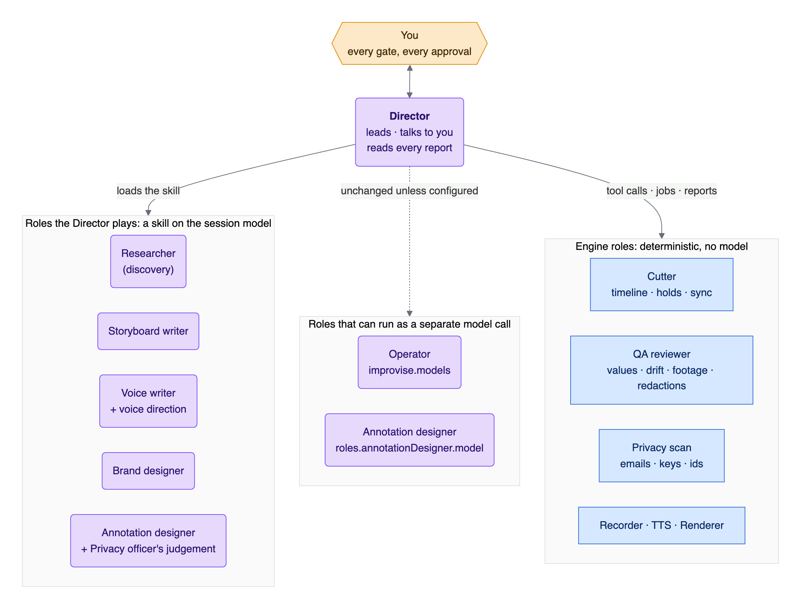
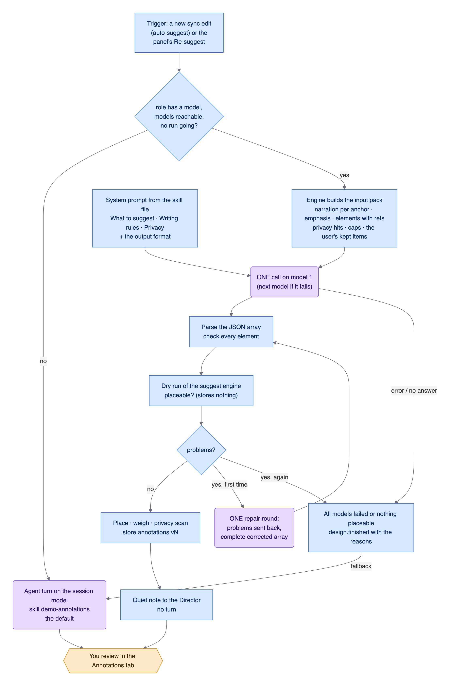

# Actors: who does what, and why

The demo is made by a **cast**. Each member has one job, takes defined inputs,
leaves defined artifacts, and may decide only what is theirs. This document
describes the cast, the four kinds of hands behind it (human, model, engine,
script), how work is handed over between them, and how a role's model is
chosen.

The whole system and its flow are in [ARCHITECTURE.md](ARCHITECTURE.md); the
decisions and the alternatives we turned down are in [VISION.md](VISION.md)
(`D40`, `D85`–`D90`, and the others cited below).

**Contents**
1. [The vision behind the cast](#1-the-vision-behind-the-cast)
2. [Four kinds of hands](#2-four-kinds-of-hands)
3. [The cast at a glance](#3-the-cast-at-a-glance)
4. [The actors, one by one](#4-the-actors-one-by-one)
5. [Handovers](#5-handovers)
6. [Dependencies between actors' work](#6-dependencies-between-actors-work)
7. [Which model plays which role](#7-which-model-plays-which-role)
8. [The separate Annotation designer run](#8-the-separate-annotation-designer-run)
9. [Failure modes at a glance](#9-failure-modes-at-a-glance)
10. [Background decisions and rejected alternatives](#10-background-decisions-and-rejected-alternatives)

---

## 1. The vision behind the cast

A good product demo is made by a small crew: a **director** who owns the story
and talks to the client, a **researcher** who learns the product, a **writer**
who plans the scenes, an **operator** who drives the product on camera, a
**voice writer** who watches the footage and writes what to say, a **cutter**
who lines picture and voice up, a **designer** who decides where the eye
should go, someone who looks after the **brand**, a **reviewer** who checks
the result against the footage, and someone who guards **privacy**.

We copy that crew for three reasons:

- **Clear responsibilities.** Each role has its own inputs and outputs, its
  own rules (a skill or an engine module), and its own failure modes. When a
  demo goes wrong you can say *which role* got it wrong, and fix that role.
- **Different roles need different strengths.** The Researcher needs eyes and
  patience, the Voice writer taste and precision, the Cutter and the QA
  reviewer *no judgement at all* but perfect repeatability. Some of these
  are best done by a model, some by code.
- **Independence where it counts.** The party that checks the work (QA) is
  not the party that did it (the Director's models). It is code, and it only
  reports.

The crew is **not** ten separate agents. Splitting work between model runs
costs context and tokens at every hand-off, so by default **every model role
is a skill that the Director plays** on the session model. A role runs as a
separate model call only where its work is a pure function of a compact input
(today: the Operator and, opt-in, the Annotation designer).

---

## 2. Four kinds of hands

| Kind | In this system | Strengths | Limits |
|---|---|---|---|
| **Human** | you | taste, intent, risk, the last word | your time and attention |
| **Model** | the session model (the Director and the roles it plays), and the configured model chains | judgement, language, reading a screen | not reproducible, can be confidently wrong; never trusted with exact values, timing or its own approval |
| **Engine** | our Node code in the extension | validation, measurement, versioning, orchestration, gating; reproducible and free of tokens | judges nothing about what is *interesting* |
| **Script / tool** | Playwright + Chromium, ffmpeg, `uv` (Whisper, Kokoro), the TTS services | the heavy lifting | decides nothing; always wrapped by the engine |

Every role below is labelled with its kind. Several roles are a **model
judgement checked by an engine step** (for example the Annotation designer: a
model suggests, the engine places and weighs). That pairing is deliberate.

---

## 3. The cast at a glance

| Role | Kind | Acts in | Reads | Leaves | Model |
|---|---|---|---|---|---|
| **You** | human | every gate | everything in the panel | approvals, notes, directions, instructions | – |
| **Director** | model | all of it | all reports, the project's memory | the plan, the next step, a summary for you | the **session model** |
| **Researcher** | model + engine safety net | discovery | the app, the brief | discovery screens, findings | the session model |
| **Storyboard writer** | model + engine checks | storyboard | brief, findings, discovery | `storyboard/vN.yaml` | the session model |
| **Operator** | model (live) + engine | recording | the live screen, the brief | improvised inputs in the take | **`improvise.models`** (separate call) |
| **Voice writer** | model + engine checks | voice-over | take analysis, keyframes, brief, your notes and directions | `vo/script.vN.md` | the session model |
| **Cutter** | **engine** | edit | take, voice audio and timings | `edit/timeline.vN.json`, a draft render | none |
| **Annotation designer** | model + engine | annotations | the input pack | `annotations/vN.json` | the session model, or **`roles.annotationDesigner.model`** (separate call) |
| **Privacy officer** | engine scan + the designer's judgement | annotations | layout snapshots, the brief | redaction suggestions (always off) | none for the scan; the designer's model for names |
| **Brand designer** | model | brand | your logos, colours, fonts | `brands/<name>/` | the session model |
| **QA reviewer** | **engine** | render | the render, the timeline, the take | the QA report, fix proposals | none |

---

## 4. The actors, one by one

Each entry: **responsibility · inputs · outputs · tools · decides alone ·
needs you or the Director · model profile · failure modes**.

### You (human)

- **Responsibility:** the story, the risk, the final yes. You are the only one
  who may accept anything, and the only one who lets the Director spend: voice credits and
  recording time wait for your Allow (panel or `/demo allow`).
- **Decide in the panel:** approve per scene (storyboard), accept the take,
  approve the script, toggle and accept annotations, confirm a voice
  generation after its estimate, fix a leaking redaction (or, as a last resort, confirm it **with a
  reason**), accept the final.
- **Steer:** notes per scene or section, an overall note, a **voice direction**
  (stance, tone, length, focus), annotation **instructions**, findings marked
  *use* or *ignore*, outdated inputs.
- **Never needed for:** validation, versioning, timing, rendering, QA checks,
  fixes that only re-time.
- **Failure modes:** approving blind. The panel counters it with reasons per
  item, "N need your eyes", a plan popup before *Approve high-confidence*, and
  a cost estimate before spending.

### Director (model)

- **Responsibility:** leads the production, talks to you, reads every report,
  picks the next step, and plays the model roles through their skills. It is
  the *only* model that talks to you. It does not approve anything.
- **Inputs:** your chat, `[demo-panel]` messages from the panel, `[demo-recording]`
  reports from engine jobs, quiet notes, the project memory
  (`demo_rec_project context`).
- **Outputs:** tool calls, short summaries ("v2 is in the Voice tab, I
  tightened 01-dashboard"), and then **stops and waits**.
- **Tools:** all `demo_rec_*` tools and the `/demo` command; skills
  `demo-brief`, `demo-recording`, `demo-voiceover`, `demo-annotations`,
  `demo-brand`, `demo-config`.
- **Decides alone:** which step comes next, how to explore, what to propose.
  Re-timing a drifting anchor is a mechanical fix; changing wording is not.
- **Asks you first:** anything that changes approved content (narration text,
  values, a re-take, the storyboard) and every config change (with a diff).
- **Model profile:** a **vision** model (screenshots drive discovery) with a
  large context (≥ 200k recommended). `/demo doctor` warns when the session
  model has no image input or a small context.
- **Failure modes:** working blind without image input; losing context on a
  long discovery (the project memory is the remedy); rushing a gate (the tools
  refuse).

### Researcher (model, with the engine's safety net)

- **Responsibility:** learn the app like a curious expert, and find the use
  cases worth showing, with evidence.
- **Inputs:** the brief, the app URL, a saved login (`auth/`), earlier
  discovery.
- **Outputs:** `apps/<app>/discovery/<session>/` (screens, `actions.jsonl`,
  `audit.jsonl`, `sitemap.json`) and **findings** (`demo_rec_project finding`,
  with evidence and a suggestion). Findings are marked *auto*, *use* or
  *ignore* by you; a *use* finding **must** appear in the recording and the
  narration.
- **Tools:** `demo_rec_browser` (open, look, act, plan, close).
- **Decides alone:** what to explore, what to click.
- **Engine guard:** a hard denylist blocks destructive, financial and sharing
  actions; every state-changing action is audited and shown; budgets cap
  screens, actions and minutes; a per-app `policy.json` can allow what you
  know is safe.
- **Model profile:** vision, as the Director.
- **Failure modes:** a blocked action (reported, not worked around), exhausted
  budgets, an expired login, a screen the page text alone can't explain.

### Storyboard writer (model + engine checks)

- **Responsibility:** turn the findings into scenes that react to the real
  screen: order, steps, targets, `emphasis` hints (intent only), a narration
  outline, and its own doubt where it has some.
- **Inputs:** brief (depth `poc` / `showcase` / `sales` sets stance and length
  defaults), findings, discovery screens, your review notes.
- **Outputs:** `storyboard/vN.yaml`, plus `vN.checks.json` (targets never seen
  in discovery, stored at write time).
- **Tools:** `demo_rec_storyboard` (write, get).
- **Decides alone:** scene order and steps. **You approve** every scene.
- **Engine checks:** schema, `deep_link` (needed to re-shoot a scene safely),
  findings coverage, legacy flags; **confidence** per scene (unseen or `css`
  targets, failed or retried takes, improvise without a fallback, changes since
  the last version).
- **Failure modes:** fragile targets (the engine flags them), a scene no one
  can re-shoot (no deep link), a *use* finding no scene covers.

### Operator (model, live, plus the recorder engine)

- **Responsibility:** be the "hands" on camera. The recorder (engine + script)
  moves the cursor like a person and types like one. The **model part** is
  only the **improvised input**: a search query, a chat question, a filter
  value, invented from the live screen *while the cursor travels*, so the
  viewer sees no pause.
- **Inputs:** an `improvise` step (prompt, max length, optional fallback), the
  page's accessibility digest, optionally a screenshot (`vision: true`).
- **Outputs:** the typed text, logged in the take with its source.
- **Model profile:** a **fast** model, tried in order: `anthropic/claude-haiku-4-5`
  → `openai/gpt-5.4-mini`, text-only by default (~1 s). Configure with
  `improvise.models`, `improvise.hesitateMs`, `improvise.timeoutMs`.
- **Failure modes:** no model available or too slow → the step's `fallback`
  text is typed (and doctor warned you); a step without a fallback fails and
  the scene is retried.

### Voice writer (model + engine checks)

- **Responsibility:** write the narration **from the run that happened**:
  dense, opinionated, first person, one takeaway per scene, quoting real
  on-screen values, anchored to events with `[@mark]`.
- **Inputs:** `demo_rec_take analyze` (marks with times and page text,
  streaming content, dead time, toasts, **keyframes**), the brief (stance,
  length, voice), the storyboard outline, your review notes, and a **voice
  direction** when you give one.
- **Outputs:** `vo/script.vN.md`, with `script.vN.meta.json` (its **base** and
  the direction). `<!-- confidence: 2 — why -->` marks its own doubt.
- **Tools:** `demo_rec_vo` (template, write, get).
- **Decides alone:** wording. **You approve** the script; only then is voice
  synthesis unlocked, and even then it waits for your Allow.
- **Engine checks:** anchors in order and valid, bindings (`{{dom:mark|regex}}`)
  resolve, banned marketing words, speech vs footage; **confidence** (a number
  not on the page, a ratio that forces freezes, missing marks, changes vs the
  base).
- **Failure modes:** a wrong number (caught by the value check and QA), too
  much speech for the footage, a script that no longer fits a re-shot take.

### Cutter (engine, no model)

- **Responsibility:** make picture and voice agree: the **audio-led edit**.
  Cuts dead time, holds and speed-ramps static stretches, **never alters
  typing or clicks**, never freezes in-app motion, and places every `[@mark]`
  phrase on its event. Produces the per-scene videos and the full video.
- **Inputs:** the take (events, analysis), the voice audio and word timings.
- **Outputs:** `edit/timeline.vN.json`, a draft render, sync stats per scene
  ("narrator waits", "off-sync @mark +N ms").
- **Decides alone:** everything mechanical. It is deterministic: the same input
  gives the same timeline.
- **Failure modes:** an anchor that can't be reached because the narration
  before it is too long (reported with a suggested shorter text), in-app video
  that can't be cut (the narrator pauses).

### Annotation designer (model + engine) and Privacy officer

- **Responsibility:** decide what the viewer's eye should be pulled to, and
  when: zooms, highlights, spotlights, callouts, chapters. Suggest about **twice
  as many as should be on**; the engine enables the best half.
- **Inputs:** the **input pack** (`demo_rec_annotations action=context`):
  per scene the narration at each anchor, the storyboard's emphasis hints, the
  steps and their element boxes, the on-screen elements at each mark **with
  refs**, the privacy hits, the caps, the noise table, your kept items, and
  your instructions.
- **Outputs:** `annotations/vN.json` (items with value, noise, reason,
  alternatives, `confidence`).
- **Tools:** `demo_rec_annotations` (context, suggest, get, write, import,
  preview).
- **Decides alone:** which suggestions, targets, anchors, wording. The engine
  **resolves** every target and anchor against the recording and **drops what
  can't be placed**, with the reason.
- **Privacy officer.** Part of the same step: the engine's **deterministic
  scan** of layout snapshots (emails, phone numbers, keys and tokens, IBAN and
  card-like numbers, long ids) always runs; the designer adds the judgement a
  pattern can't have (real person names, customer names, internal URLs).
  **Every redaction starts disabled**; you confirm.
- **Model profile:** the session model by default. It can run as a **separate
  call** on a cheaper model: see [the separate run](#8-the-separate-annotation-designer-run).
- **Failure modes:** a wrong target (a text target matches the wrong element),
  a callout that repeats the narration, noise (the budget meter and the 2×
  rule keep it in check), a redaction that doesn't cover its element (QA
  blocks).

### Brand designer (model)

- **Responsibility:** turn your logos, colours and fonts into a **brand
  package** (title card, backdrop, inset frame, callout pill, logo bug) and keep
  refining it with you.
- **Inputs:** a zip or folder of brand material, your wishes.
- **Outputs:** `brands/<name>/brand.json` with its assets; previews you see in
  the Config tab.
- **Tools:** `demo_rec_brand` (inspect, create, update, duplicate, preview,
  use); skill `demo-brand`.
- **Decides alone:** the mapping of material to slots. **Asks you** before
  switching the default brand (with a diff).
- **Failure modes:** low-quality logos (warnings), missing light/dark
  variants. Trademarked assets never go into the repo.

### QA reviewer (engine, no model)

- **Responsibility:** check the **rendered result against the footage**, as an
  independent party that **only reports**.
- **Inputs:** the rendered final, its timeline and take, the voice manifest.
- **Checks:** every number and name said vs the page at that moment; error
  toasts and console errors in the used footage; sync drift measured with
  Whisper on the rendered audio; frozen, black and silent stretches; redactions
  that no longer cover their element.
- **Outputs:** `render/vN.qa.json`, with blocking items, warnings, fix
  proposals; runs **automatically after every final**.
- **Decides alone:** nothing beyond reporting. Only **hard stops** (a broken
  file, a leaking redaction) gate *Accept*; everything else is a report with
  what needs your eyes first. You can **apply the proposed fixes** (a new
  final with overrides next to the timeline).
- **Why no model:** deterministic checks are more reliable than sparse
  keyframes, cheaper, and identical on every run (D13, D69).
- **Failure modes:** Whisper not installed → one warning, drift not checked.

---

The QA report is read by the **Director** in the fix loop (P1c Q3): when you flag findings and ask for suggested fixes, the Director (the session
model, a visible turn) reads them with `demo_rec_qa context` and answers with `demo_rec_qa propose`: **one proposal per stage, the earliest stage
first, as many findings as possible per run**. It cannot accept or apply anything; you decide, add context and ask it to rethink
([QA.md](QA.md#suggested-fixes-flag-propose-rethink-decide-q3)).

## 5. Handovers

Who passes what to whom, and how.

| From → to | What | Carrier |
|---|---|---|
| You → Director | a goal, a correction, a decision | pi chat |
| You → engine | an approval, review marks, a direction, an instruction, a config change | panel POST; the engine records it, **then** reports it |
| Panel → Director | "review sent", "APPROVED", "re-suggest", "voice direction" | `[demo-panel · You]` user message (starts a turn) |
| Director → engine | write an artifact, start a job, read a report | `demo_rec_*` tool call |
| Engine → Director | a job result, a validation error, the confidence listing | tool result, or a `[demo-recording · <role>]` report (a turn): the role is the one that produced it (Operator, Voice writer, Cutter, QA reviewer, Annotation designer) |
| Engine → Director, quiet | "voice started from the panel", "annotations vN suggested by model X" | a note for the next turn (**no turn**) |
| Engine → script | a command with inputs | process spawn with explicit arguments |
| Script → engine | a file, an exit code | the file system |
| Engine → model (separate run) | the input pack and the rules | one `complete` call |
| Model (separate run) → engine | a JSON answer | parsed and checked; one repair round |
| Engine → you | events, views, reasons, diffs, estimates | WebSocket and the panel |

**Rules of thumb**

- Anything that must survive a session goes to disk (versions, `inputs.jsonl`,
  `state.json`), not into chat.
- A turn is for a decision; a note is for information.
- A model's answer is checked by the engine *before* it can matter.

---

## 6. Dependencies between actors' work

Each role works on artifacts upstream roles have produced and you have
accepted. The chain is the stage chain: `storyboard → recording → voice-over →
annotations → render`, with exactly one parent per version, and several
accepted versions per stage allowed ([ARCHITECTURE.md §7](ARCHITECTURE.md#7-stages-versions-and-the-working-line)).

| Role | Needs accepted | Reads from that version |
|---|---|---|
| Storyboard writer | the brief | findings, discovery |
| Operator / recorder | storyboard vN | steps, targets, improvise prompts |
| Voice writer | a recording (take) | the take's analysis, keyframes, page text |
| Cutter | a voice-over **and** its generated voice | the take's events, the audio timings |
| Annotation designer | a voice-over and its edit | the timeline, the take's layout snapshots, the narration |
| Renderer / QA reviewer | accepted annotations | the timeline, annotations, brand |

A new upstream version does not reset downstream work (D44, D45): old versions
stay valid on their own lines; un-accepting an ancestor only **orphans** its
descendants until it is accepted again. When annotations need to follow a new
take or voice-over, *import from vN* carries over what still matches (a
deterministic step, no model).

---

## 7. Which model plays which role

| Setting | Role | Default | Notes |
|---|---|---|---|
| (pi's session model) | Director and every role it plays | whatever you picked in pi | a vision model with ≥ 200k context is recommended |
| `improvise.models` | **Operator** | `anthropic/claude-haiku-4-5`, `openai/gpt-5.4-mini` | an ordered chain; env `DEMO_REC_IMPROVISE_MODELS` |
| `roles.annotationDesigner.model` | **Annotation designer** | *unset* (the agent turn on the session model) | one `provider/id` or an ordered list; env `DEMO_REC_ANNOTATION_MODEL` |
| `align.model` | word timings (Whisper) | `base.en` | local, not an LLM |
| `ttsChain`, `voiceName`, `tts.*` | the voice | ElevenLabs → OpenAI → Kokoro | one engine per video |

Only models from **Anthropic, OpenAI and ElevenLabs** are used.

**What can't be configured, and why.** `roles.<role>` accepts only roles that
can run separately; the config explains the others:

| Role | Why not |
|---|---|
| Director | it *is* the session model; pick it in pi |
| Researcher, Storyboard writer, Brand designer | multi-step work that needs the browser, the conversation, or the discovery context: the Director plays them |
| Voice writer | not separable yet: the direction loop needs the Director's context |
| Operator | its model is `improvise.models` (no second key to keep in sync) |
| Cutter, QA reviewer | engine roles: deterministic, no model |
| Privacy officer | its scan is an engine step; the judgement is part of the designer |

**Doctor.** `/demo doctor` prints a **roles** line (who plays what, on which
model) and, when a designer model is configured, checks that each model is
found in pi, has credentials, and has a context window of at least 64k (the
whole input pack goes in one message). Failures are warnings: the agent turn
does the designing instead.

In the **Config** tab the keys appear in the *Models* group, the Operator's
under "Operator" and the designer's under "Annotation designer".

---

## 8. The separate Annotation designer run

The one role that can run as its own model call. It exists for cost and
speed: the designer's work is *"a compact pack in, a list of suggestions
out"*, which does not need the session model's context or its tool loop.

**When it replaces the agent turn:** after each **sync edit** that has no
annotations yet (`annotations.autoSuggest`), and for the panel's **Suggest /
Re-suggest** (your instructions and your edited items carry over). Your own
requests to the Director in chat ("zoom on the EMEA bar") still go through the
`demo-annotations` skill; that path is unchanged.

**The run, step by step**

1. **Pack.** The engine builds the same input pack the tool returns, including
   your instructions and kept items.
2. **System prompt.** Built from the **skill file**
   (`skills/demo-annotations/SKILL.md`): *What to suggest*, *Writing rules* and
   *Privacy*, plus a fixed output format. One source: the rules the Director
   follows and the rules the separate model follows can't drift apart. The
   skill's tool-workflow lines are left out.
3. **One call** on the first model of the chain (`maxTokens` 8000, 180 s). The
   next model is tried on any error or empty answer.
4. **Parse and check.** The answer must be a JSON array; every element is
   checked (type, scene, anchor).
5. **Dry run** of the suggest engine: which items can be *placed* on this
   recording? Nothing is stored yet.
6. **One repair round** if anything is wrong (invalid JSON, bad elements,
   items that can't be placed): the problems go back to the same model together
   with its answer, and it returns the complete corrected array.
7. **Place and store.** The suggest engine resolves, weighs, adds the privacy
   scan and stores **one** annotation version.
8. **Quiet note** to the Director: "annotations vN were suggested by the
   separate Annotation designer (model X, N placed, M on)". No turn.

**When it can't deliver:** every model failed, the answer was unusable twice,
or nothing could be placed. The engine publishes `design.finished` with the
reasons and **hands over to the agent turn**, whose message says what went
wrong. A missing key never blocks the demo.

**What you see:** the Live log (`🎨 designer · calling anthropic/…`), then
`annotations vN suggested`, and the version in the Annotations tab, shown as
"by annotation-designer (separate run)". Confidence works the same as for any
version.

**What it gives up:** the Director's look at 1–2 previews and its fix loop. That
is the trade for the cost; use Re-suggest with instructions, or ask the
Director in chat, when something looks off.

---

## 9. Failure modes at a glance

| Role | Typical failure | What catches it | What you see |
|---|---|---|---|
| Director | blind (no image input), small context | doctor | a warning at `/demo doctor` and when a tool needs vision |
| Researcher | blocked or state-changing action | safety net, audit log | the Live safety box, a refusal that names the policy key |
| Storyboard writer | fragile or unseen target | confidence, checks file | low badges with reasons |
| Operator | no model / too slow | fallback text, doctor | a warning; the take uses the fallback |
| Voice writer | a number not on the page | value check, confidence, QA | a low badge ("says 4.2 — not on the page") |
| Cutter | anchor unreachable | sync stats | "off-sync @mark" with a suggested shorter text |
| Annotation designer | a wrong or unplaceable item | the engine's resolve step, repair round | "not placed" with the reason, or a low badge |
| Annotation designer (separate) | model errors, bad JSON | repair round, fallback to the agent | `design.finished` with the reasons; the agent takes over |
| Privacy officer | a name nobody flagged | your review (redactions are off by default) | a suggested redaction you confirm |
| Brand designer | weak source material | warnings | warnings in the brand preview |
| QA reviewer | Whisper missing | a warning | "drift not checked" |

---

## 10. Background decisions and rejected alternatives

**Why a cast of roles at all (D40).** Clear responsibilities are worth having
even when one model plays them all. *Rejected:* a single undifferentiated
"agent" (no way to say what went wrong, no place to put role-specific rules).

**Personas on one model vs every actor a separate run (D40, D85).** Handing
work between separate model runs costs context and tokens at every step, and
loses what the Director knows about you and the project. So the default is a
**skill the Director plays**. *Rejected:* every role as its own run. *Kept
open:* roles whose work is a pure function of a compact pack, which is why
the Operator and the Annotation designer can be separate.

**The Operator keeps `improvise.models` (D86).** *Rejected:* a duplicate
`roles.operator.model` (two ways to set one thing), an alias, and moving the
setting (touches your config and the skill). The Config tab and doctor show it
as the Operator's model anyway.

**QA stays an engine role (D13, D69, D86).** *Rejected:* a model "second look"
at the rendered video. Sparse keyframes make a poor witness and a model
reviewer would blur "measured" and "opined". Deterministic checks are cheap,
repeatable and independent of the Director.

**Only the Annotation designer can run separately now (D86).** *Rejected for
now:* a separate Voice writer. Narration quality is where a weaker model hurts
most, and the direction loop needs the Director's context.

**A separate run replaces the agent turn for auto-suggest and Re-suggest
(D87).** *Rejected:* auto-suggest only (your instructions would go to the
costliest path for the cheapest-to-delegate work).

**One prompt source (D88).** The system prompt is built from the skill file.
*Rejected:* a dedicated prompt file (two texts to keep in sync).

**One repair round, then a quiet note (D88).** *Rejected:* no repair (falls
back to the agent turn too often), and an agent turn afterwards to review
(costs the turn this exists to save).

**A model value is one `provider/id` or a chain (D86).** A chain gives a
fallback when a provider is down. *Rejected:* a single model only.

**Versions: one parent, branching, orphans (D30, D44–D46).** *Rejected:*
independent stages (can't trace what was built from what), a full version
tree UI (the working line and the input pickers are enough for now; a map
view is in [FUTURE_IDEAS.md](FUTURE_IDEAS.md)), and a **cascade reset** when
an upstream version changes (D33, superseded: it throws work away; un-accepting
only orphans).

**Confidence from measurement; the model's score only lowers (D23, D77).**
*Rejected:* trusting the model's self-rating, and a hidden score without
reasons.

**Why this documentation exists (D90).** To make the system understandable at
a glance and in depth: one document for the whole flow
([ARCHITECTURE.md](ARCHITECTURE.md)), this one for the cast, and diagrams kept
as text sources so they can be changed and re-rendered.
