# Annotations

Annotations are the visual emphasis burned into a demo video: a **zoom** into
the number that matters, a **highlight** around the button being clicked, a
**spotlight** on one table row, a **callout** pill that names what just
happened, a **chapter** title at a scene start, and a **redaction** over
anything that must not be seen.

They come after the voice-over in the pipeline (storyboard → recording → VO →
**annotations** → render, D30): only then is it known what the narration
stresses and where each moment lands in the edited video.

Where they come from:

- **The Annotation designer** (the agent, `demo-annotations` skill) suggests
  them automatically after each sync edit: about twice as many as needed, the
  best half switched on. The **Privacy officer** adds redaction suggestions
  (off until you confirm). See [The Annotations stage](#the-annotations-stage).
- **You** review them in the panel's **Annotations** tab: toggle, edit texts,
  nudge timing, pick other targets, preview, re-suggest with instructions,
  and accept.
- **By hand** (or a script): the same file format, from the [CLI](#cli).

All examples on this page are real renders of the bundled Acme Pulse fixture
(the [example file](#the-fixture-example) is below), with the `neutral` brand.

---

## Contents

- [How it works](#how-it-works)
- [The Annotations stage](#the-annotations-stage): [designer](#the-annotation-designer) · [privacy](#privacy-suggestions) · [weights and budget](#weights-and-the-budget) · [the tab](#the-annotations-tab) · [re-suggest and import](#re-suggest-and-import) · [accept and render](#accept-and-render)
- [The file](#the-file)
- [Anchors: when](#anchors-when)
- [Targets: where](#targets-where)
- [Timing and motion](#timing-and-motion)
- [The types](#the-types): [zoom](#zoom) · [highlight](#highlight) · [spotlight](#spotlight) · [callout](#callout) · [chapter](#chapter) · [redact](#redact)
- [Rules and limits](#rules-and-limits)
- [Brand](#brand)
- [CLI](#cli)
- [The fixture example](#the-fixture-example)
- [Performance](#performance)
- [Warnings and troubleshooting](#warnings-and-troubleshooting)
- [Not yet](#not-yet)

---

## How it works

```
annotations/vN.json ──resolve──► times (output ms) + boxes (source px) ──build──► render ops
        │                               ▲         ▲                                  │
        │                    timeline (edit)   take: events.jsonl,                   │
        │                    anchors/pieces    layout.jsonl, take.json               ▼
        │                                                              ffmpeg filter graph
```

1. **Resolve.** Each enabled item's anchor (a storyboard mark or a scene start)
   is mapped through the edit timeline to *output* time: cuts, holds and speed
   changes of the sync edit are accounted for, so an annotation anchored to
   `results-visible` appears exactly when the results appear in the finished
   video. Its target becomes a box in *source* pixels (the capture is at
   device-pixel ratio 2, so CSS px × 2).
2. **Build.** Highlights, spotlights, callouts and chapters become transparent
   PNGs rendered from small HTML templates with Playwright (cached by content
   hash under `<root>/.cache/annotation-assets/`). Zooms and redactions are
   pure ffmpeg filters.
3. **Render.** Two layers, in this order:

   | Layer | Types | Drawn on | Moves with the zoom? |
   |---|---|---|---|
   | page space | redact → highlight / spotlight → **zoom** | the recorded page, at source resolution (3200×1800) | yes — they are part of the page |
   | screen space | callout, chapter | the finished, branded frame (after the inset and backdrop) | no — they stay put |

   Then the brand's title card and logo bug go on top, as before.

Only the parts of the video that carry a page-space annotation or a zoom are
processed at source resolution; everything else is scaled down first, as in a
clean render (see [Performance](#performance)). Annotations never change the
timing: an annotated render has exactly the same frames as the clean one.

---

## The Annotations stage

```
sync edit done ──► designer (agent) ──► annotations/vN.json ──► Annotations tab ──► accept ──► final render with vN
  (auto-suggest)     context → suggest       suggestions,         toggle / edit /                Render tab /
                     engine: places,         ~half enabled,       nudge / preview /              demo_rec_render
                     weighs, privacy         privacy off          re-suggest
```

### The Annotation designer

A skill of the main agent (`skills/demo-annotations`, D52). It runs
**automatically after each sync edit** whose voice-over has no annotations
yet (config `annotations.autoSuggest`, default on, D53), when you press
**Suggest annotations** / **Re-suggest** in the tab, or when you ask in chat.

1. It reads an **input pack** (`demo_rec_annotations action=context`), a
   compact text of a few KB: per scene the duration, the steps and their
   element boxes, the director's `emphasis` hints (✦), the narration at each
   anchor with its output time, and the elements on screen at each mark with
   refs (`t13107#e24`) it can target directly. Secrets found by the privacy
   scan are masked in it.
2. It submits **about 2× as many suggestions as should be on**
   (`action=suggest`), each with a value 1–5 and a one-line reason, following
   the skill's rules: the callout names *what*, the voice says *why*; nothing
   while typing; never two things on the same region at once; ≤ 2 zooms.
3. The **engine** does everything deterministic: validates and places every
   suggestion (unplaceable ones go back to the agent with the reason, e.g.
   `mark "nope" is not in 01-dashboard`), adds the privacy scan's redactions,
   computes the weights, switches on the recommended set and writes the next
   `annotations/vN.json` (`by: annotation-designer`).

For the fixture, the stub designer set in
[`fixtures/annotations/stub-designer.json`](../fixtures/annotations/stub-designer.json)
is what such a run submits (12 suggestions → 6 on).

### Privacy suggestions

A deterministic scan of every layout snapshot (D54) finds **emails, phone
numbers, API keys and access tokens (`sk-…`, `ghp_…`, AWS, Slack, Google),
session tokens (JWTs), IBAN- and card-like numbers (Luhn-checked) and long
IDs**, while ignoring amounts, percentages and dates. Each hit becomes a
**redact suggestion that is off**, targeted at the smallest element carrying
the text, from its first appearance; its reason names the kind and shows the
text masked (`privacy: looks like an email address (da••••••••••••le)`). The
designer adds what a pattern can't see: real person or customer names,
addresses, internal URLs — judged from the brief (a demo tenant with fake
names is fine). Turn them on in the tab to redact.

### Weights and the budget

Every suggestion carries a **value** and a **noise** cost (Q7):

| | |
|---|---|
| **value** 1–5 | from the designer; **+1** (max 5) when it matches an `emphasis` hint, is anchored to a spoken word, or the narration at its anchor mentions what it shows (e.g. the row says "EMEA" and so does the voice). The reason says which. Spotlights never get the bonus. |
| **noise** | by type: callout 1.0, highlight 0.6, zoom 1.5, spotlight 2.0; +0.5 × (extra time / default) when longer than the default. Chapters and redactions: 0 — outside the budget. |

The **recommended set** (what gets switched on): about half of the counted
suggestions — the must-haves (value 5) first, then the best value per noise —
never more than 2 zooms, never two items on the same region at the same time,
spotlight only at value 5, chapters and redactions off. Its noise is the
**optimum**. The tab's **budget meter** compares the enabled noise with it:
**balanced** within ±25 %, otherwise *too quiet* or *too busy*; plus how much
of the suggested value is switched on.

### The Annotations tab

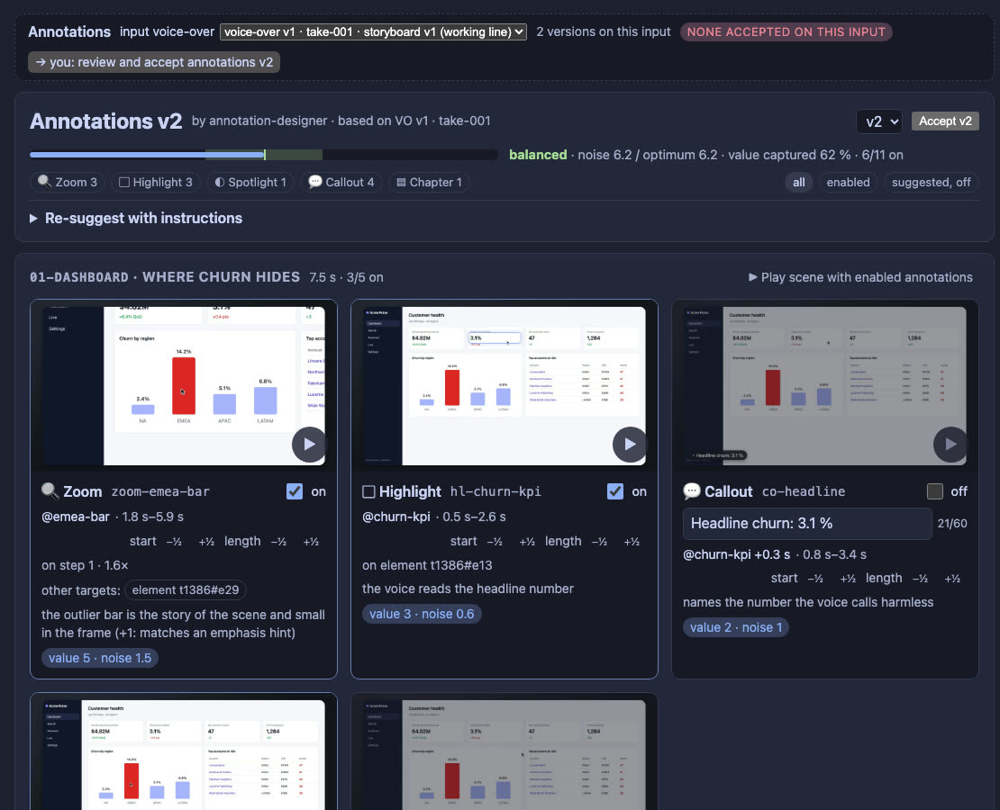

- **Header:** the stage header (input voice-over, accepted versions, working
  line), the version picker, **Accept**, who made the version and from what
  (re-suggested from, imported from, your edits on), the instructions it was
  made with, and the **budget meter**.
- **Filters** by type and by *enabled* / *suggested, off*.
- **One card per suggestion**, grouped by scene:
  - an **enabled** checkbox at the top left, above the picture;
  - a **still** at its peak moment, rendered right away and cached. **Click
    it** to open a large preview; **click the large image** to render and play
    a clip around the annotation (960×540, with the voice, cached). × or Esc
    closes it;
  - type and id;
  - the **text** (callouts, chapters; ≤ 60 characters, live counter);
  - when: its anchor and output time window, with **±½ s nudges** for start
    and length;
  - its target, and **other targets** the designer considered (one click
    switches);
  - the reason, value and noise, and tags: **privacy**, **yours** (you changed
    it), **can't place** (with why).
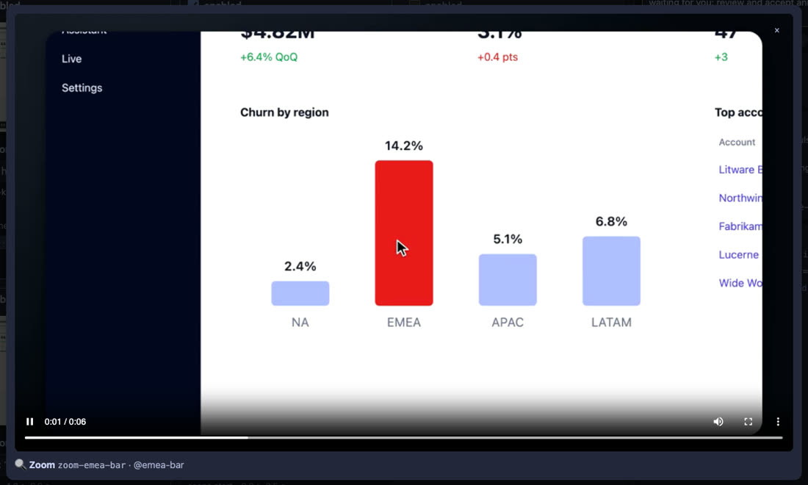

- **▶ Play scene with enabled annotations:** a low-res draft of the scene
  with everything that is on (chapters only appear in the full video).

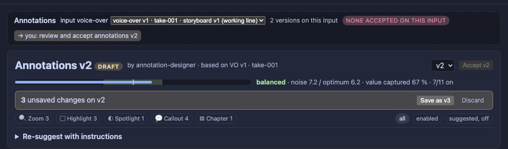

**Edits are a draft** (D58): every enabled tick, text edit, nudge or target switch
applies at once (stills and the budget update), shown as *N unsaved changes*.
**Save as vN** writes one new version with all of them (each item keeps what
you changed in its `edits`, and the save is logged in the project's inputs);
**Discard** drops them. The draft is on disk, so it survives reloads and
restarts.

### Re-suggest and import

- **Re-suggest with instructions** (the box in the header): your text goes to
  the agent verbatim (and into the project's inputs). The designer suggests
  again on top of the version — and **every item you added, edited or
  toggled is kept as it is** (D56); everything else is regenerated. Save or
  discard unsaved changes first.
- **Import from an older version** (`demo_rec_annotations action=import
  from=N`, e.g. after a new take or voice-over): carries over every item
  whose scene and mark still exist and whose target still resolves on the
  new recording — with your edits — and lists the rest with the reason
  (`mark gone`, `target not found`). Deterministic, no model (D57).

### Accept and render

**Accept** in the tab (one or several versions, like every stage) makes a
**final render** possible: in the Render tab, or the agent offers one
(`demo_rec_render action=start kind=final`). Drafts work from any version —
even your unsaved changes. Which annotation types a render includes is a
render option (all by default; none, chapters only, …) — the version stays as
approved. See [RENDER.md](RENDER.md).

### The tool

`demo_rec_annotations` (the agent's side):

| Action | Does |
|---|---|
| `context` | the input pack (with `base` + `instructions` for a re-suggest) |
| `suggest` | submit suggestions → next version (with `base`: keep the user's changes) |
| `get` | a version (or `draft=true`: the panel's unsaved draft) with weights and budget |
| `write` | a full revision as JSON (exact changes the user asked for) |
| `import` | carry what still matches from version `from` |
| `preview` | a clip + still of one annotation (the still comes back as an image) |

There is no approve: you accept in the panel.

---

## The file

`annotations/vN.json` in the project, versioned like everything else (a new
version per change, never overwritten).

```json
{
  "version": 1,
  "basedOn": { "vo": 1 },
  "take": "take-001",
  "by": "hand-written",
  "items": [
    {
      "id": "zoom-emea",
      "type": "zoom",
      "scene": "01-dashboard",
      "anchor": { "mark": "emea-bar" },
      "target": { "step": 1 },
      "factor": 1.6,
      "enabled": true
    }
  ]
}
```

| Field | Required | Meaning |
|---|---|---|
| `version` | — | Set when stored. |
| `basedOn.vo` | yes | The voice-over version the annotations were made for. A render on an edit of another VO still works (anchors go through marks) but warns. |
| `take` | yes | The take (`take-NNN`). Rendering on an edit of another take is refused — boxes would point at the wrong things. |
| `by` | no | Who wrote it: `annotation-designer`, `user edits`, `import`, `agent`, … |
| `importedFrom`, `resuggestedFrom`, `editedFrom` | no | The version it was imported from, re-suggested on top of, or saved panel edits on. |
| `instructions` | no | The user's instructions for a re-suggest. |
| `budget.optimumNoise` | no | Noise of the recommended set (for the budget meter). |
| `items[]` | yes | The annotations. |

**Item fields:**

| Field | Types | Meaning |
|---|---|---|
| `id` | all | Unique in the file. Shown in warnings and previews. |
| `type` | all | `zoom`, `highlight`, `spotlight`, `redact`, `callout`, `chapter`. |
| `scene` | all | The storyboard scene id. |
| `anchor` | all | When — see [Anchors](#anchors-when). |
| `target` | zoom, highlight, spotlight, redact | Where — see [Targets](#targets-where). |
| `text` | callout, chapter | ≤ 60 characters. |
| `durMs` | all (optional) | How long it stays; each type has a default ([Timing](#timing-and-motion)). For redact, `0` (default) = to the end of the scene. |
| `factor` | zoom (optional) | 1.1–1.8, default 1.5. |
| `enabled` | all | Only enabled items are rendered. |
| `weight` | — | `{ value 1–5, noise }` ([weights](#weights-and-the-budget)). Ignored by the renderer. |
| `reason` | — | Why (one line from the designer; privacy hits say what was found). |
| `origin` | — | `suggested`, `edited` (you changed it) or `manual` (you asked for it). |
| `edits` | — | Your changes (`enabled`, `text`, `start`, `duration`, `target`) with the previous value — kept on re-suggest and import. |
| `alternatives` | zoom, highlight, … | Other targets the designer considered; the tab offers them. |

Validation is strict and names the exact field (`annotations: items[3].text
must be ≤ 60 characters — it marks, it doesn't narrate`); an invalid file is
never stored.

---

## Anchors: when

| Anchor | Means |
|---|---|
| `{ "mark": "results-visible" }` | The moment of that storyboard mark in the edited video. Exact: it is the same anchor the narration is synced to. |
| `{ "sceneStart": true }` | The first frame of the scene. |
| `{ "word": "EMEA", "occurrence": 2 }` | The moment the voice says that word (or short phrase) in the scene's narration — the n-th time, default the first. Through the voice's word timings, so it moves with the narration. Punctuation and case don't matter. |
| `"offsetMs": 1400` (with any) | Shift by this much (negative = earlier). Use it for "a beat after the results appear". |

The anchor is the moment the annotation should be **fully there**. Each type
starts a little earlier (its lead-in) so it has arrived by then — a zoom
starts 0.6 s before its mark, so it is completely in when the number appears.

Use a word anchor when the voice names something that has no mark of its own
("…and **EMEA** is far above everyone else").

---

## Targets: where

Coordinates are **CSS pixels of the page viewport** (as in the browser's
devtools), never output pixels. The resolver scales them to the capture.

| Target | Example | Resolves to |
|---|---|---|
| `step` | `{ "step": 1 }` | The element that step of the scene acted on (hover, click, type, wait). If the element moved after the action (an animation, a re-layout), its *settled* position is used (recorded since S5 part 6). Works on every take. |
| `text` (+ `role`) | `{ "text": "EMEA", "role": "row" }` | The **smallest** visible element whose text or accessible name contains the text (case-insensitive), in the layout snapshot at the anchor. `role` narrows it: `row`, `cell`, `button`, `link`, `heading`, `textbox`, … Needs layout snapshots (takes recorded since S5 part 6). |
| `layout` | `{ "layout": "t13107#e24" }` | An exact element of a layout snapshot (`t<ms>` snapshot time, `e<n>` element id) — what the designer writes. |
| `box` | `{ "box": { "x": 1345, "y": 351, "w": 103, "h": 197 } }` | An explicit rectangle. For regions that aren't one element (a column, a group). |

To find texts, roles, ids and boxes, look at the take's
`takes/take-NNN/layout.jsonl` (one JSON snapshot per line: `t`, `url`,
`scroll`, `els[]` with `id`, `role`, `text`, `box`), or run
`annotate check` and read the resolved boxes.

**Page changes.** A page-space annotation (zoom, highlight, spotlight, redact)
ends at the first page change after its anchor — a route change or a scroll —
because afterwards its box points at something else.

---

## Timing and motion

Nothing pops in. Every type has a short entrance and exit; on top of the fade,
three types have a small motion (D49: *fade + small motion*).

| Type | Lead-in before the anchor | Default duration | In / out | Motion |
|---|---|---|---|---|
| zoom | 0.6 s | 3.5 s | eased push-in 0.6 s, pull-out 0.5 s (smoothstep) | — |
| highlight | 0.15 s | 2.0 s | fade 0.2 s | settles from 1.06× to its size (0.26 s) |
| spotlight | 0.3 s | 1.8 s | fade 0.3 s | — |
| callout | 0.15 s | 2.5 s | fade 0.15 s | rises 12 px into place (0.26 s) |
| chapter | 0 | 2.5 s | fade 0.3 s | slides in 16 px from the left (0.32 s) |
| redact | 0 | to the scene end | **none — instant on, instant off** | — |

Durations count from the anchor; everything is clipped to the scene. Motion
distances are for 1080p and scale with the output size.

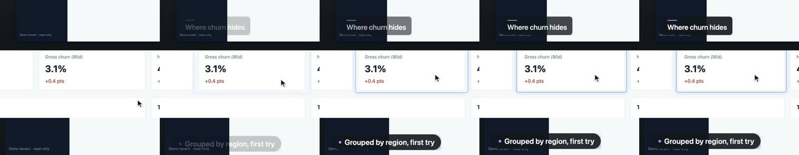

*Entrances, every third frame (0.1 s apart). Top: the chapter slides in from
the left. Middle: the highlight around the churn KPI settles from slightly
larger. Bottom: the callout rises into place.*

---

## The types

### Zoom

**For:** the one number or element the narration is about, when it is small in
the frame. The strongest emphasis — use it for the key moment of a scene, not
for every scene.

```json
{
  "id": "zoom-emea",
  "type": "zoom",
  "scene": "01-dashboard",
  "anchor": { "mark": "emea-bar" },
  "target": { "step": 1 },
  "factor": 1.6,
  "enabled": true
}
```

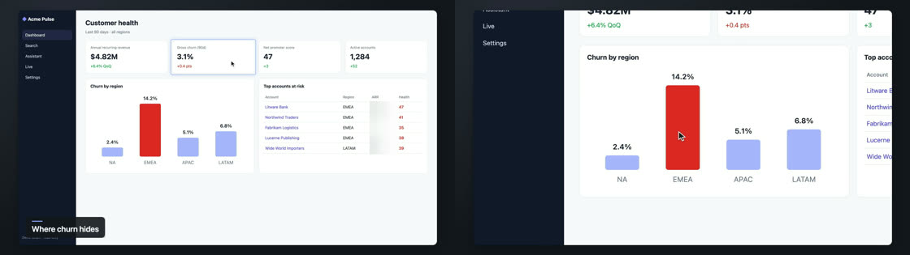

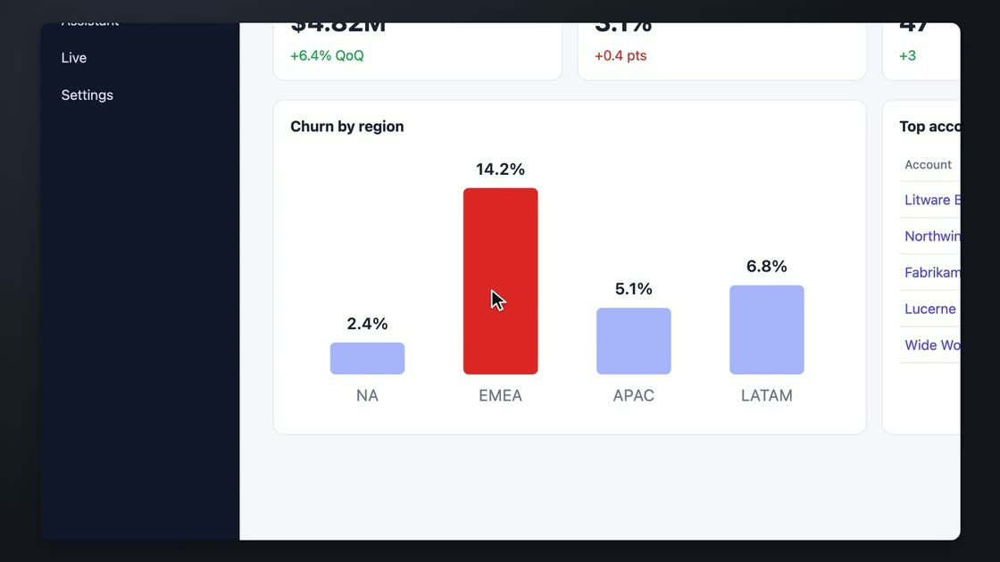

- A virtual camera move, at source resolution: the capture is 3200×1800, so a
  1.6× zoom is still sharp (sharp up to 1.8×; [spike Q3](spikes/S5-zoom.md)).
- Centered on the target, clamped to the page (never shows outside the
  recording). If the target wouldn't fit at the requested factor, the factor is
  lowered (with a warning) so the whole target stays in view with a margin.
- Eased in so it is complete *at* the anchor; held; eased out.
- The cursor and page-space annotations (highlight, spotlight, redaction) zoom
  with the page; callouts and chapters don't.
- **Limits:** at most 2 enabled zooms per demo; 1.1–1.8×; overlapping zooms in a
  scene: the later one is dropped; needs at least 1.4 s (in + out + a hold).

### Highlight

**For:** pointing at an element while the narration talks about it — a KPI, a
button, a field. Quiet; can be used more often.

```json
{
  "id": "hl-churn",
  "type": "highlight",
  "scene": "01-dashboard",
  "anchor": { "mark": "churn-kpi" },
  "target": { "step": 0 },
  "enabled": true
}
```

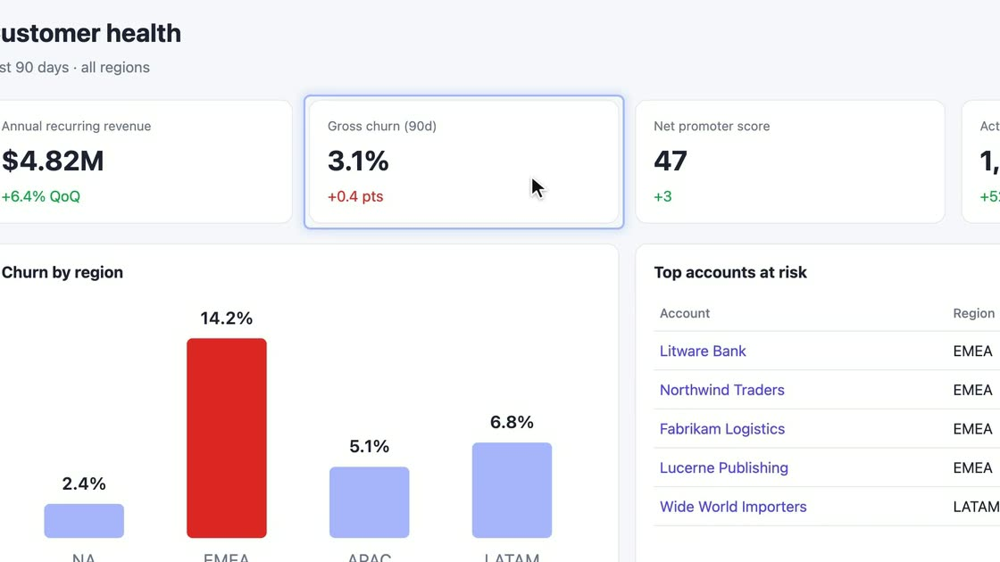

- A rounded outline in the brand accent (~78 % opacity) with a faint glow,
  ~6 px (CSS) outside the element, so the content stays readable.
- Page space: drawn on the page, so it follows a zoom.
- Skipped when the element covers more than 60 % of the frame (a highlight of
  everything means nothing).

### Spotlight

**For:** a single row or element in a busy screen — dims everything else.
Heavy: the designer leaves it off unless it is very strongly suggested (D35);
prefer a highlight.

```json
{
  "id": "sp-emea-row",
  "type": "spotlight",
  "scene": "02-search",
  "anchor": { "mark": "results-visible", "offsetMs": 1400 },
  "target": { "text": "EMEA", "role": "row" },
  "durMs": 2200,
  "enabled": true
}
```

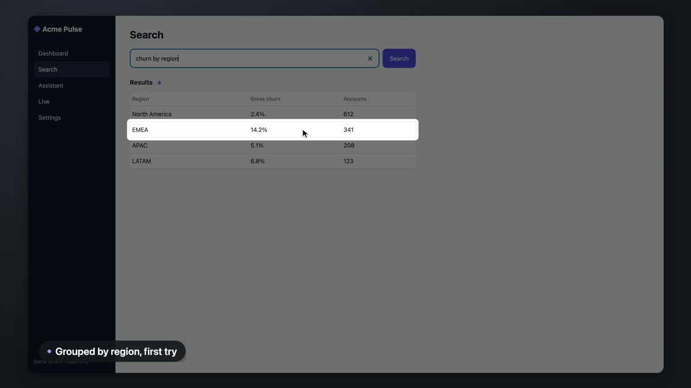

- Everything except the target (with a rounded cut-out, ~8 px CSS padding) is
  darkened to ~45 % brightness; fades in and out in 0.3 s.
- Page space: follows a zoom.
- A highlight inside a spotlight at the same time gives a warning — pick one.

### Callout

**For:** naming what just happened, in a few words — "Grouped by region, first
try". It *marks*, it doesn't narrate: ≤ 60 characters, and never a repeat of
the sentence the voice is saying.

```json
{
  "id": "co-grouping",
  "type": "callout",
  "scene": "02-search",
  "anchor": { "mark": "results-visible" },
  "text": "Grouped by region, first try",
  "enabled": true
}
```

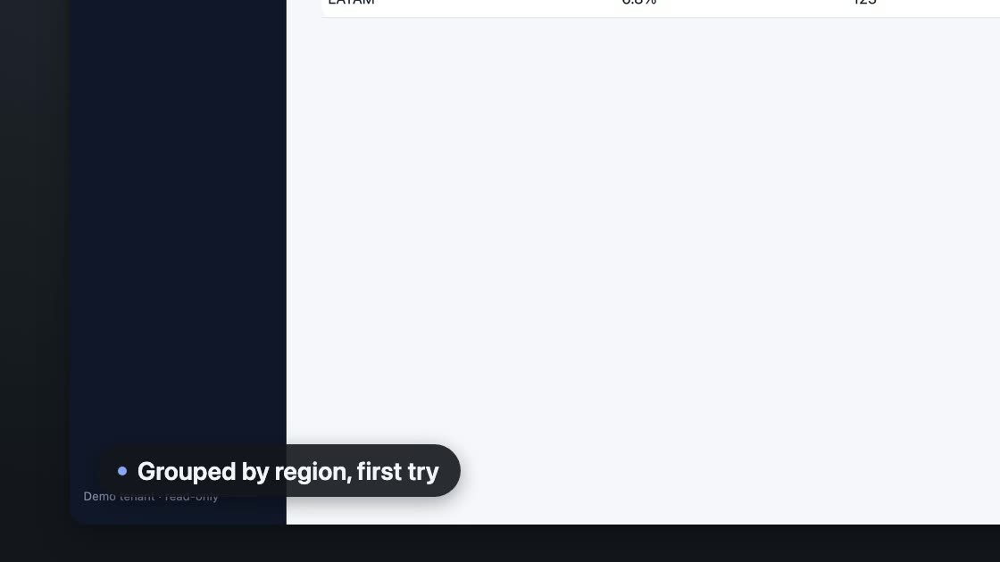

- A pill in the brand's `colors.pill` / `colors.pillText` with an accent dot,
  at the bottom left of the footage (inside the brand frame), with a soft
  shadow.
- Screen space: stays put during a zoom.
- One at a time: a later callout cuts the earlier one short.
- When a chapter title is on screen, the callout stacks above it.

### Chapter

**For:** structure in longer demos — a lower-third title when a scene starts.
Off by default in the designer's suggestions and outside the noise budget
(D35): it adds structure, not emphasis.

```json
{
  "id": "ch-dashboard",
  "type": "chapter",
  "scene": "01-dashboard",
  "anchor": { "sceneStart": true },
  "text": "Where churn hides",
  "enabled": true
}
```

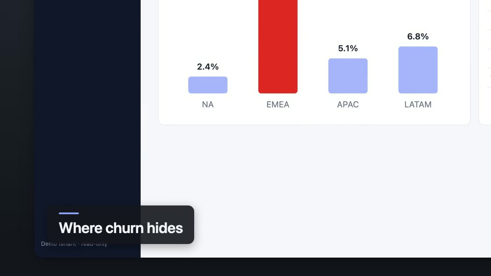

- A card with an accent bar and the title in the brand font, in the lower third
  (bottom left of the footage).
- Screen space (D50). Rendered in the **full video only** — per-scene clips
  (`scenes/*.mp4`) are meant to be reused on their own, where "chapter 2" makes
  no sense.

### Redact

**For:** anything that must not be seen: customer names, emails, revenue
figures, tokens. Privacy, not emphasis — outside the noise budget; part 8's
*Privacy officer* suggests them (disabled, for you to confirm).

```json
{
  "id": "redact-arr",
  "type": "redact",
  "scene": "01-dashboard",
  "anchor": { "sceneStart": true },
  "target": { "box": { "x": 1345, "y": 351, "w": 103, "h": 197 } },
  "enabled": true
}
```

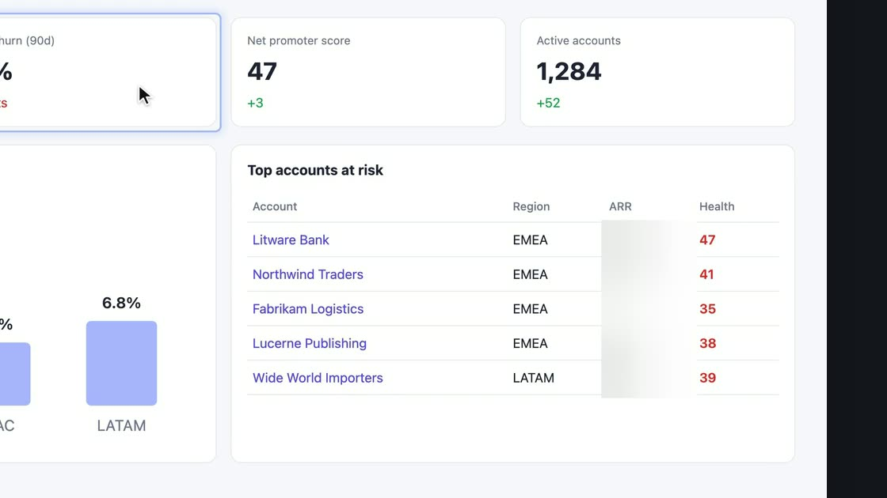

- The region (plus ~4 px) is reduced (D51) to large blocks (≥ 16 source px, or a
  third of the region's short side) and smoothed with a Gaussian on top — the
  original cannot be recovered (a plain pixelation can be, with
  depixelization tools).
- **Never fades**: it is fully there from its first frame to its last (a blur
  that fades in shows the secret for a few frames).
- From the anchor to the end of the scene by default (`durMs` to limit it).
- Page space: zooms with the page.
- **Ends at a page change** (route or scroll), with a warning: if the secret is
  still on screen after a scroll, add a second redaction for its new position.
  Redactions don't track moving elements yet.

---

## Rules and limits

| Rule | Why |
|---|---|
| ≤ 2 enabled zooms per demo | Zooms lose their effect when overused (D26, D35). |
| zoom factor 1.1–1.8 | Sharp up to 1.8× at dpr 2 (spike Q3). |
| no overlapping zooms in a scene (later one dropped) | One camera. |
| texts ≤ 60 characters | Callouts and chapters mark; the voice narrates. |
| one callout at a time | Readability. |
| highlight skipped above 60 % of the frame | It would mean nothing. |
| page-space annotations end at a page change | The box would point at something else. |
| redact never fades | Privacy. |
| chapters only in the full video | Per-scene clips stand alone. |
| an item that can't be placed is skipped with a warning | Never a silently wrong placement. |

---

## Brand

Annotations use the brand (`docs/BRANDS.md`):

| Brand field | Used by |
|---|---|
| `colors.accent` | highlight outline and glow, callout dot, chapter bar |
| `colors.pill`, `colors.pillText` | callout pill |
| `colors.pill`, `colors.text` | chapter card |
| `font.family`, `font.weight` | callout and chapter text |

The footage box (the brand's inset) decides where callouts and chapters sit;
without a frame they sit in the corners of the whole video.

---

## CLI

From the repository root (no model needed):

```bash
# store a hand-written file as the next annotations/vN.json (validated)
node extensions/demo-recording/cli.ts annotate add --project <p> --file my-annotations.json

# resolve against the latest edit: output times, boxes in source px, warnings
node extensions/demo-recording/cli.ts annotate check --project <p> [--version N] [--edit N]

# preview one annotation: a short clip (its window ± 1 s, with narration) and a still at its peak
node extensions/demo-recording/cli.ts annotate preview --project <p> --id zoom-emea [--version N]

# render with annotations burned in (a draft; --kind final once accepted)
node extensions/demo-recording/cli.ts render --project <p> --annotations N [--kind final] [--brand B]
```

- `render` makes a render version in `render/vN/<variant>/` (a draft by
  default; `--kind final` once the annotations are accepted) — see
  [RENDER.md](RENDER.md#cli-and-tool).
- Previews go to `previews/annotations/<id>-<hash>.{mp4,png}` and are cached:
  the second call is instant; any change to the annotation, the edit or the
  brand makes a new one.
- Use the same `DEMO_REC_ROOT` / `DEMO_REC_CONFIG` as the project.

---

## The fixture example

One annotation of every type on the Acme Pulse fixture (`fixture-demo`
project; the storyboard is `fixtures/storyboards/s3-human.yaml`). The file
ships as [`fixtures/annotations/s3-human.json`](../fixtures/annotations/s3-human.json):

```json
{
  "basedOn": { "vo": 1 },
  "take": "take-001",
  "by": "hand-written example",
  "items": [
    { "id": "ch-dashboard", "type": "chapter", "scene": "01-dashboard", "anchor": { "sceneStart": true }, "text": "Where churn hides", "enabled": true },
    { "id": "hl-churn", "type": "highlight", "scene": "01-dashboard", "anchor": { "mark": "churn-kpi" }, "target": { "step": 0 }, "enabled": true },
    { "id": "zoom-emea", "type": "zoom", "scene": "01-dashboard", "anchor": { "mark": "emea-bar" }, "target": { "step": 1 }, "factor": 1.6, "enabled": true },
    { "id": "redact-arr", "type": "redact", "scene": "01-dashboard", "anchor": { "sceneStart": true }, "target": { "box": { "x": 1345, "y": 351, "w": 103, "h": 197 } }, "enabled": true },
    { "id": "co-grouping", "type": "callout", "scene": "02-search", "anchor": { "mark": "results-visible" }, "text": "Grouped by region, first try", "enabled": true },
    { "id": "sp-emea-row", "type": "spotlight", "scene": "02-search", "anchor": { "mark": "results-visible", "offsetMs": 1400 }, "target": { "text": "EMEA", "role": "row" }, "durMs": 2200, "enabled": true },
    { "id": "zoom-answer", "type": "zoom", "scene": "03-assistant", "anchor": { "mark": "answer" }, "target": { "step": 2 }, "factor": 1.4, "enabled": true },
    { "id": "co-accounts", "type": "callout", "scene": "03-assistant", "anchor": { "mark": "answer", "offsetMs": 600 }, "text": "Names the accounts behind it", "enabled": true }
  ]
}
```

To reproduce (free, local voice, about 2 minutes):

```bash
R=$(mktemp -d); echo '{}' > $R/none.json
export DEMO_REC_ROOT=$R DEMO_REC_CONFIG=$R/none.json DEMO_REC_NO_OPEN=1 DEMO_REC_TTS_CHAIN=say
node extensions/demo-recording/cli.ts fixture-demo          # take + VO + edit + clean render
node extensions/demo-recording/cli.ts annotate add --project fixture-demo --file extensions/demo-recording/fixtures/annotations/s3-human.json
node extensions/demo-recording/cli.ts annotate check --project fixture-demo
node extensions/demo-recording/cli.ts render --project fixture-demo --annotations 1
open $R/projects/fixture-demo/render/v2/neutral/full.mp4      # v1 is the edit's own draft
```

Or run [`scripts/fixture-walkthrough.fish`](../scripts/fixture-walkthrough.fish),
which does all of this (with the stub designer) and continues into the Render stage.

The recording is not byte-identical between machines, but the marks, steps
and texts are, so the file resolves the same way.

---

## Performance

On the fixture (40 s full video + 3 scene clips, M-series Mac): clean render
8.4 s, with the 8 annotations above 20.5 s. The cost comes from the parts at
source resolution: here the redaction covers all of scene 1, so that scene is
processed at 3200×1800 end to end. A zoom adds about 0.25 s of render time per
second of zoom (spike Q3). Overlay PNGs are decoded once and looped in memory.
Preview clips take 2–3 s and are cached.

---

## Warnings and troubleshooting

`annotate check` and `render` list every item that was adjusted or skipped:

| Warning | What to do |
|---|---|
| `mark "x" is not in <scene>` | Use a mark of that scene (see the storyboard) or `sceneStart`. |
| `step N of <scene> has no target box in the take` | That step has no element (a `press`, a `wait` for text). Use `text` or `box`. |
| `this take has no layout snapshots` | The take predates S5 part 6: use `step` or `box`, or re-record. |
| `no element with text "…" on screen at the anchor` | Check the spelling against `layout.jsonl`, or drop the `role`. |
| `the target covers more than 60 % of the frame` | Target something smaller. |
| `zoom lowered to 1.3× so the whole target stays in view` | Informational; target something smaller for a stronger zoom. |
| `too short for a zoom` | The scene ends too soon after the anchor; anchor earlier or drop it. |
| `overlaps zoom …` | Two zooms at once in a scene; keep one. |
| `the page changes at … — the redaction ends there` | Add another redaction after the scroll/route change if needed. |
| `annotations vN were made for VO vM` | Fine if the marks are the same; check the timing in a preview. |

---

## Not yet

- **Tracking:** redactions and highlights don't follow an element that moves
  (scroll, animation); they end at a page change instead.
- **Adding a new annotation from the panel** — ask the agent in chat ("add a
  callout 'two clicks' when the export finishes"); a full timeline editor is
  in `FUTURE_IDEAS.md`.
- **Callout subtitles** (`full.callouts.srt`) — part 9, with the render stage.
