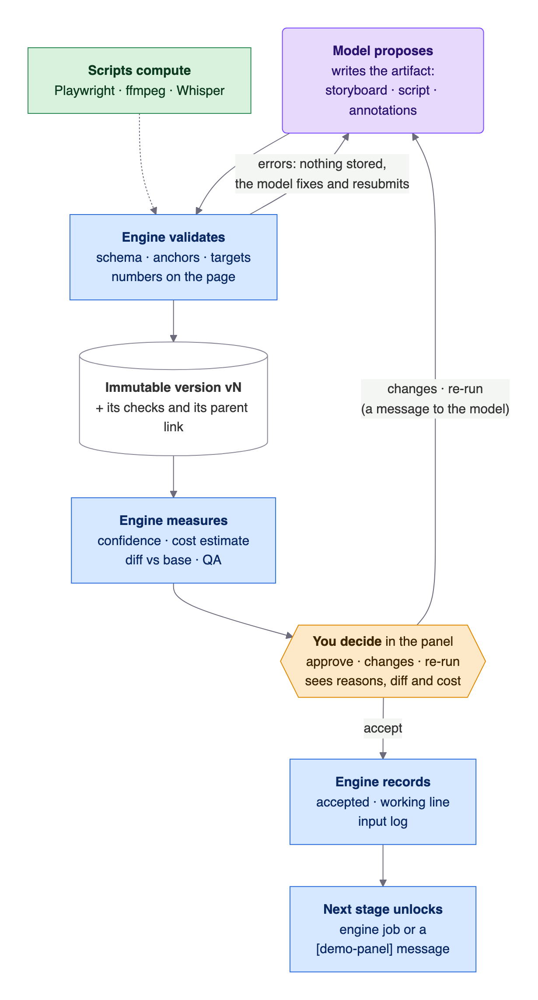
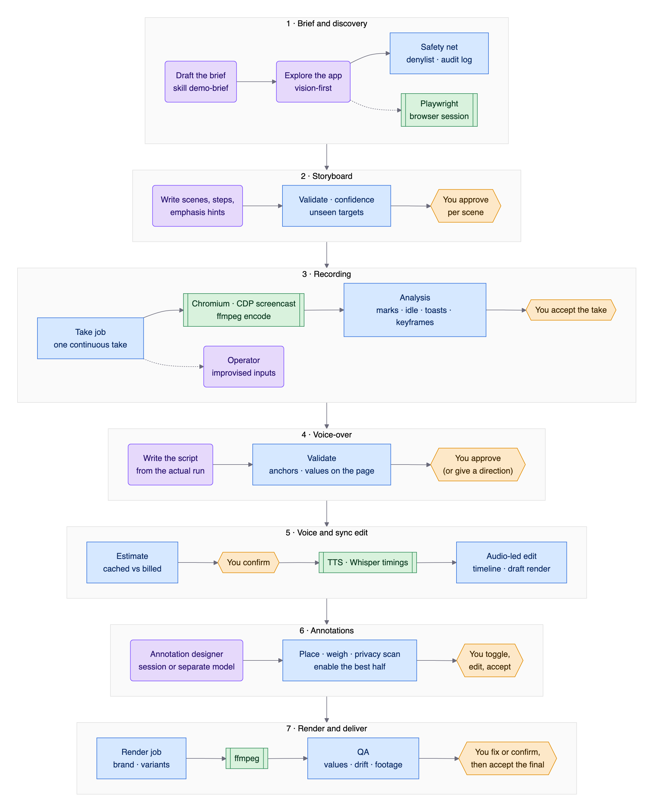
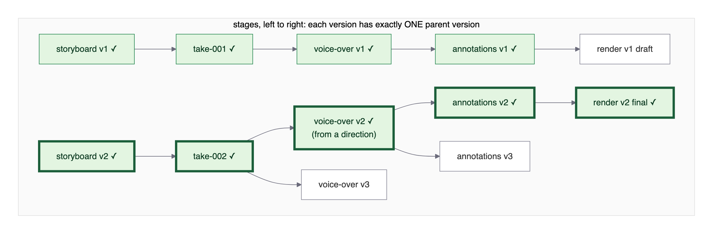
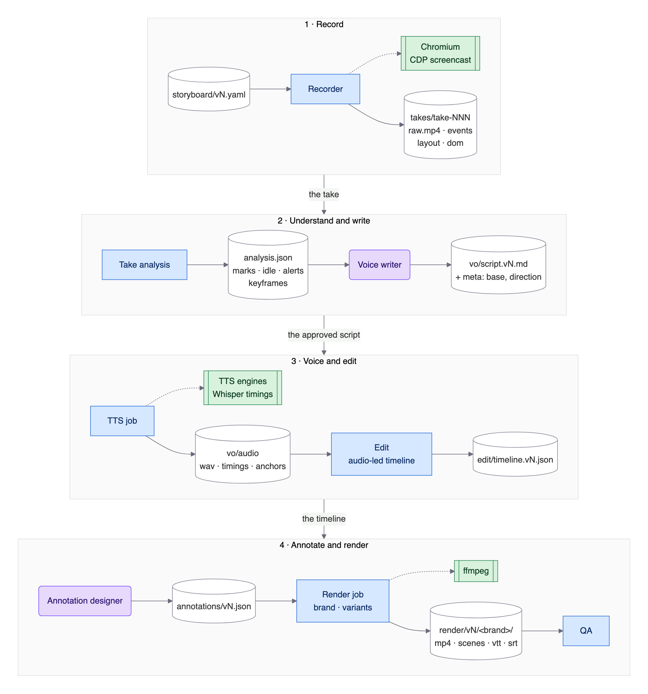
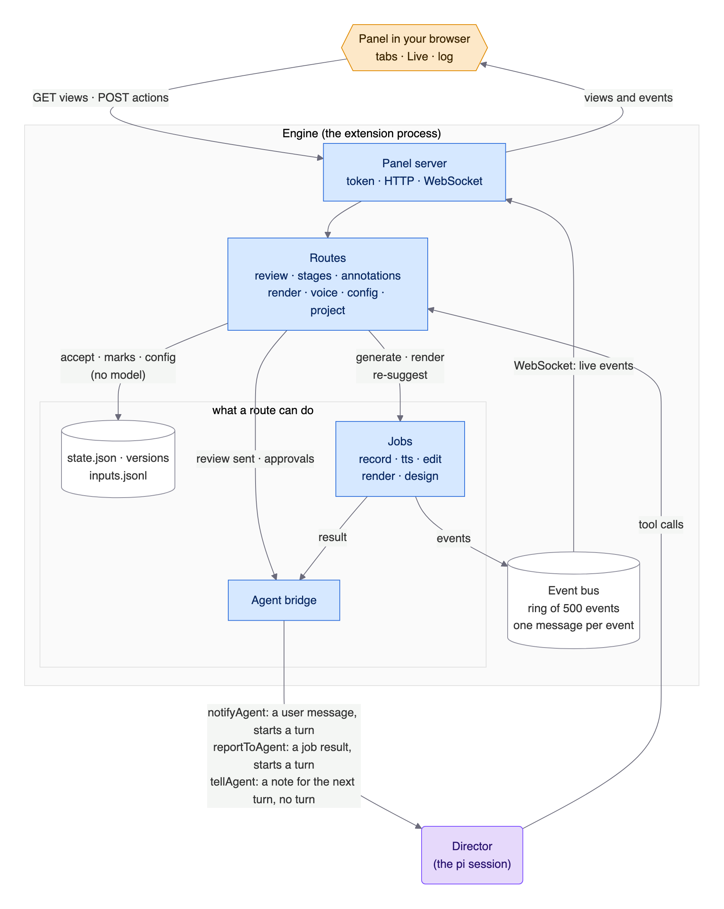
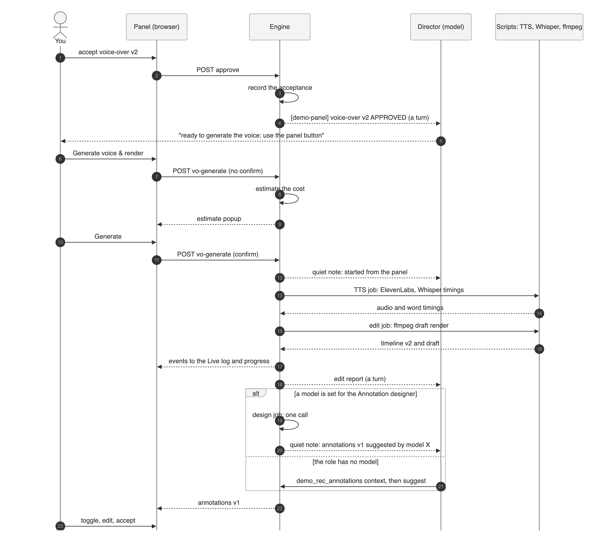

# Architecture and flow

How the demo-recording extension is built, how a demo gets made from the
first URL to the delivered video, **who does which part** (you, a model, the
engine, or a script), and **why** it is built this way.

This is the map. The details live in the other documents; this one links to
them where they matter. Who plays which role, and on which model, is in
[ACTORS.md](ACTORS.md). The decision record with the alternatives is in
[VISION.md](VISION.md) (`D1` … `D90`).

**Contents**
1. [The idea in one page](#1-the-idea-in-one-page)
2. [Principles, and the reasons behind them](#2-principles-and-the-reasons-behind-them)
3. [System context](#3-system-context)
4. [Four kinds of hands: human, model, engine, script](#4-four-kinds-of-hands-human-model-engine-script)
5. [The end-to-end flow](#5-the-end-to-end-flow)
6. [The loop every stage follows](#6-the-loop-every-stage-follows)
7. [Stages, versions and the working line](#7-stages-versions-and-the-working-line)
8. [From recording to deliverable: the media pipeline and the files](#8-from-recording-to-deliverable-the-media-pipeline-and-the-files)
9. [The panel, the event bus and the agent bridge](#9-the-panel-the-event-bus-and-the-agent-bridge)
10. [A session, end to end](#10-a-session-end-to-end)
11. [Where models are used, and who pays](#11-where-models-are-used-and-who-pays)
12. [Configuration, safety and secrets](#12-configuration-safety-and-secrets)
13. [Decision map](#13-decision-map)
14. [Where to read next](#14-where-to-read-next)

---

## 1. The idea in one page

You give the extension a web app URL and some background. It explores the app
like a curious expert, finds what is worth showing, and writes a
**storyboard** that reacts to what is really on screen. You review it in a
local web panel. It records the demo as **one continuous, human-looking
take**, writes a dense, first-person **voice-over from the recording that
actually happened**, generates the voice, **edits the video to the
narration**, suggests **annotations** (zooms, highlights, callouts, redactions),
renders with a **brand**, and checks the result before you accept it.

Three things make this work, and the rest of this document is about them:

- **The work is split by who is good at it.** A model decides and writes, the
  engine executes and verifies, scripts compute, and *you* approve. Nothing
  moves to the next step on a model's say-so.
- **Everything is a version on disk.** Each step produces an immutable,
  numbered artifact that names its parent. You can go back, branch, compare,
  and see why something looks the way it does.
- **Measurement beats opinion.** Numbers said are checked against the page,
  sync against audio, confidence against signals, cost against the cache. The
  model gives soft hints; the engine measures.


*Colour legend, used in every diagram: **orange** = human, **purple** = model,
**blue** = engine (our Node code), **green** = script or external tool,
**white cylinder** = a stored artifact.*

---

## 2. Principles, and the reasons behind them

| # | Principle | Why | Decision |
|---|---|---|---|
| 1 | **The pi session directs; a deterministic Node engine executes.** Panel actions are injected into the session as user messages. | The agent loop and the model choice come from pi for free. Mechanical work stays reproducible and costs no tokens. | D9 |
| 2 | **Hard human gates.** Nothing is recorded before the storyboard is approved, no voice is paid for before the script is approved, no final exists without accepted annotations, and a final with blocking QA items can't be accepted. | A demo is shown to customers. A wrong number or a leaked name is expensive, and an unattended pipeline can't judge that. | D10, D21, D70 |
| 3 | **Every artifact is an immutable, numbered version with exactly one parent.** Errors never consume a version. | You can branch (two voice-overs on one take), compare, undo, and always answer "built from what?". | D16, D30, D44–D47 |
| 4 | **Measurement over opinion.** Quoted values are found on the page, drift is measured with Whisper, confidence comes from signals, and the model's 1–5 self-rating can only *lower* a level. | Models are persuasive and sometimes wrong; measurements are boring and right. | D13, D23, D71, D72, D77 |
| 5 | **Vision first, DOM for precision.** Screenshots are the source of truth for *what is demo-worthy*; the page text is used for *exact values*. | Human-like judgement, and no misread numbers in the narration. | D4 |
| 6 | **The narration is written from the actual run**, anchored to events (`[@results-visible]`), with word timings from the TTS. | The voice lands on the exact moment; dead time disappears. | D7, D11 |
| 7 | **Cost and effect are visible before they happen.** A voice generation shows cached vs billed characters, credits and money first; a review shows what an approval skips. | No surprise bills, no blind approvals. | D80, D84 |
| 8 | **Mechanical fixes may happen alone; content changes are always asked.** Re-timing an anchor is an override next to the timeline; changing a number or a sentence is a new version you approve. | Speed without silently changing approved content. | D22, D74 |
| 9 | **Everything lives in one working directory, in plain files.** Brand packages, projects and apps are folders; nothing trademarked is in the repo. | Inspectable, diffable, backed up like any folder. | D16, D24 |
| 10 | **API keys come only from the environment** and are never written, printed or logged. The panel listens on `127.0.0.1` behind a token. | A local tool with a local trust boundary. | D5, D41 |
| 11 | **Roles are skills on one model by default.** A role runs as a separate model call only where its work is a pure function of a compact pack. | Hand-offs between model runs cost context and tokens; clear responsibilities don't. | D40, D85, D86 |

---

## 3. System context

Reading the picture above from top to bottom:

- **You** work in two places: the pi terminal (talking to the **Director**) and
  the **panel** in the browser (the control room: reviews, approvals, Live
  log, config).
- The **Director** is the session model plus the extension's **skills**
  (brief, recording, voice-over, annotations, brand, config). It acts through
  `demo_rec_*` **tools** and `/demo` **commands**.
- The **extension** is one Node process inside pi: a `Runtime` (config, jobs,
  event bus), the **panel server** (HTTP + WebSocket, token), and the **engine
  jobs** (record, tts, edit, render with its QA, design). Everything is stored
  in the **working directory**.
- The engine drives **scripts and tools** (Playwright with Chromium, ffmpeg,
  `uv` with Whisper and Kokoro) and **models** (the Operator's and the
  Annotation designer's configured chains, and the TTS services).

| Folder (`extensions/demo-recording/`) | What lives there |
|---|---|
| `index.ts`, `src/runtime.ts`, `src/jobs.ts`, `src/bus.ts` | the extension entry, the runtime, background jobs, the event bus |
| `src/tools/`, `src/commands/` | the `demo_rec_*` tools and the `/demo` command (the Director's hands) |
| `skills/` | the six skills (the Director's playbooks) |
| `src/discovery/`, `src/browser/` | the browser session, the safety net, the cursor and typing motion, capture |
| `src/recorder/`, `src/analysis/` | the take runner, events, layout snapshots, improvise, and take analysis |
| `src/storyboard/`, `src/vo/`, `src/annotations/` | the three authored artifacts: parsing, validation, versions, the designer engine |
| `src/tts/`, `src/align/`, `py/` | the voice engines and word timings (Whisper, Kokoro via `uv`) |
| `src/edit/`, `src/render/`, `src/brand/`, `src/qa/` | the audio-led edit, rendering, brands, QA and fixes |
| `src/confidence/` | the signals behind "N need your eyes" |
| `src/panel/` | the panel server, routes, the agent bridge, and the browser app (`public/`) |
| `src/workdir/` | the working directory: projects, state, stages, inputs, findings |
| `docs/`, `docs/diagrams/` | this documentation, and the diagram sources |

---

## 4. Four kinds of hands: human, model, engine, script

Every step in the pipeline is done by one of four kinds of hands. Choosing the
right one for each step is the core design idea.

| Kind | Good at | Never trusted with | Hands over by |
|---|---|---|---|
| **Human** (you) | taste, intent, risk, the final yes: *is this the story? may this go to a customer?* | repetitive mechanical work | approvals and notes in the panel; chat in pi |
| **Model** | judgement and language: what is demo-worthy, the narration, which element deserves the eye | exact values, timing, anything that must be reproducible, and approving its own work | writing an **artifact** through a tool (the engine validates it); reading **reports** |
| **Engine** (our Node code) | validating, measuring, versioning, orchestrating, gating; the same input gives the same output | judging what is interesting | **versions on disk**, events, reports and notes to the Director |
| **Script / tool** (Playwright, ffmpeg, Whisper, TTS engines) | heavy lifting: capture, encode, timings, speech | deciding anything | files and exit codes, wrapped by the engine |

**The handover rules** are what keeps this safe:

1. **A model's output is a proposal, never a state change.** It goes through a
   tool, the engine validates it, and only then is it a version. An invalid
   proposal stores nothing; the model gets the error and fixes it.
2. **An approval is always yours.** There is no tool for a model to accept,
   approve or confirm. Panel approvals are recorded by the engine and *then*
   reported to the Director.
3. **The engine measures what a model can't be trusted to.** Confidence, QA,
   cost estimates and "is that number on the page?" are computed, not asked.
4. **Scripts are wrapped, never called by a model directly.** The engine
   starts them, watches them, and turns their results into artifacts and
   events.
5. **Everything that crosses a hand is persisted.** The project's memory
   (`inputs.jsonl`) and the versions are what survive a session restart, not
   the chat.



---

## 5. The end-to-end flow



Each phase, with its gate:

| # | Phase | Model | Engine | Scripts | **Your gate** | Entry points |
|---|---|---|---|---|---|---|
| 1 | **Brief and discovery** | drafts `brief.md` (skill `demo-brief`); explores the app vision-first and records findings | browser session with the **safety net** (denylist, audit log, budgets), findings and evidence | Playwright / Chromium | the brief (soft) | `/demo new`, `/demo discover`, `demo_rec_browser`, `demo_rec_project` |
| 2 | **Storyboard** | writes scenes, steps, `emphasis` hints, and its own doubt (`confidence`) | validates the schema, warns on unseen targets and unsafe resumes, rates **confidence** per scene | – | **approve per scene**, then the version | `demo_rec_storyboard`, panel *Storyboard* |
| 3 | **Recording** | the **Operator** invents live inputs (`improvise` steps) | runs **one continuous take**: human-like cursor and typing, events, layout snapshots, page text at marks; retries and resumes from the last good scene; then **analyses** the take | Chromium CDP screencast, ffmpeg encode | **accept the take** | `demo_rec_record`, `demo_rec_take`, panel *Recording* |
| 4 | **Voice-over** | writes the script **from the analysis and keyframes**, anchored to marks, quoting real values; rewrites on a **voice direction** | validates anchors, `{{dom:…}}` bindings, banned words, speech vs footage; rates **confidence**; word-diffs against the base | – | **approve the script** | `demo_rec_vo`, panel *Voice over* |
| 5 | **Voice and sync edit** | – | **estimates the cost** (cached vs billed), runs TTS, builds the **audio-led timeline** (cuts, holds, speed ramps, never touching typing), renders a **draft** | ElevenLabs / OpenAI / Kokoro, Whisper timings, ffmpeg | **confirm the estimate** (panel) | `demo_rec_tts`, `demo_rec_edit`, panel *Generate voice & render* |
| 6 | **Annotations** | the **Annotation designer** suggests ~2× as many as should be on (session model, or its own configured model) | resolves targets and anchors, weighs value vs noise, enables the best half, adds **privacy redactions** (off) | – | **toggle, edit, accept** | `demo_rec_annotations`, panel *Annotations* |
| 7 | **Render and deliver** | – | renders by **brand** and variant, runs **QA** (values, drift, footage, picture, redactions), proposes **mechanical fixes** | ffmpeg, Whisper, Chromium (overlays) | **confirm or fix blocking items, accept the final** | `demo_rec_render`, `/demo render`, panel *Render* |

The **Director** reads a report after every engine job, tells you in a few
lines what happened, and waits. It never skips a gate: the tools themselves
refuse (`demo_rec_record` needs an accepted storyboard, `demo_rec_tts` an
accepted voice-over, a final needs accepted annotations).

---

## 6. The loop every stage follows

Phases 2, 4 and 6 are the same loop (shown in the figure in
[section 4](#4-four-kinds-of-hands-human-model-engine-script)):

1. The **model proposes** by writing the artifact through a tool.
2. The **engine validates**: schema, anchors, targets, and numbers against the
   page. Errors store nothing, and the model resubmits.
3. The artifact becomes an **immutable version** `vN` with its checks and its
   parent link.
4. The engine **measures** it: confidence with reasons, a cost estimate, a
   diff against its base, QA when it is a final.
5. **You decide** in the panel, looking at reasons, the diff and the cost:
   approve, request changes, or re-run, per scene or section.
6. *Changes* and *re-runs* go back to the model as a `[demo-panel]` message.
   *Accept* is recorded (parent link, working line, input log) and **unlocks
   the next stage**.

Recording (3), the sync edit (5) and the render (7) are the same loop with an
**engine job** instead of a model proposal.

---

## 7. Stages, versions and the working line



The five stages are `storyboard → recording → voice-over → annotations →
render`. The rules (D30, D44–D47):

- **Each version has exactly one parent version** of the previous stage. The
  link is read from the artifacts themselves: a take's `take.json` names its
  storyboard version, a script names its take, annotations and renders carry
  `basedOn`. There is no second source of truth.
- **Version numbers count up per stage.** A recording's version is its take
  number. Nothing is overwritten.
- **Accepted** means "good enough to build on". Several versions per stage may
  be accepted, so lines **branch**: two voice-overs on one take, annotations
  for each. Accepting resets nothing.
- **Usable** means accepted *and* every ancestor accepted. If you un-accept an
  ancestor, its accepted descendants become **orphaned** (computed, never
  stored): they can't be an input, be selected or be rendered as a final until
  the ancestor is accepted again.
- **The working line** (bold boxes above) is the one line the panel shows and
  the agent works on. Its default per stage is the most recently accepted
  usable child of the line's parent. Tools follow it (`demo_rec_vo template`
  uses the line's take, `demo_rec_tts` the line's voice-over); explicit
  versions are allowed if they are accepted and usable.
- A version created from a **direction** or an **edit** records its **base**
  (`vo/script.vN.meta.json`); annotations record `editedFrom`,
  `resuggestedFrom` or `importedFrom`. That is what the panel's diffs compare.

Details and the panel behaviour: [VISION.md](VISION.md) D44–D47, and the
Stage header in the panel. **How to start a new path** (with the map as it
looks in the panel, a process chart and the step tables):
[BRANCHING.md](BRANCHING.md).

---

## 8. From recording to deliverable: the media pipeline and the files



Reading the figure: **white cylinders** are the files you can open, **blue**
boxes are engine jobs, **green** boxes are the tools they drive, **purple**
boxes are the two authored steps.

What the recorder captures per take, and why:

| File | Content | Used for |
|---|---|---|
| `raw.mp4` | the CDP screencast, encoded to a constant frame rate (the master) | the picture |
| `events.jsonl` | every action, mark, toast, dwell, with take time | sync, cuts, "what happened when" |
| `layout.jsonl` | element boxes, text, roles at every settle and mark | annotation targets, privacy scan, value checks |
| `dom/<mark>.yaml` | the page text (aria snapshot) at each mark | `{{dom:…}}` bindings, number checks |
| `attempts.jsonl` | failed attempts cut out of the take | findings, confidence ("failed 2×") |
| `analysis/analysis.json` | marks, idle stretches, alerts, streaming, motion, keyframes | the voice writer, the cutter |

The working directory (`~/DemoRecordings` by default):

```text
apps/<app>/                 shared per app
  app.json  policy.json  auth/  discovery/<session>/
brands/<name>/              your brand packages (the neutral brand ships in the extension)
projects/<demo>/
  brief.md  brief/vN.md     the brief, versioned
  inputs.jsonl              the project's memory (directions, notes, reviews) — never edited, only marked outdated
  state.json                accepted versions, the working line, reviews, history
  storyboard/vN.yaml        + vN.checks.json (targets never seen in discovery)
  takes/take-NNN/           the recording and its evidence (table above)
  vo/script.vN.md           + script.vN.meta.json (base, direction), direction.pending.json
  vo/audio/                 per-section wav, word timings, the content-hash cache
  edit/timeline.vN.json     the audio-led timeline (+ overrides from QA fixes)
  annotations/vN.json       + the panel's unsaved draft
  render/vN.json            one record per render version (draft or final)
  render/vN/<flavor>/       full.mp4, scenes/, vtt, srt, poster — per brand and subtitles variant
  render/vN.qa.json         the QA report, render/vN.overrides.json the fixes
  previews/  jobs/  out/    annotation stills and clips, job logs, legacy edit output
```

---

## 9. The panel, the event bus and the agent bridge



The panel is a small Preact app served by the extension on `127.0.0.1` with a
per-session **token**. It has three kinds of traffic:

- **Views and actions.** The browser `GET`s views (`/api/storyboard`,
  `/api/vo`, …) and `POST`s actions (accept, review marks, config, generate).
  Routes either change **state with no model** (accept, marks, config), start
  an **engine job** (generate voice, render, re-suggest), or **tell the
  Director** (review sent, approvals).
- **Events.** Everything that happens is published on the **event bus**: a
  ring of the last 500 events, each with a one-line `message` and a `data`
  object. A WebSocket carries them to the **Live** panel and its log (a click
  on a line opens the whole event; progress ticks collapse into one line per
  job).
- **The agent bridge.** Three ways to reach the Director, chosen by whether it
  should act now:

| Call | Delivered as | Starts a turn? | Used for |
|---|---|---|---|
| `notifyAgent` | a user message `[demo-panel] …` | yes | your review, an approval, a re-suggest, a voice direction |
| `reportToAgent` | a custom message `[demo-recording] …` | yes | the result of an engine job (take, edit, render) |
| `tellAgent` | a note for the next turn | **no** | "voice generation started from the panel", a working-line change, a designer result |

- **Cost classes and the estimate route.** Every route is classed by what it may
  start: nothing, a local job, an agent turn, TTS, a take, or a separate
  designer run (`src/panel/cost.ts`; a test fails for an unclassified route).
  `POST /api/estimate` is a free dry run of those, with exact numbers where they
  are known. The panel **asks first** only for money and long jobs (voice, a
  new take, a designer run); a turn gets a visible hint. Decisions are in-panel
  dialogs, errors are toasts (`public/dialog.js`).

**Why quiet notes exist:** the Director should know everything that happened,
but a turn costs tokens and time. If nothing is needed from it, it gets a note
and reads it with its next turn.

---

## 10. A session, end to end



The sequence shows one real stretch, from the accepted voice-over to your
review of the annotations:

- Steps 1–5: your acceptance is recorded by the engine *first*, then reported
  to the Director (a turn), which points you to the panel button.
- Steps 6–11: **Generate voice & render** is a two-phase action. The first
  call only *estimates* (nothing is synthesized); the second, after your
  confirm, starts the jobs.
- Steps 12–18: TTS, then the edit and its draft render, run as **engine jobs
  with no agent turn**. The Director gets a quiet note up front and the edit
  report at the end.
- Steps 19–22: the annotations come from the Annotation designer. With a model
  configured for that role it is **one engine job** and a quiet note;
  otherwise the Director does it with the `demo-annotations` skill (see
  [ACTORS.md](ACTORS.md#8-the-separate-annotation-designer-run)).
- Step 23: you review, toggle and accept in the panel.

---

## 11. Where models are used, and who pays

| Where | Which model | Cost shape | Configurable |
|---|---|---|---|
| The **Director**: brief, discovery, storyboard, voice-over, review loops, brand, config | the **session model** (vision, ≥ 200k context recommended) | tokens in the pi session | in pi |
| The **Operator**: `improvise` steps during a take | a fast chain: `claude-haiku-4-5` → `gpt-5.4-mini`, text-only by default | one short call per improvise step | `improvise.models` |
| The **Annotation designer**, when its role has a model | the chain you set, one call per run (+ at most one repair call) | one big input pack, one answer | `roles.annotationDesigner.model` |
| **TTS** | ElevenLabs (your voice) → OpenAI → Kokoro (local); one engine per video | characters / credits, **cached by content** | `ttsChain`, `voiceName`, `tts.*` |
| **Word timings** | Whisper (local, via `uv`) when the engine gives none; always in QA | local CPU | `align.model` |
| Everything else (validation, confidence, QA, edit, render, fixes) | **none** | local CPU and ffmpeg | – |

The doctor (`/demo doctor`) checks that each configured model is found, has
credentials, and has the capabilities its role needs (image input, context
size).

---

## 12. Configuration, safety and secrets

- **Layers.** Built-in defaults → the global config
  (`~/.config/demo-recording/config.json`) → the project's `config.json` →
  environment variables. The Config tab and `demo_rec_config` always show the
  effective value, where it comes from, and a diff before anything is written.
  Reference: [README](../README.md#configuration).
- **Discovery safety net (D6).** The Researcher may act freely, but a hard
  denylist blocks destructive, financial and sharing actions, every
  state-changing action is audited and shown in the panel, and a per-app
  `policy.json` can allow what you know is safe.
- **Secrets.** API keys are read from the environment only; they are never
  stored, printed, logged or put in an event. Browser sessions (`auth/`) are
  files with `0600`; their contents are never shown.
- **Local only.** The panel binds to `127.0.0.1`; every request needs the
  token. Nothing leaves your machine except the model and TTS calls you
  configured.
- **No trademarked assets in the repo.** User brands live in your working
  directory.

---

## 13. Decision map

The reasons, grouped. The full table with rationale is in
[VISION.md](VISION.md).

| Area | Decisions | In one line |
|---|---|---|
| Recording | D1–D3, D7, D8, D15 | Playwright with a virtual cursor, CDP screencast, headless, one continuous take, 1600×900 @ 2× |
| Perception and safety | D4–D6 | vision-first, DOM for exact values, login once (storageState), a safety net |
| Orchestration | D9, D10, D39–D41 | the session directs, the engine executes; the panel is the control room |
| Voice | D11, D12, D18, D19, D82–D84 | audio-led and event-anchored, ElevenLabs → OpenAI → Kokoro, expert-guide persona, direction, cost estimate |
| Quality | D13, D21–D23, D69–D75 | deterministic QA with a blocking gate, mechanical fixes only, confidence from signals |
| Look | D14, D24–D28, D49–D51 | brand packages, frame and title, annotation motion and placement |
| Versions | D16, D30, D33, D44–D48 | one parent per version, branching lines, orphans, the working line |
| Annotations | D31–D37, D52–D58 | designer suggests ~2×, noise budget, previews, privacy, import |
| Rendering | D38, D59–D68 | drafts vs finals, brands per render, retention |
| Roles and models | D40, D85–D90 | the cast, which roles can run separately, the documentation |
| Test target | D20 | a bundled fixture app, so the whole pipeline runs offline |

---

## 14. Where to read next

| You want to … | Read |
|---|---|
| **use it**: the path from an idea to a delivered video, the panel screen by screen, a first run | [GUIDE.md](GUIDE.md), [CONTROL_ROOM.md](CONTROL_ROOM.md), [TUTORIAL-101.md](TUTORIAL-101.md) |
| know **who plays which role**, on which model, and what each may decide | [ACTORS.md](ACTORS.md) |
| run it and use the commands | [README](../README.md) |
| **try a second path** without losing the first (narration, story, look) | [BRANCHING.md](BRANCHING.md) |
| understand **annotations** in depth | [ANNOTATIONS.md](ANNOTATIONS.md) |
| understand **renders, outputs and retention** | [RENDER.md](RENDER.md) |
| understand **QA and fixes** | [QA.md](QA.md) |
| understand **confidence** and **voice direction** | [CONFIDENCE.md](CONFIDENCE.md) |
| build or change a **brand** | [BRANDS.md](BRANDS.md) |
| see all decisions and the plan | [VISION.md](VISION.md), [IMPLEMENTATION_PLAN.md](IMPLEMENTATION_PLAN.md) |
| change a **diagram** | edit `docs/diagrams/*.mmd`, then `node scripts/render-diagrams.ts` |
