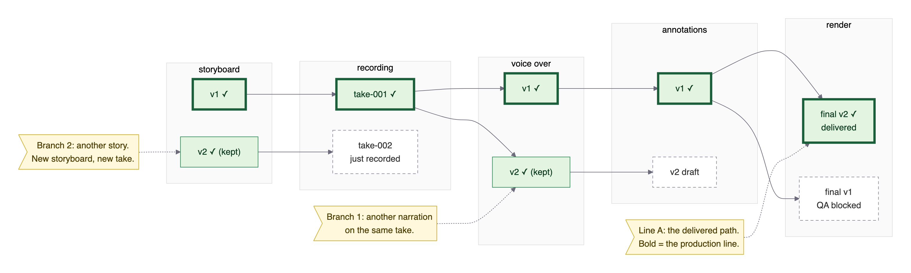
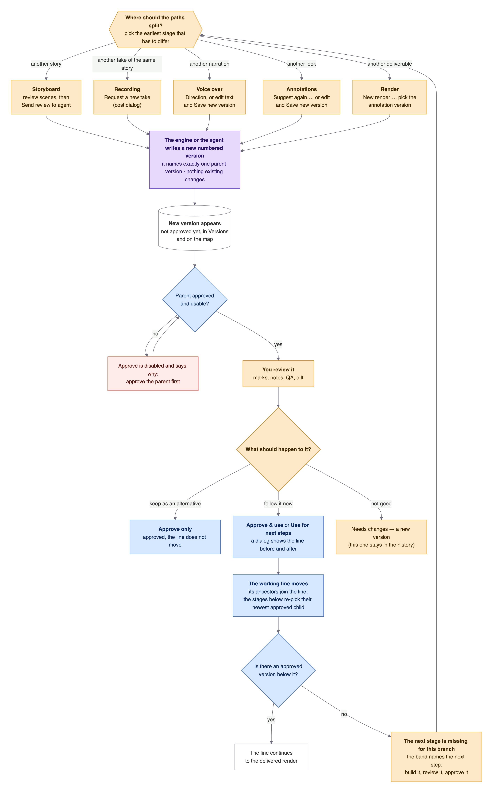
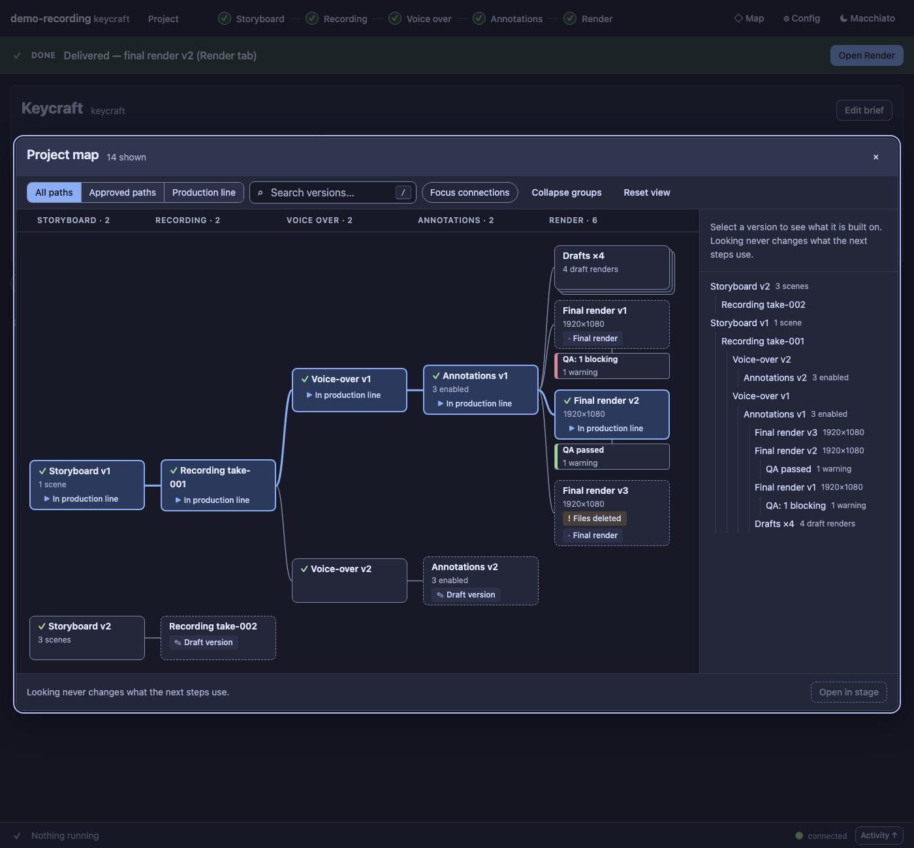
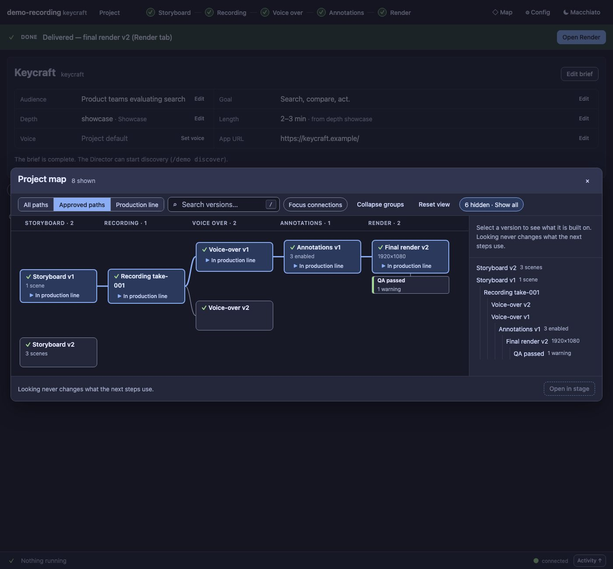
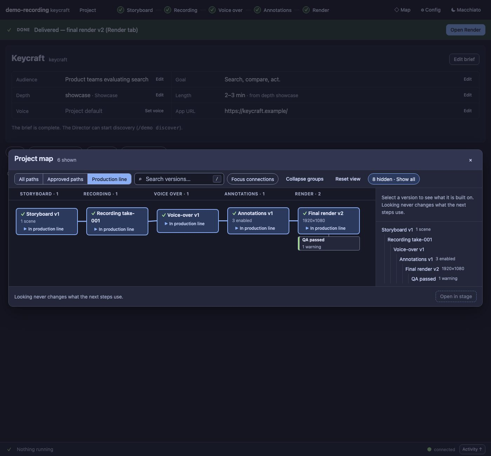
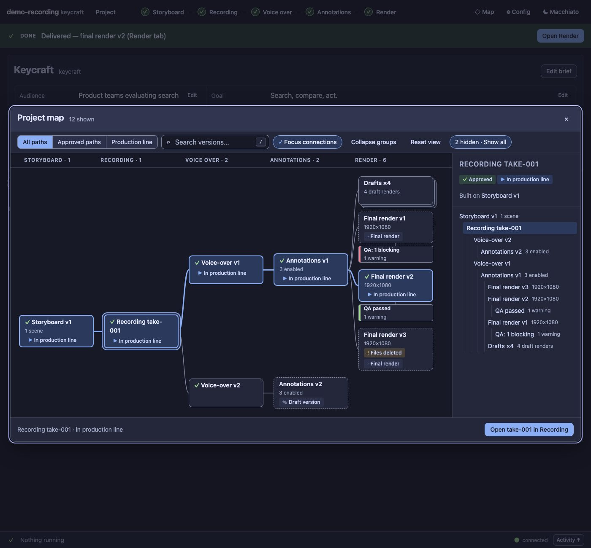
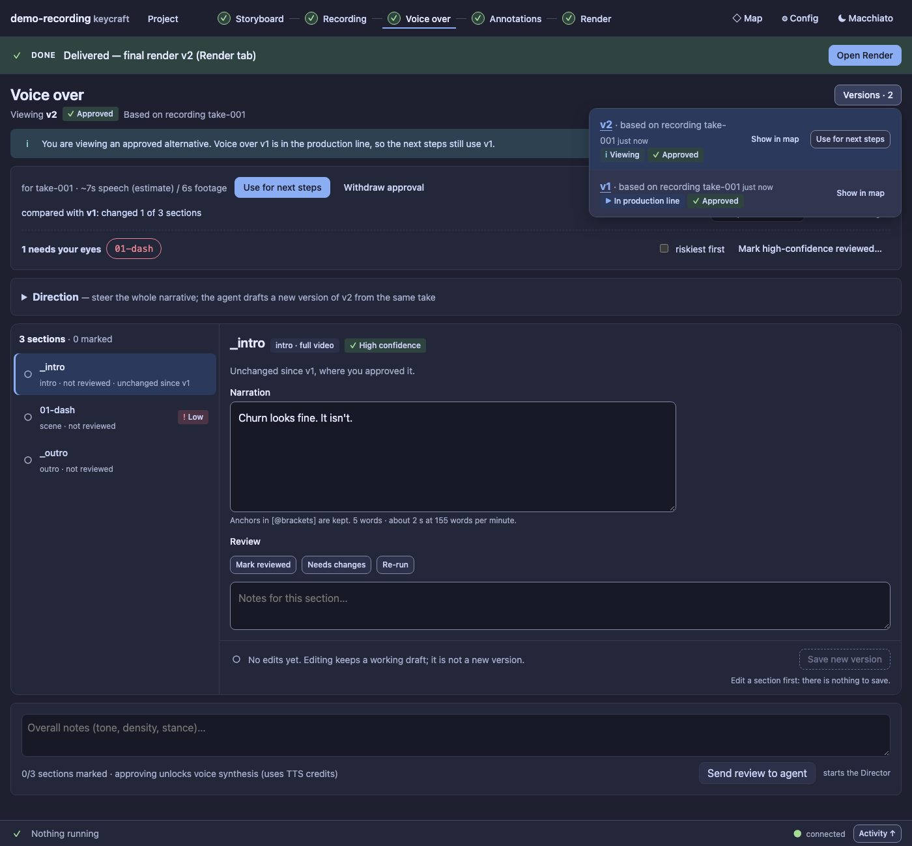
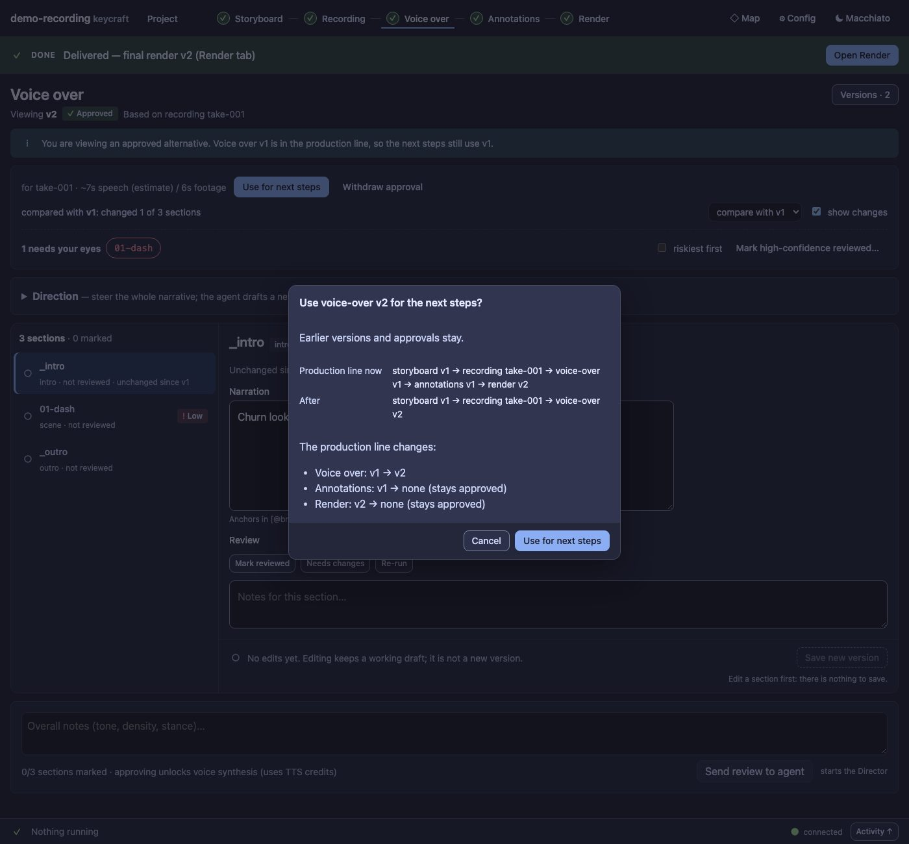
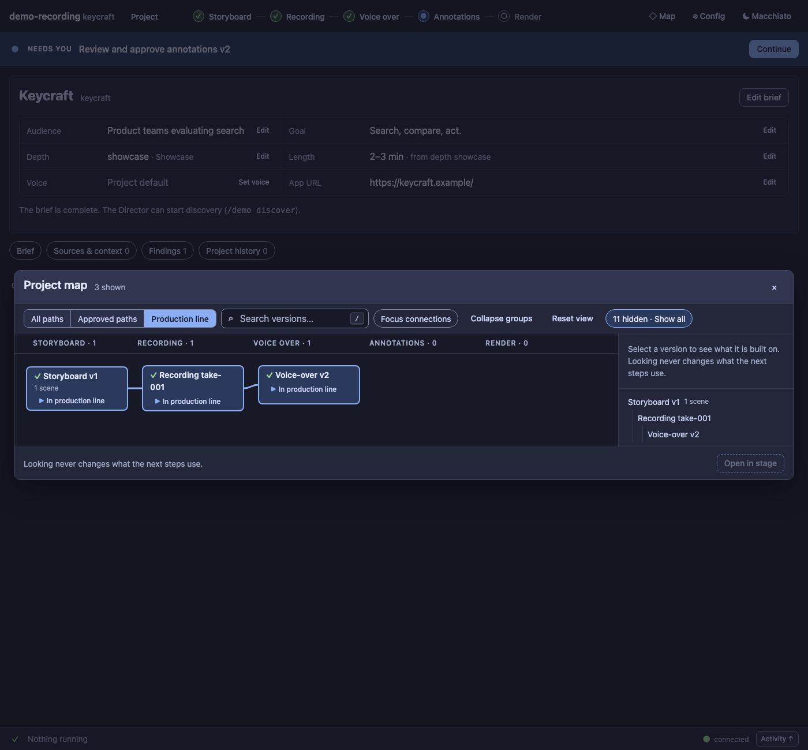
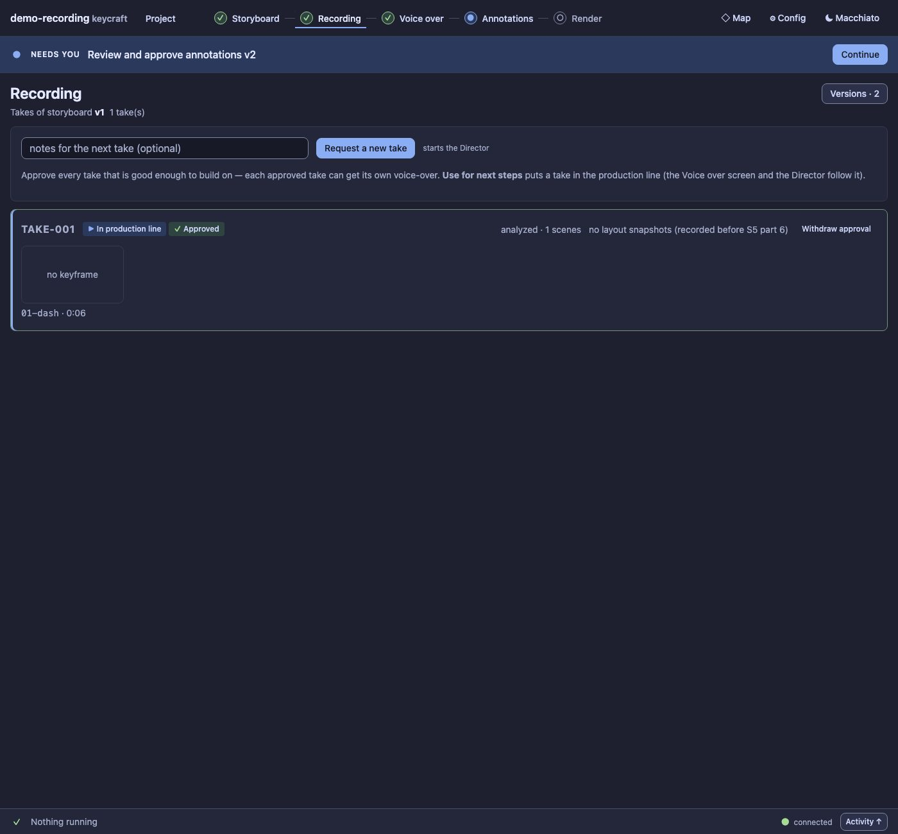

# Branching: trying a second path without losing the first

A demo is rarely right the first time. You want to try another narration on the same take, another story, a
different look, or just see whether a re-recording is better, **without throwing away what already works**.
That is what branching is for. This page explains how to start a new path, what happens behind the scenes at
each step, and what to do next. The screenshots are the real control room on a small branching demo project
(`scripts/branching-shots.ts` makes them, so they stay true).

If you only want the rules, read [The five rules](#2-the-five-rules) and then
[How to start a new path](#4-how-to-start-a-new-path-stage-by-stage).

---

## 1. The demo project used on this page

- **Line A (bold)** is the delivered path: storyboard v1 → take-001 → voice-over v1 → annotations v1 → final
  render v2. It is the **production line**: what the next steps use.
- **Branch 1, another narration:** voice-over v2 is a second narration of the same take-001. It is approved and
  kept as an alternative. Annotations v2 were drafted on it but not approved yet.
- **Branch 2, another story:** storyboard v2 is approved and kept. take-002 is a fresh recording of it that has
  not been approved yet.

Nothing on branch 1 or 2 changed anything on line A. That is the point.

---

## 2. The five rules

1. **Every version has exactly one parent version** in the stage before it (a storyboard has none). A branch is
   just a second child of the same parent: two voice-overs on one take, two takes of one storyboard.
2. **Versions are never changed.** Editing, directing or re-recording makes a **new numbered version**; the old
   one stays in **Versions** and on the **map**.
3. **Approving is not choosing.** *Approve only* says "good enough to build on" and keeps the alternative.
   *Approve & use* and *Use for next steps* also move the **production line** onto it.
4. **A version can only be approved when its parent is approved and usable.** If it cannot be, the button is
   disabled and says why. Un-approving an ancestor does not delete anything: its approved descendants become
   *orphaned* and wait until the ancestor is approved again.
5. **Looking never writes.** Opening Versions, the map or an old version changes nothing. Only an explicit action
   does, and the ones that move the line first show you the line before and after.

Where this comes from: [ARCHITECTURE.md §7](ARCHITECTURE.md#7-stages-versions-and-the-working-line) and
decisions D44–D47 in [VISION.md](VISION.md).

---

## 3. The path, as a flow

Pick the **earliest stage that has to differ**. Everything below it will need its own version on the new path;
everything above it is shared.

---

## 4. How to start a new path, stage by stage

| Where the paths split | What you do | Behind the scenes | The next expected step |
|---|---|---|---|
| **Storyboard**: another story | On *Storyboard*, mark scenes *Needs changes*, add notes, press **Send review to agent** (it says it starts the Director). | The agent writes the next storyboard file, `storyboard/vN.yaml`. The old storyboard, its takes and everything below stay as they were. A storyboard has no parent version. | Review the new storyboard, then **Approve only** (keep it) or **Approve & use** (follow it). Then it needs a take: *Recording → Request a new take*. |
| **Recording**: another take | On *Recording*, check the storyboard named at the top of the screen (the one on the line), add an optional note, press **Request a new take**. The storyboard must be approved; you confirm a cost dialog. | The panel sends the agent a "re-record requested for storyboard vN" note. The agent records `take-00N`; its `take.json` names the storyboard version. Older takes are untouched. Two takes of one storyboard are two siblings. | Watch the take. If it is good enough to build on, **Approve & use** it (or **Approve only**). Each approved take can get its own voice-over. |
| **Voice over**: another narration | Either **Direction** ("steer the whole narrative": the agent drafts a new version from the same take), or edit the text yourself: your edits autosave as a private working draft, and **Save new version** publishes one. For a *different take*, first approve and use that take, then ask the Director to write its voice-over (it works on the take on the line). | The script file names its take in its header, so the parent is always visible. A `.meta.json` records which version a new one was based on, which is what the diff compares. **Saving your own edit costs nothing** (no agent, no model). Direction and review use the Director and can cost. | Review the sections (confidence badges, diff against the base), then **Approve & use**. Approving unlocks voice synthesis, which uses TTS credits and shows an estimate first. |
| **Annotations**: another look | On *Annotations*, open **Suggest again…** (the designer proposes a new set), or edit items and **Save new version**. It is based on the voice-over version you are viewing. | A new `annotations/vN.json` records its voice-over parent and how it began (edited, re-suggested or imported). Items you changed live in a private draft until you save. | Review enabled items, previews and privacy redactions, then **Approve & use**. |
| **Render**: another deliverable | **New render…**, choose the annotation version (and brands, subtitles), **Render now**. A *final* needs an approved, usable annotation version; a *draft* can use any, even unsaved changes. | `render/vN.json` records its annotation parent. It runs as a background job; every final is QA-checked. Older runs and their files stay (finals are never pruned, drafts keep files for the newest few). | Open the run's **Quality check**. Fix or confirm each blocking item, then **Approve final**. The approved final is the delivered version. |

Read the table top to bottom for a full second line, or start at the row that matches your idea: a second
narration needs only the Voice over row; a second story needs the first three rows.

---

## 5. Choosing which path continues

| Step | What you do | Behind the scenes | The next expected step |
|---|---|---|---|
| **Keep it as an alternative** | **Approve only** on the version. | It is recorded as approved in `state.json`. The production line does not move; the stage tells you "You are viewing an approved alternative. Voice over v1 is in the production line, so the next steps still use v1." | Nothing is required. Build on it later, or compare it on the map. |
| **Follow it** | **Approve & use** on a version, or **Use for next steps** on one that is already approved (the button on the stage, or in the **Versions** list). | The dialog shows the production line *now* and *after*, and lists what changes. On confirm the line moves: the version's ancestors join the line, and each stage below picks its newest approved version that fits (or none). Earlier versions and their approvals stay. | If a stage below has nothing for this branch, the band names the next step: build it, review it, approve it. Otherwise the line runs on to a final render. |
| **Go back** | **Use for next steps** on the earlier version. | The same dialog and the same rules. Nothing was deleted, so going back is just choosing again. | The line runs from the older version again. |
| **See both** | **◇ Map** in the header, or **Show in map** on any row of Versions. | Read-only. It reads the files and the approvals; it never changes what the next steps use. | Pick a node to see what it is built on; **Open in stage** goes to that exact version. |

The Director follows the same line. When you change the line in the panel, the agent is told in a note for its
next turn (no turn is started), and its tools use the line by default: the voice-over template uses the take on
the line, synthesis and editing use the voice-over on the line.

---

## 6. What it looks like in the control room

### The map

The **◇ Map** overlay draws every version, grouped by stage, one parent per node, with the production line in
bold. **All paths** shows the demo project exactly as in the chart above:

*(The real overlay is at most about 52 rem tall and scrolls inside; this picture shows the whole graph at
once.)* **Approved paths** hides what is not yet usable, so you see only the approved alternatives:

**Production line** shows just the path the next steps use:

Select a node and **Focus connections** to see its parents and children; at a branch point (take-001 here) you
see both children:

### Versions and the stage

Each stage has a **Versions** list next to its title. A row says what the version is based on and where it
stands; clicking anywhere on a row opens that version (viewing only). A version that is approved but not on the
line has its own **Use for next steps** button:

### Moving the line

**Use for next steps** never acts silently. The dialog says what the line is now, what it will be, and what moves
(and that earlier versions and approvals stay):

After confirming, the line follows voice-over v2. Annotations and render for it do not exist yet, so the
**Production line** view stops at voice-over v2. That is the expected "next step": build annotations for the new
narration, approve them, and render.

### Recording: siblings

Takes of one storyboard sit side by side. Approve every take that is good enough to build on; **Use for next
steps** puts one on the line.

---

## 7. Three recipes

| I want to … | Do this |
|---|---|
| **Try a second narration** on the take I like | *Voice over* → **Direction** (or edit the text and **Save new version**) → review → **Approve only** to keep it, or **Approve & use** to follow it → annotations and render for it. |
| **Try a second story** | *Storyboard* → review + **Send review to agent** → **Approve & use** the new storyboard → *Recording* → **Request a new take** → approve the take → voice-over, annotations, render. |
| **Re-render the delivered path with other annotations** | *Annotations* → **Suggest again…** → review → **Approve & use** → *Render* → **New render…** (final) → QA → **Approve final**. |

## 8. When it does not do what you expect

| You see | Why | What to do |
|---|---|---|
| **Approve is disabled** with a reason | The parent version is not approved, or (for a final render) it has an open blocking QA item. | Approve the parent (the reason names it), or fix or confirm the QA item. |
| **The line stops early** (a stage says nothing is in the production line) | You moved the line to a version that has no approved child yet. | Build the next stage for this branch (the band's next step), or **Use for next steps** on the older version to go back. |
| **A version looks approved but cannot be used** | It is *orphaned*: an ancestor was un-approved. | Approve the ancestor again (nothing was lost). |
| **A new draft is not on the line** | New versions are never selected for you; "a new result never moves you." | Review it, then **Approve & use**. |
| **I edited and nothing new appeared** | Editing keeps a private working draft; it is not a version. | **Save new version** (it makes exactly one and approves nothing). |

Related: [UX.md](UX.md) for the screen design, [RENDER.md](RENDER.md) for renders and retention,
[ACTORS.md](ACTORS.md) for who writes each version.
