# The control room: a tour of the panel

The panel is where you look at what the Director produced and decide. It runs locally (`/demo panel` opens it; `DEMO_REC_NO_OPEN=1`
only prints the address) and is also what the Director sees: when you approve something here, the Director is told.
This page describes every part of it. For the process see [GUIDE.md](GUIDE.md); for a first run [TUTORIAL-101.md](TUTORIAL-101.md).

Contents: [the frame](#the-frame) · [Project](#project) · [Storyboard](#storyboard) · [Recording](#recording) ·
[Voice over](#voice-over) · [Annotations](#annotations) · [Render](#render) · [Versions and the production line](#versions-and-the-production-line) ·
[The map](#the-map) · [Config and Brands](#config-and-brands) · [Keyboard, themes and small windows](#keyboard-themes-and-small-windows) ·
[Safety of the panel itself](#safety-of-the-panel-itself)

---

## The frame

Every screen has the same frame around it, so you always know where you are, what needs you and what is running.

| Part | Where | What it is |
|---|---|---|
| **Top bar** | top | the project name; **Project**; the five stages as a stepper, each with a state (complete, needs you, running, blocked, not started: an icon **and** a word); **◇ Map**, **? (shortcuts)**, **⚙ Config**, the theme |
| **Next-step band** | under the bar | what needs you (a draft newer than the newest approved version, or the engine's next step) or what is blocked, with a link to go there and a menu of the other pending items. It only links: it never starts anything and never moves you |
| **The screen** | middle | one of the stages, Project, Config, or the Map as an overlay |
| **Status strip** | bottom | one short line: *Nothing running*, what runs (a percentage only when the job reports one), a failure in red with **Show error**, or the connection state |
| **Activity drawer** | right, on demand | the running jobs with progress, **what happened by itself**, what needs attention, recent jobs, the live frame, the safety feed and the log |

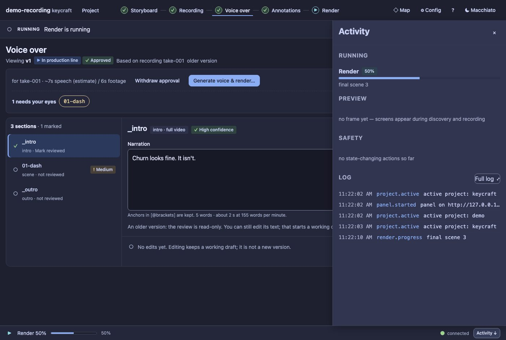

- **The address says where you are** (`#/voice`, `#/render/v2`, `#/config?q=voice`): back, forward and reload work; a bare address
  restores the last place in this project; an unknown one says so and shows Project. Moving around never changes project state.
- **Nothing happens in silence** (run-and-tell). What the panel does with an event is written down once (`src/panel/public/steps.js`, a test
  keeps it complete): an **ask** is the Director asking to spend; **progress** shows in the strip and the Activity rows; an **alert** (a model
  warning, a failure to reach the Director) is always a toast; your own actions say nothing; and a **result that arrived by itself** (the
  Director wrote something, the edit and its draft render finished, the QA of a final, the annotation designer) is a **new** badge on its step,
  **a toast when you are looking at that screen**, and a line under **Happened by itself** in Activity.
- **After Approve & use** the toast says what happens next ("Next: the Director asks to record it. A recording uses model calls, so it waits for
  your Allow", "Done: this is the delivered version"). **A draft made before there are annotations** (the voice step's) carries a **no annotations**
  badge so it is not mistaken for the annotated one.
- **A result that arrives** (a storyboard, a take, a voice-over, annotations, a render) puts a **new** badge on its step. It never
  switches the screen, takes the focus or touches what you are typing.
- **The Activity drawer never opens by itself**, not even on an error; it is closed again after a reload. A failure is also in the strip
  and in the band, so it cannot be missed without taking the screen over.
- **Messages** are toasts: errors stay until dismissed and have **Copy**; information goes away after a few seconds (not while the
  pointer or the keyboard focus is on it).
- **Decisions** (approve, withdraw an approval, save a setting, delete files, discard a draft) are in-panel dialogs that say what
  changes: Escape cancels, Enter confirms, a destructive one starts on *Cancel*.

## Project

The first step. It opens on a **summary** of the brief in human terms (audience, goal, depth, length, voice, app URL) and one **Next**
line; what is missing is marked, but nothing is mandatory.

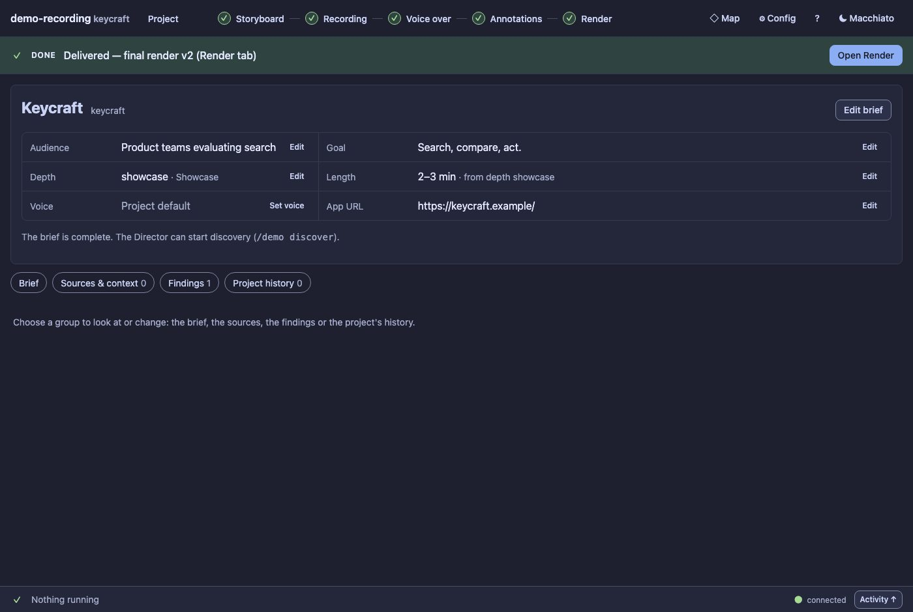

Below it, one group at a time (the chip that is open closes when you press it again):

| Group | What it holds |
|---|---|
| **Brief** | the facts as a form (title card preview, audience, depth, stance, target length, voice, URLs, goal). Each save shows a diff and writes a new brief version |
| **Sources & context** | what you gave the Director (notes, links, assets) |
| **Findings** | what discovery and the recordings found (strengths, weaknesses, friction, values, use cases, length), each **auto**, **use** (always in the recording and the narration) or **ignore** |
| **Project history** | the input log: every direction, review, edit and note; withdrawn ones are marked outdated, never deleted |

## Storyboard

The scenes the Director plans to record, as a list with one scene in detail: the steps, what each waits for, and the confidence of the
Director in each (the doubtful ones come first with **riskiest first**).

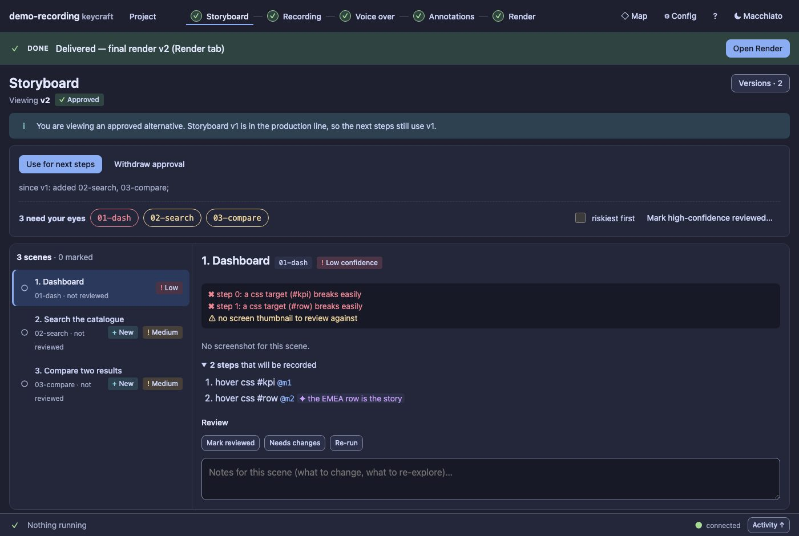

- **Mark reviewed**, **Needs changes**, **Re-run** and a note per scene; **Mark high-confidence reviewed…** shows what it will mark
  before it does.
- **Send review to agent** sends everything as one message (the button says it starts the Director); the next storyboard version comes
  back with a diff.
- **Approve & use**, **Approve only**, **Use for next steps** and **Withdraw approval** are explained under
  [Versions](#versions-and-the-production-line).

## Recording

The takes of the selected storyboard, newest first, each with status, duration, analysis state, a keyframe per scene and the raw
video. **Approve** each take that is good enough to build on. **Request a new take** (with an optional note) asks the Director for
another one, and shows its cost first.

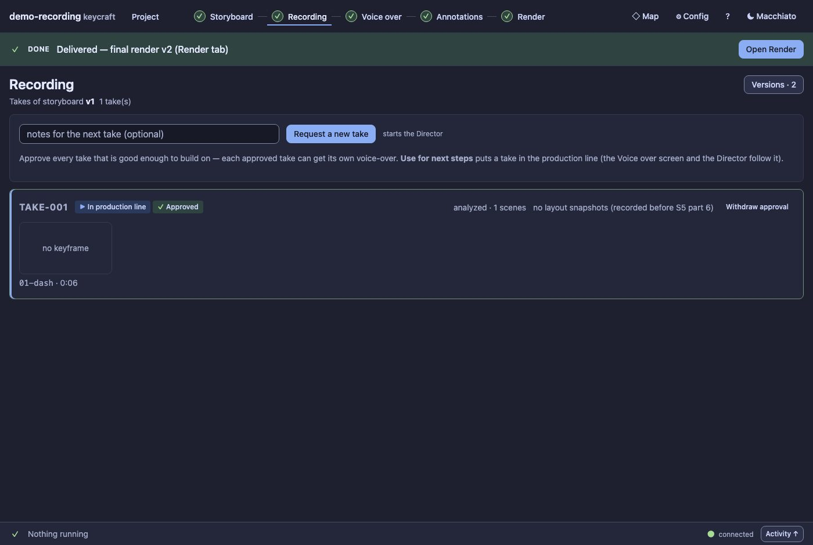

## Voice over

A list of sections (an intro, one per scene, an outro) and one in detail.

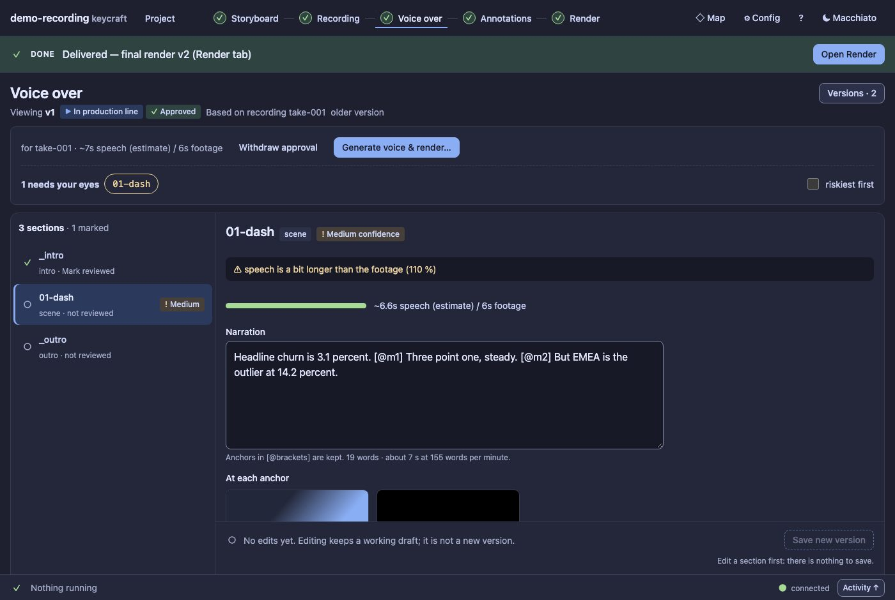

| Part | What it does |
|---|---|
| **Narration** | editable; autosaves as a working draft on the version it started from; **Save new version** makes exactly one version and approves nothing |
| **Under the narration** | one picture per anchor `[@mark]` the section speaks: the take's keyframe at that moment, the time and a line of what the page said |
| **Review** | Mark reviewed / Needs changes / Re-run, a note, and **Send review to agent** |
| **Direction** | stance, tone, length, focus and notes for the whole narrative; the Director writes a new version from the same take |
| **Confidence** | a badge per section with the reasons (a number not on the page, speech longer than the footage, changed since the version you approved) |
| **compare with v1** | the words that changed, per section |
| **Generate voice & render…** | the cost dialog, then the voice and the edit (no agent). Only for an approved version in the production line |

**The Director asks.** When the Director wants to spend (a voice synthesis, a new take) and you have not allowed it, nothing starts: a bar
appears on every screen, above the content: *The Director asks to … / Allow / Not now*. Allow lets that one thing go (for 15 minutes,
once); Not now tells the Director not to try again unless you ask. In chat the same is `/demo allow [id | all]` and `/demo deny [id | all]`.

If a newer version exists than the one a draft was started on, the draft is flagged ("v2 exists") and **Compare with v2** shows both;
a draft is never rebased or dropped for you.

## Annotations

Zooms, highlights, spotlights, callouts, chapter titles and privacy redactions, grouped by scene.

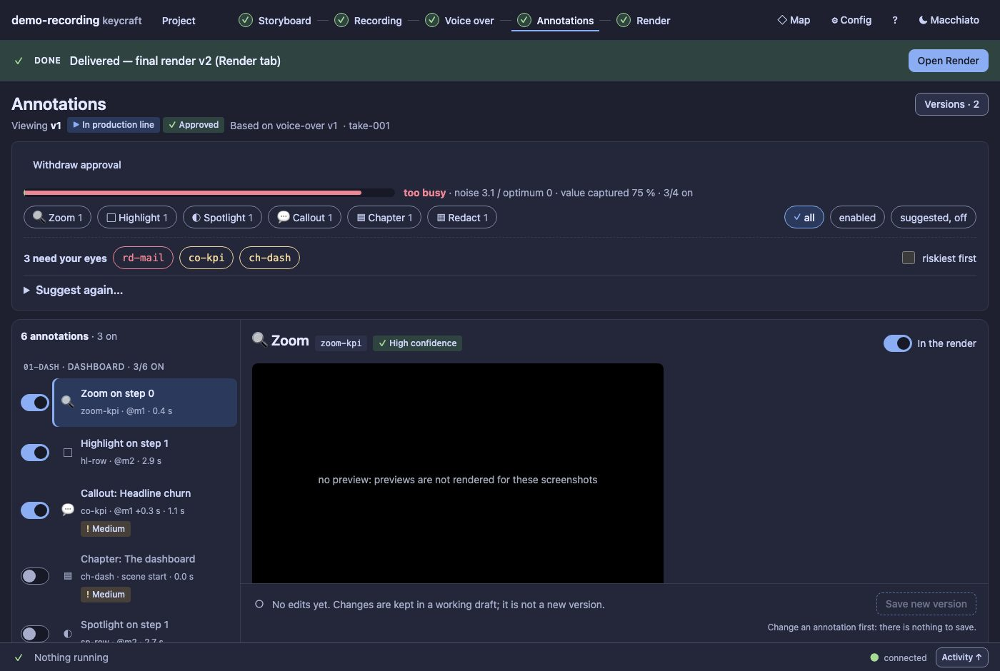

| Part | What it does |
|---|---|
| **The switch on a row** | in the render or not; a privacy redaction asks first, once per redaction |
| **The detail** | its type, start and length (with 0.5 s nudges), its target and alternatives, why it was proposed, and a still or a clip of the result |
| **A budget bar** | how busy the video is against the optimum for its length |
| **Suggest again…** | a new set on the version you are viewing, keeping your changes; says whether it runs as a separate call or an agent turn |
| **Save new version** | your working draft becomes one version; nothing is approved |

## Render

The runs (finals and drafts) as a table, the delivered final first, the drafts folded under one line.

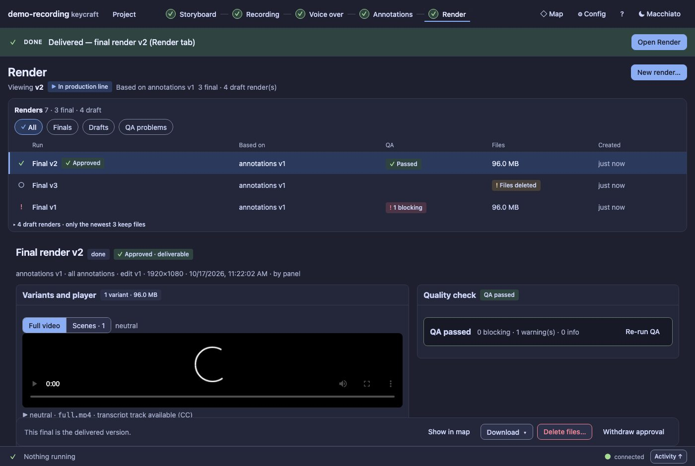

| Part | What it does |
|---|---|
| **New render…** (header) | kind (draft or final), annotation version, brands, annotation types, subtitles, logo bug; **Render now** uses what the summary says |
| **Runs** | Run, Based on, QA, Files, Created; chips All, Finals, Drafts, QA problems |
| **Player** | a **Full video / Scenes** switch, one chip per scene, a table of the variants with downloads |
| **Quality check** | the items found (**Hard stops** first, then **Needs your eyes** and **Worth a look**, with a ▶ time link and fixes; **Ignore…** on any finding that is a judgement call, with a scope and a reason, and **Export anyway…** for a leaking redaction) and, in plain words, the checks that found nothing |
| **The bar** | what approving does; **Show in map**, **Download** (the video, transcript, callouts, poster, a zip of the variant, its folder), **Delete files…** and the approve / withdraw buttons. A reason is said once if two buttons are blocked for the same reason |

## Versions and the production line

Every stage has a **Versions** list next to its title. A row says what the version is based on and where it stands, and clicking
**anywhere on the row** opens it. **Looking never changes anything.** The head of the screen always says what you are looking at
("Viewing v2 · Draft version · Based on recording take-001") and, when it is not in the production line, how it differs.

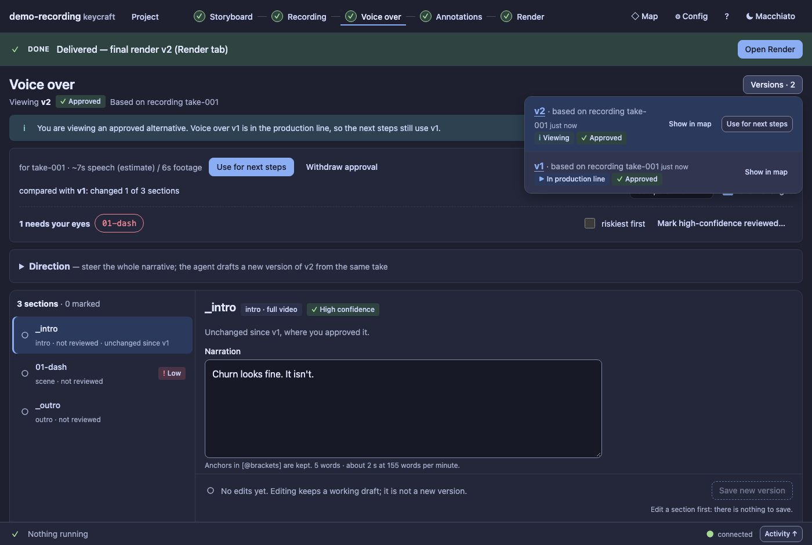

| Action | What it does | Asks? |
|---|---|---|
| **Approve & use** | approves it and puts it in the production line; **starts the Director** | when it changes the line |
| **Approve only** | approves it as an alternative; the line stays exactly as it is | no |
| **Use for next steps** | puts an approved version in the line | when it changes the line |
| **Withdraw approval** | removes the approval; whatever was built on it is flagged **blocked by dependency** (nothing is deleted) | when something becomes blocked |

Each one shows the production line **before and after** when it changes it, and applies only if the project is still as planned. Every one
leaves an **Undo** in the confirmation toast for about 12 seconds; it restores the approvals, the line and the phase exactly, and is
refused (with the reason) if anything else changed them since. *Delete files* has no Undo: its two dialogs are its safeguard.

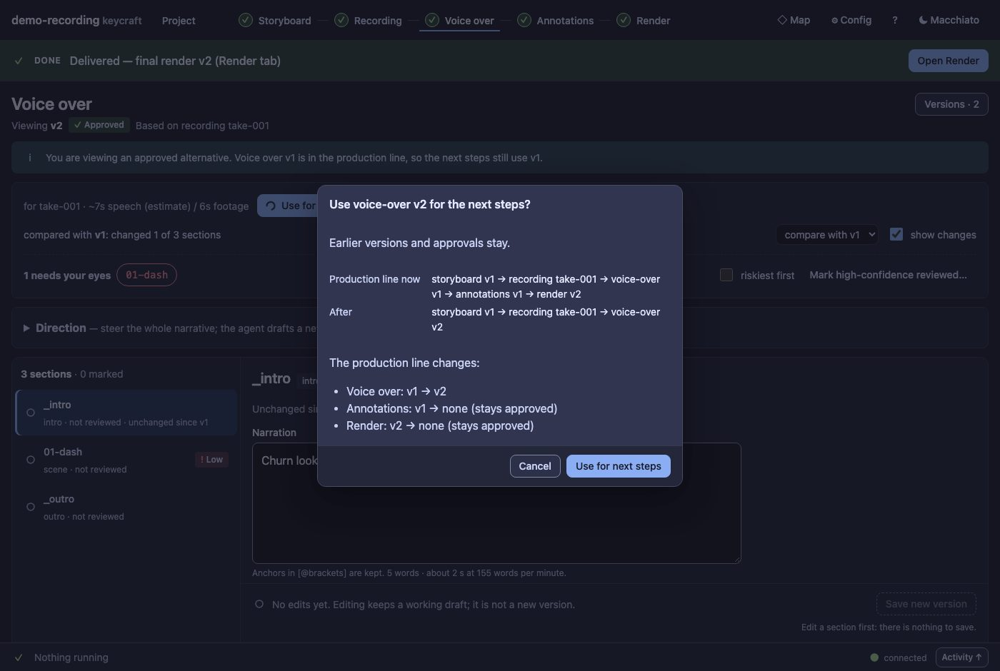

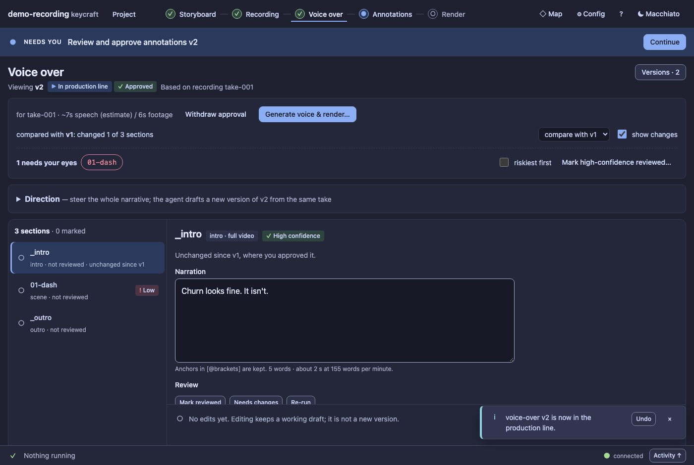

More on branching in [BRANCHING.md](BRANCHING.md).

## The map

**◇ Map** (or **Show in map** on any version) draws every version, grouped by stage, one parent per node, with the production line in bold.

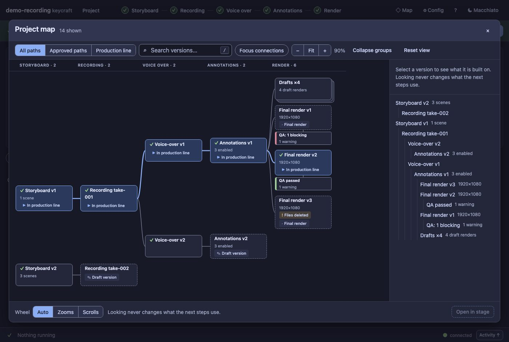

- **All paths**, **Approved paths** and **Production line** change what is shown; **Focus connections** shows a selection's parents and
  children; search finds versions; **Collapse groups** folds the draft renders; **Reset view** returns to the start.
- **Zoom:** −, **Fit**, +, the keys `+ − 0`, the mouse wheel (at the pointer) and a trackpad pinch. **Pan:** drag the background, or two
  fingers on a trackpad. **Wheel: Auto / Zooms / Scrolls** (in the foot) fixes a wrong guess about your device.
- **Open in stage** goes to the exact version. Looking never changes what the next steps use.

## Config and Brands

**Config → Settings** lists every setting that is not about the demo itself (voice engines and their order, models, capture size,
output and look, discovery budgets), grouped, with the most important first. It opens on the first group.

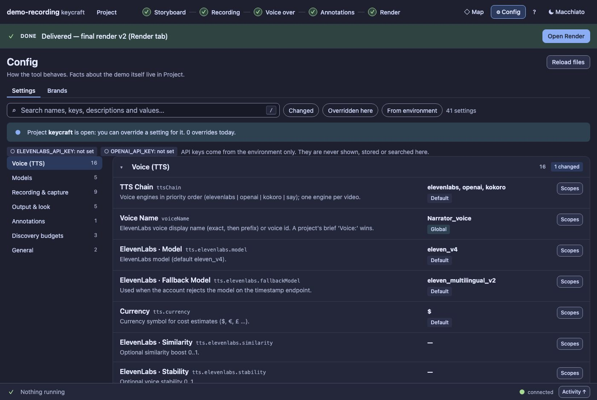

- **Environment overrides** are listed in a warning at the top whenever a `DEMO_REC_*` variable is set: what it sets, the value it hides,
  and test switches (`DEMO_REC_NO_OPEN`, `DEMO_REC_NO_VOICE_LIST`) flagged as such, so a variable left over from a test cannot silently win.
- **Search** finds a setting by name, key, description or value (`/` or Cmd/Ctrl+K inside Config); **Changed**, **Overridden here** and
  **From environment** filter. API keys are shown only as *set* or *not set* and are never searched or displayed.
- Each row shows the **effective value and where it comes from**; **Scopes** shows each layer (environment, project, global, default)
  with its own action. An environment value is read-only; a value hidden by a higher layer is flagged. Every change ends in a diff.
- **Voice name** is a picker of your ElevenLabs voices (yours first), with a text field when the list is not available.

**Config → Brands** is a list of brands and an inspector: a preview of the title card and a sample frame, and the colours, frame,
title card and logo bug as rows with one control each. A changed field is marked, with an **Undo** per row; **Save as copy…** keeps
your tweaks (built-in brands are read-only), **Set as default** and **Default for this project** go through a diff.

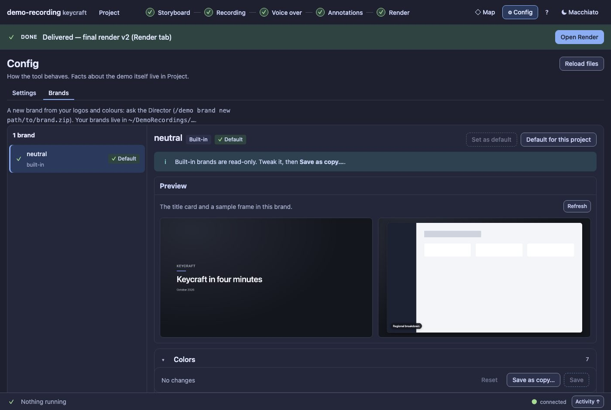

## Keyboard, themes and small windows

- **A list is one tab stop;** ↑ ↓ Home End move between its items and Enter opens the one in focus. **`?`** opens the sheet of every
  shortcut, which never fires while you type or over a dialog:

  | Keys | What |
  |---|---|
  | `?` | show the shortcut sheet |
  | Tab, Shift+Tab | move between controls (a list is one stop) |
  | ↑ ↓, Home, End | move between the items of a list; Enter opens the one in focus |
  | Esc | close the top layer: a dialog, the Versions list, the Map, or clear a search |
  | `/`, Ctrl/Cmd+K | search the settings (in Config) |
  | arrow keys in the Map | walk the graph from node to node; Enter selects |
  | `+`, `−`, `0` in the Map | zoom in, zoom out, fit the whole graph |
  | the mouse in the Map | the wheel zooms at the pointer (Shift + wheel scrolls); drag the background to pan |
  | a trackpad in the Map | pinch zooms at the pointer; two fingers pan |

  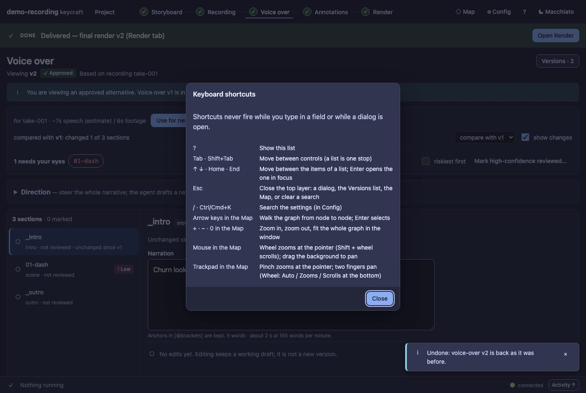

- **Two themes** (Catppuccin Macchiato, dark, and Latte, light); the choice is remembered. Status is always an icon and a word, never
  colour alone.

  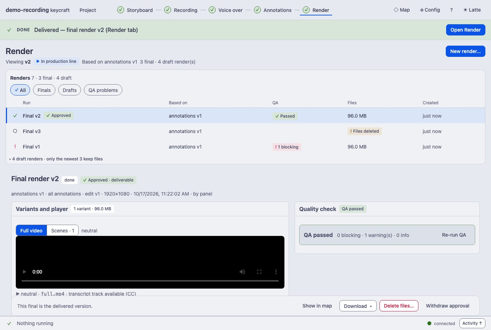

- **Small windows:** the layout follows the width of the workspace, not the window. Below about 52 rem the list becomes a select above
  the detail, secondary columns of a table fold away, and the header drops the stepper's labels.

  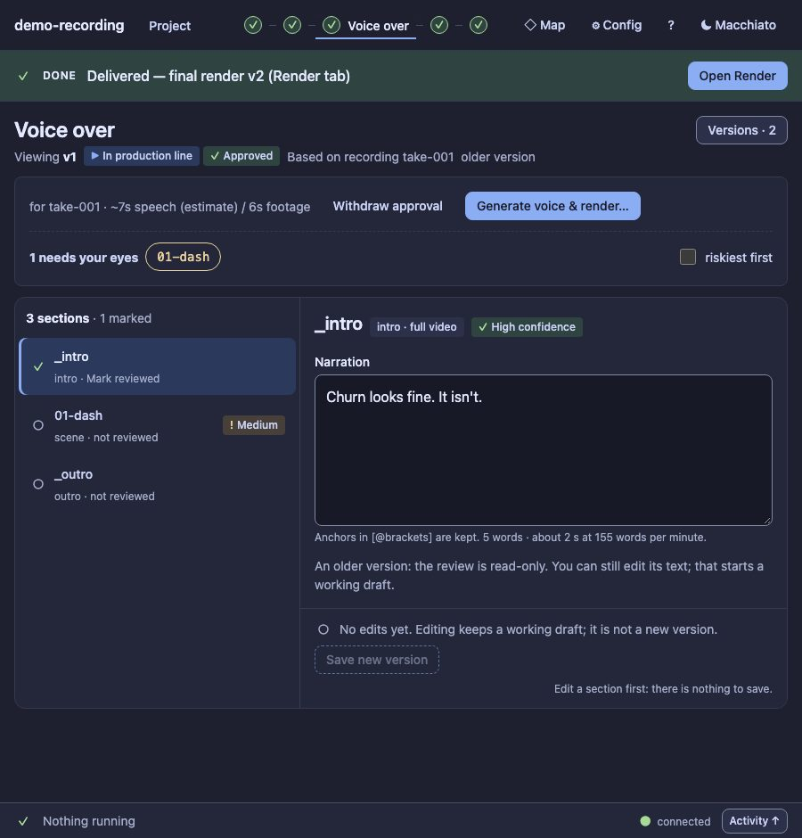

- **Text zoom** to 200 % does not scroll the page sideways; reduced-motion settings are honoured; every control is at least 24 px and
  shows a focus ring (checked by an automatic audit in both themes at 900 and 1400 px).

## Safety of the panel itself

The panel listens on `127.0.0.1` only. Its API and its live connection need a random per-session token, and the Host header must be
loopback (a guard against DNS rebinding). Requests that change something accept only a Bearer header with a JSON body, so another page
on your machine cannot forge them. The token is removed from the address after the first load. The panel never shows, stores or
searches an API key; the voice list is read on the server with the key from the environment and only the names reach the page.
If a part of the panel cannot load, the page says so and what to try instead of staying blank.
