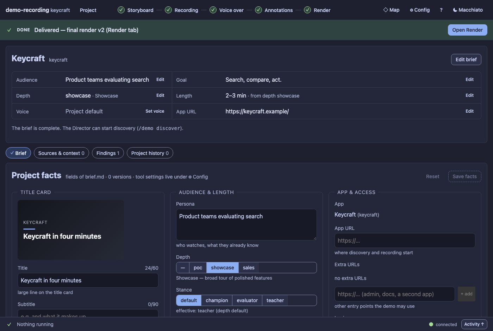

# User guide: from an idea to a delivered demo video

This is the guide for **using** demo-recording. It follows one demo from the first sentence you write to the video you hand
over, says what you do, what the Director (the agent in pi) does, what costs money, and where each step is in the panel (the
**control room**). For the panel screen by screen see [CONTROL_ROOM.md](CONTROL_ROOM.md); for a hands-on first run see
[TUTORIAL-101.md](TUTORIAL-101.md); for how it works inside see [ARCHITECTURE.md](ARCHITECTURE.md).

The pictures show the control room on a small demo project (**keycraft**) that has a delivered video and two branches.

---

## 1. What you get, and what you do

You give it a web app and a few sentences about the demo. It gives you a narrated, in-sync video of that app: one combined
video and one clip per scene, with a title card, your brand, zooms, callouts and highlights, checked automatically before you
hand it over.

You stay in charge in four ways:

- **You write the brief** (who watches, what they should believe afterwards, how long).
- **You approve each stage** in the panel: storyboard, recording, voice-over, annotations, final render. The agent cannot approve
  for you: it has no tool that does (a test keeps it that way). When it thinks a take is ready it can only *suggest* it, and the
  Recording step gets a "new" badge.
- **You are asked before anything costs money or takes long.** A new take and the voice are never started by the Director on its own:
  it asks, the panel shows **The Director asks to synthesize voice-over v3 (…) / Allow / Not now** (or you type `/demo allow` in
  chat), and only your answer lets it go on. The separate annotation designer starts by itself after the voice step, but says so,
  with its models and input size, in Activity (turn it off with `annotations.autoSuggest`).
- **Nothing is ever overwritten.** Every change is a new numbered version, so you can compare, go back, or try a second idea
  next to the first ([BRANCHING.md](BRANCHING.md)).

## 2. Before you start

| You need | Why |
|---|---|
| **pi** with the extension installed | the Director lives there; `/demo` is its command |
| **Node 22+**, `npx playwright install chromium` | the recording browser |
| **`ffmpeg` 7+** and **`uv`** on your PATH | the edit and render; word timings and the local voice |
| **`ELEVENLABS_API_KEY`** (and optionally **`OPENAI_API_KEY`**), exported **before** starting pi | the voice. Keys come from the environment only: they are never shown, stored or sent anywhere but the voice service |

Run `/demo doctor` first: it checks all of this and prints presence only, never a key. It also lists the `DEMO_REC_*` environment
variables that are overriding your config file (what they set, what they hide); the same list shows when a project opens and at the top of
**Config**, so a variable you set for a test cannot silently win.

## 3. The whole path on one page

| # | Phase | You | The Director | Panel | Costs |
|---|---|---|---|---|---|
| 0 | **Brief** | say what the demo is for | drafts `brief.md` with you | **Project** | a model turn |
| 1 | **Discover and storyboard** | review scenes, approve | explores the app, proposes scenes and steps | **Storyboard** | model turns |
| 2 | **Record** | approve the take | records one continuous take | **Recording** | model use for live inputs |
| 3 | **Voice-over** | review, edit, approve | analyses the take, writes the narration | **Voice over** | model turns |
| 3b | **Voice and edit** | confirm the cost dialog | (the engine, no agent) synthesizes the voice and syncs the take | **Voice over** | **TTS credits** |
| 4 | **Annotations** | toggle, edit, approve | proposes zooms, callouts, highlights, redactions | **Annotations** | one designer call |
| 5 | **Render** | pick a final, read the QA, approve | (the engine) renders and checks | **Render** | CPU time |

The top bar shows these as a stepper with a state on each (complete, needs you, running, blocked, not started: always an icon and a
word). The band under it says what needs you next and links to it; it never starts anything and never moves you by itself.

## 4. Phase by phase

### 0. The brief: who watches and what they should believe

`/demo new <project> <app-url> [app name]` creates the project, opens the panel and starts the brief skill. A new project opens on
a short summary with one **Next** line; nothing is mandatory and there is no wizard.

Two ways in: **Ask the Director to draft it** (describe the demo in a sentence or two; it asks for what it needs) or **Fill it in
myself** in the Project facts form. What the brief holds:

| Field | What it is |
|---|---|
| **Audience** (persona) | who watches and what they already know |
| **Goal / key message** | the one thing the viewer should believe afterwards: the demo is built around it |
| **Depth** | `poc`, `showcase` or `sales`: sets the stance and the length by default |
| **Target length** | e.g. 2 to 3 min; the edit is compared with it |
| **Voice** | an ElevenLabs voice by name (a picker lists your account's voices); empty uses the Config default |
| **Title, subtitle, app URL, extra URLs** | the title card and where recording starts |

| Depth | Stance | Length |
|---|---|---|
| poc | evaluator | 3 to 5 min |
| showcase | teacher | 2 to 3 min |
| sales | champion | 60 to 90 s |

Every save shows the change as a diff first and writes a **new brief version**.

### 1. Discover and storyboard: what the demo shows

`/demo discover [notes]` lets the Director explore the app in a real browser, looking at the screen and the page text, and find
the demo-worthy use cases. You can watch it live in the Activity drawer (the current screen, the budget used and a safety feed).

**Safety.** Discovery clicks and types in a real app. A safety net blocks destructive, financial and sharing actions (delete, pay,
send) before they happen, enforces budgets (screens, actions, minutes) and keeps an audit log. State-changing steps that are not
blocked are allowed, but audited and shown to you. The check is heuristic: for a sensitive tenant set a `policy.json` and read the
security notes in the README first.

The Director then writes a **storyboard**: scenes in order, each with the steps to perform, what to wait for, and which
numbers will be visible. In the panel you review it as a list of scenes with one scene in detail:

- mark each scene **Mark reviewed**, **Needs changes** or **Re-run**, with a note;
- the confidence badge tells you where to look first (low confidence goes to the top with **riskiest first**);
- **Send review to agent** sends all your marks and notes as one message, and the Director writes the next storyboard version, with a
  diff against the one before.

When it is good enough to build on, press **Approve & use** (or **Approve only** to keep it as an alternative, see
[BRANCHING.md](BRANCHING.md)). Approving is the only way a storyboard becomes an input to recording.

### 2. Record: one continuous take

Once a storyboard is approved the Director records it as **one continuous, human-looking take**: a virtual cursor with realistic
motion, realistic typing, and live inputs (the `improvise` steps for a search box or a chat) that a small model writes on the spot.
It runs in the background: the strip along the bottom shows progress with an estimate, and pi's footer shows the current step.

Starting another take is a deliberate act and is asked first: **Request a new take** shows what it will use (the improvise steps, their
models, whether they have credentials, the length of the last take). A scene that fails is retried by resuming: the earlier scenes are
replayed off-camera to restore the state and the take is stitched. If the retries run out the take is marked failed and keeps its
evidence.

Each take is a version of the Recording stage with its own analysis: a keyframe per scene and the raw video. **Approve** every take
that is good enough to build on; each approved take can get its own voice-over.

### 3. Voice-over: written from what actually happened

`/demo voiceover [notes]` (or the Director, once you have approved the take) analyses the take (dead time, typed text, error toasts,
what was on screen at each moment) and writes the narration **from the actual run**. It quotes real on-screen values and pins phrases to
events with anchors like `[@m1]`, so a number is said when it appears.

In the panel the narration is a list of sections (an intro, one per scene, an outro) with one in detail:

- **Edit the text yourself.** It autosaves as a private working draft; **Save new version** makes it a version. Nothing is sent to the
  Director until you save, and a draft stays on the version it was started on.
- **Under the narration** you see the picture the take had at each anchor, so you can check the words against what is on screen.
- **Direction** steers the whole narrative (stance, tone, length, focus, notes) and asks the Director for a new version.
- **Confidence badges** and the speech-versus-footage bar show where it is risky; **compare with v1** shows what changed.

When the voice-over is right, **Approve & use**. Approving unlocks the voice.

### 3b. Voice and edit: this is where credits are spent

**Generate voice, edit and a draft to watch…** shows a cost dialog first: how many characters are cached (free) and how many are billed, in credits
and in money. It can never be switched off for the voice. (If the Director gets there first, it does not synthesize: it asks, with the
same numbers, and waits for your **Allow**.) Then the engine (no agent) synthesizes the voice with the first engine of
your chain that works (ElevenLabs, then OpenAI, then the local Kokoro; one engine for the whole video), and **edits the take to the
voice**:

1. cuts dead time (spinners), keeping a short beat;
2. speeds up static stretches (up to 1.6×), streamed answers (up to 1.3×) and in-app animation (up to 1.15×);
3. trims static stretches, or, if the narration is longer, slows them (never below 0.85×) and then holds a settled frame;
4. **never touches** typing and clicks. If the video cannot shrink further the narrator pauses instead of drifting.

The result is a **draft render** to watch. Audio is cached by content, so changing one section only pays for that section.

### 4. Annotations: what to look at

After a sync edit the **annotation designer** looks at what was recorded and said and proposes about twice as many zooms, callouts,
highlights, spotlights, chapter titles and privacy redactions as should be on, and switches the best half on. It runs as one separate
model call (if you set `roles.annotationDesigner.model`) or as an agent turn.

In the panel the items are grouped by scene. Switch items on and off, nudge their start and length, change a target, read why each was
proposed, and watch the preview. A **privacy redaction** asks you before it is switched off. **Suggest again…** asks for a new set based
on the version you are looking at and keeps the changes you made. Your edits are a working draft until you **Save new version**.
When the set is right, **Approve & use**: a final render needs approved annotations.

### 5. Render: drafts, finals and the check

**New render…** chooses what to render: a **draft** (a quick 960×540 render, any annotation version, even unsaved changes) or a
**final** (full quality, per-scene clips, transcripts and a poster; needs approved annotations), the brands (each brand is a variant),
the annotation types to include, subtitles and the logo bug. Every final is **checked automatically** right after the render, in the
same job, with no model:

| Check | What it looks for | Blocks approval |
|---|---|---|
| **Values** | every number the narration says is on the page at that moment | a number nowhere in the scene |
| **Footage** | an error toast or a console error in the footage the edit uses | an error |
| **Sync** | each anchor's narration start against its event in the rendered audio | more than 300 ms (150 to 300 ms is a warning) |
| **Picture and sound** | frozen or black picture, long silence | no (warnings and info) |
| **Annotations** | items that cannot be placed; a redaction that does not cover its element; private-looking data left showing | a redaction that misses |

Only two things **stop** a final: a broken file (render again) and a redaction that leaks (fix it; as a last resort export anyway with a reason). A
wrong number, a toast in the footage or a narration far off its moment is a finding under **Needs your eyes**: look, fix it (the mechanical
fixes, like re-timing a sentence, are one click and make a new render) or leave it. Then **Approve final**: the approved final is the **delivered version**. Details: [QA.md](QA.md), [RENDER.md](RENDER.md).

**Where the files are:** `projects/<demo>/render/vN/<variant>/` holds the video (`<demo>_final-vN_<variant>.mp4`), its transcript
(`…_transcript.vtt`), the callout texts (`…_callouts.srt`), the poster and a `scenes/` folder with one clip per scene. The Download
menu in the Render screen gets the ones you are looking at, or all of a variant as one zip. Finals are never cleaned up; drafts
keep their files for the newest three (`render.keepDrafts`). See [RENDER.md](RENDER.md).

## 5. Trying a second idea: branching

You never have to throw away what works. A second narration on the same take, a second story, another look or another deliverable
is a **second child of the same parent version**; the first line stays as it is. **Approve only** keeps an alternative;
**Approve & use** (or **Use for next steps**) moves the **production line**, the one path the next steps and the Director follow.
The **Map** draws every version and what it is built on, and looking at it never changes anything.

The steps, per stage, are in [BRANCHING.md](BRANCHING.md).

## 6. Money and time

| Step | What it costs | Asked first? |
|---|---|---|
| Discovery, storyboard, voice-over, review rounds | model turns (the session model). No number can be shown for a turn; buttons that start one say "starts the Director" and name the model | a hint on the button |
| A new take | the improvise steps' small model, browser time | **yes**, with the estimate (dialog; if the Director starts it, **The Director asks** with Allow) |
| Voice | ElevenLabs credits (or OpenAI characters); cached sections are free | **yes**, always, with credits and money (dialog, or **The Director asks** with Allow) |
| A separate designer run | one call on the designer's model | the panel's re-suggest asks (dialog); the automatic one after the voice step **announces itself** with its models and input size |
| Edit and render | CPU only | no |

The estimate is a free dry run: `demo_rec_tts check` prints the voice cost for the production line without synthesizing.

## 7. When something goes wrong

| You see | What it means | What to do |
|---|---|---|
| **Approve is disabled** with a reason | its parent version is not approved, or a final has a hard stop (a broken file, a leaking redaction) | do what the reason says: approve the parent, or render again / fix the redaction |
| **The line stops early** (a stage says nothing is in the production line) | you moved the line to a version that has nothing built on it yet | build the next stage for it (the band names the step) or **Use for next steps** on the older version |
| **A version is "blocked by dependency"** | something it is built on was un-approved | approve that again; nothing was lost |
| **I edited and no new version appeared** | an edit is a private working draft | **Save new version** |
| **Voice synthesis failed** | the chain moves to the next engine; the message says which | `demo_rec_tts check` shows which engine and voice would be used; check the key in the environment and restart pi |
| **A job failed** | the strip is red | **Show error** opens the Activity drawer with the details and **Copy** |
| **The page is blank or half built** | a panel file did not load (a content blocker, a bad cache) | the page says so; reload, or turn off content blockers for this address |
| **I clicked Approve by mistake** | | **Undo** in the toast for about 12 seconds; later, **Withdraw approval** |

Known issues and things not yet verified are in [KNOWN_ISSUES.md](KNOWN_ISSUES.md).

## 8. Words used in the panel

| Word | Meaning |
|---|---|
| **Version** | one numbered, never-changed result of a stage (`v3`, `take-002`) |
| **Draft version** | a version that is not approved yet |
| **Working draft** | edits you have not saved as a version; private, autosaved, not a version |
| **Approved** | good enough to build on; several versions per stage can be approved |
| **Production line** | the one path the next steps and the Director follow: storyboard → take → voice-over → annotations → render |
| **Blocked by dependency** | approved, but something it is built on is not; it cannot be used until that is approved again |
| **Mark reviewed / Needs changes / Re-run** | your opinion of one scene, section or item; once chosen it shows as the state ("Reviewed", "Needs changes", "Re-run requested") with a Revoke, and you can switch it; it never approves the whole version |
| **Variant** | one rendering of a final in one brand (and subtitled or not) |
| **The Director** | the agent in pi that writes and records; the engine and scripts do the measuring, voice, edit and checks |

## 9. Settings and brands

Everything about how the tool behaves (voice engines and order, models, capture size, budgets, output) is in **Config**, with search,
the value in each layer (default, global, project, environment) and a diff before every change. Brands (the look of the title card,
the frame around the footage, the logo bug) have their own editor with a live preview. Both are described in
[CONTROL_ROOM.md](CONTROL_ROOM.md#config-and-brands); how to make a brand from your logos is in [BRANDS.md](BRANDS.md).
