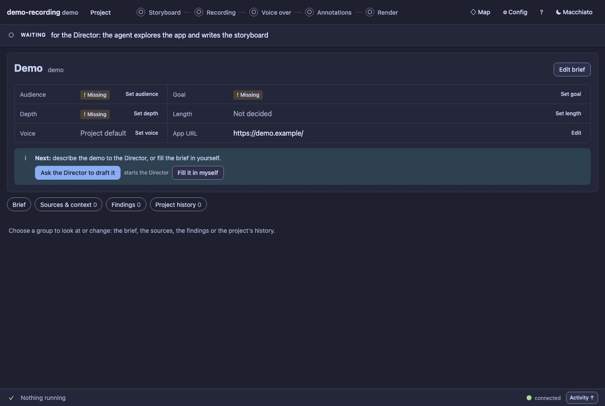

# Tutorial 101: your first demo, step by step

Two parts. **Part A** (about 15 minutes, free) walks through the control room on a ready-made sample project, so you know the panel
before you spend anything. **Part B** (an hour or two, a few model turns and some voice credits) makes a real demo of your own app.
Every step says what to **do**, what you will **see**, what happens **behind the scenes** and what to do **if it does not work**.

New to the words? [GUIDE.md](GUIDE.md#8-words-used-in-the-panel) has a glossary; [CONTROL_ROOM.md](CONTROL_ROOM.md) describes every screen.

---

## Part A: look around the sample project (free, nothing is recorded)

You need only the repository and Node. The sample is a throwaway project ("keycraft") built from files: no browser recording,
no model, no voice, no account. Your real projects and config are not touched. The commands are for **fish**.

### A0. Start the panel on the sample

```fish
cd ~/.dotfiles/dotSrc/app_coding_agents/.pi/development/extensions/codingfragments
env DEMO_REC_NO_OPEN=1 DEMO_REC_CONFIG=/tmp/tutorial-cfg.json node extensions/demo-recording/scripts/panel-seed.ts /tmp/tutorial --port 4760 --branching
```

**See:** `seeded project "keycraft" in /tmp/tutorial` and a line `panel: http://127.0.0.1:4760/?token=…`. Open that address in your browser.
**Behind the scenes:** it builds a project folder from files and starts the same panel the Director uses. The `env` prefix keeps the two
settings out of your shell. Stop it with Ctrl-C.
**If it does not work:** `Cannot find module` means you are not in the repository folder; `address already in use` means pick another `--port`.

### A1. Read the frame

**Do:** look at the top bar, the band under it and the strip at the bottom.
**See:** the stepper (Storyboard, Recording, Voice over, Annotations, Render) with an icon and a word on each, a band that says what
is next, and **Nothing running** at the bottom.


**Behind the scenes:** the stepper's state is read from the files (is the version on the production line approved and usable?). The band
only links; it never starts anything.

### A2. See a first run (optional)

**Do:** stop the panel, start it again with `--new` instead of `--branching`.
**See:** an empty project: every essential marked missing, a **Next** line, **Ask the Director to draft it** and **Fill it in myself**.



**Behind the scenes:** nothing is required to open a project; the missing parts are only orientation.

### A3. Review a storyboard

**Do:** open **Storyboard**. Click a scene. Press **Needs changes** on one scene and type a note. Do not send it.
**See:** the scenes on the left, the steps of the one you chose, a confidence badge on each, and the buttons to mark the scene.


**Behind the scenes:** a mark and a note are saved with the project, not sent. **Send review to agent** is the only thing that tells
the Director (and in a real project it starts a model turn).

### A4. Edit a narration and save a version

**Do:** open **Voice over**, choose the section `01-dash`, add a word to the narration and wait until the bar says *Draft saved*. Reload
the page. Then press **Save new version**.
**See:** after the reload your text is still there (a working draft). After **Save new version** the **Versions** button says `Versions · 3`.


**Behind the scenes:** the draft is a private file on the version you started from. Saving made exactly one new version, approved
nothing and told nobody. The picture under the narration is the take's keyframe at the anchor `[@m1]`.

### A5. Compare two narrations and choose

**Do:** open **Versions**, click **v2** (anywhere on its row), then press **Use for next steps**. Read the dialog. Press **Use for next
steps** in it.
**See:** a dialog with the production line now and after, and a list of what changes (the annotations and the render of the other
narration stay approved but leave the line). Then a toast with **Undo**.


**Do next:** press **Undo** in the toast.
**See:** the project is exactly as it was.
**Behind the scenes:** an action that moves the line is planned for free first and applied once, only if nothing changed meanwhile. Undo
restores the approvals, the line and the phase, once, and only while nothing else changed them.

### A6. Look at the whole project

**Do:** press **◇ Map**. Press **Fit**, then **Production line**, then **All paths**. Click a node. Press **Esc**.
**See:** every version in columns by stage; the delivered path in bold; the second narration and the second story as branches.


**Behind the scenes:** the map is read from the files and never writes. Try the wheel (zoom at the pointer) and dragging the background.

### A7. Annotations and the render

**Do:** open **Annotations**, switch one item off and on again; open **Render**, click **Final v1** (it was stopped by QA: a hard stop).
**See:** annotation items by scene (the previews are rendered when you ask, which needs Chromium and ffmpeg and takes a moment; the
picture below was made without them), and a final with a quality check that says why **Approve final** is disabled.


**Behind the scenes:** a final cannot be approved while it has a hard stop: a broken file (render again) or a redaction that leaks (fix it).
Everything else QA finds is a report: look at what **needs your eyes**, then decide.

### A8. Settings and the keyboard

**Do:** open **⚙ Config**, press `/`, type `voice`. Then press `?`.
**See:** the settings that match, each with its value and where it comes from, and the sheet of every keyboard shortcut.


That is the whole panel. Stop it with Ctrl-C; the sample lives in `/tmp/tutorial` and can be deleted.

---

## Part B: make a real demo

### B0. Check your machine

**Do:** in pi run `/demo doctor`.
**See:** a checklist (Node, Chromium, ffmpeg, uv, which API keys are *set*, the models). Nothing prints a key.
**If it does not work:** install what is marked missing (`npx playwright install chromium`, `brew install ffmpeg uv`), export
`ELEVENLABS_API_KEY` (and optionally `OPENAI_API_KEY`) **before** starting pi and restart it: a running pi does not see new variables.

### B1. Create the project and write the brief

**Do:** `/demo new my-demo https://my-app.example "My App"`.
**See:** the panel opens on the Project screen with the first-run summary; the Director starts the brief skill and asks about the
audience, the goal and the length.
**Do:** answer in a sentence or two, or press **Fill it in myself** and use the form. Save the facts.
**Behind the scenes:** `brief.md` is written as version 1; each save shows a diff and makes a new version. **Costs:** a model turn.
**If it does not work:** `/demo status` shows the active project; `/demo open my-demo` makes it active.

### B2. Discover and review the storyboard

**Do:** `/demo discover` (optionally with notes: `/demo discover focus on the search and the compare view`).
**See:** the Activity drawer shows the current screen, the budget used and the safety feed; then the **Storyboard** step gets a **new**
badge.
**Do:** open **Storyboard**, mark the scenes, add notes, press **Send review to agent**; repeat until it is right; then **Approve & use**.
**Behind the scenes:** the Director explores the real app in a browser; dangerous actions are blocked and everything is audited. Each
revision is a new storyboard version with a diff. **Costs:** model turns.
**If it does not work:** if discovery stops early, raise `budgets.discoveryScreens` or `discoveryMinutes` in Config for this project.

### B3. Record

**Do:** after you approve the storyboard the Director is told recording is unlocked. It asks to record: a bar says **The Director asks: Allow the Director
to record a new take of storyboard v1 …?** with **Allow** and **Deny** (or type `1` or `allow` in chat). Allow it. A cost dialog may
appear for improvised inputs when you press **Request a new take** yourself, and that click is the permission.
**See:** the strip shows a percentage and the current scene; the **Recording** step gets a take with a keyframe per scene.
**Do:** watch the take, then **Approve & use** it (or **Request a new take** with a note).
**Behind the scenes:** one continuous take with a virtual cursor, human typing and live inputs; a failed scene is resumed by replaying the
earlier ones off-camera. **Costs:** the improvise model.

### B4. Voice-over

**Do:** `/demo voiceover` (or let the Director continue after you approved the take).
**See:** the **Voice over** step with sections, the picture under each anchor, a confidence badge and a speech-versus-footage bar.
**Do:** read it, edit the words you would say differently, mark sections, **Save new version**, **Send review to agent**; then
**Approve & use**.
**Behind the scenes:** the narration is written from the analysis of the take and quotes real values; an anchor `[@m1]` pins a phrase to
an event. **Costs:** model turns.

### B5. Voice and edit

**Do:** press **Make the voice (uses credits)…**, read the dialog (cached versus billed characters, credits and money), confirm. If the
Director asks first (**The Director asks to synthesize voice-over v1 (…)**), that bar shows the same numbers: **Allow** is your confirmation.
**See:** progress in the strip; a draft render appears in **Render**.
**Behind the scenes:** the voice (ElevenLabs first, then OpenAI, then the local Kokoro), then the take is edited to the voice. **Costs:
the only step that spends voice credits.**
**If it does not work:** `demo_rec_tts check` (ask the Director) shows which engine and voice would be used; if the first engine fails the
next one is tried and the message says so.

### B6. Annotations

**Do:** open **Annotations**, switch items off that distract, check every privacy redaction, **Suggest again…** if the set is wrong, then
**Approve & use**.
**Behind the scenes:** the designer proposes about twice as many items as should be on and switches the best half on. **Costs:** one model call.

### B7. Final render and the check

**Do:** open **Render**, **New render…**, choose **Final**, **Render now**. When it is done read the **Quality check**: any hard stop must go
(render again or fix the redaction), then look at what **needs your eyes**, then **Approve final**.
**See:** the final with its variants, a player with **Full video / Scenes**, the check, and the decision bar.
**Behind the scenes:** the render and the check are one background job with no model; the check compares what is said with what is shown.
**If it does not work:** a finding says what and where (**▶ time** plays from just before it); **Re-run QA** after you install what it
needs.

### B8. Hand it over

**Do:** in **Render** open the **Download** menu: the video, the transcript, the callouts, the poster, a zip of everything of the variant or its
folder.
**See:** files named `<project>_final-vN_<variant>…` under `projects/<demo>/render/vN/<variant>/`.
**Done.** To try another narration, story or look without losing this one, see [BRANCHING.md](BRANCHING.md).
