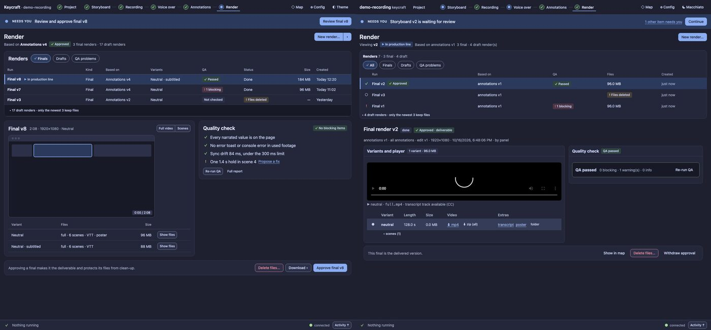

# UX10 report: the Versions selector and the Render screen

Slice UX10 of the [UX pass](../UX.md) (D126). It came from a side-by-side of the real Render screen with the
UX0 mock, after the user said the mock "felt better" and could not say why, and from a question about the
History control: why is only the version number a click target, and is "History" even the right word?

## Why the mock felt better

Measured against the screen before this slice:

1. **It read as a story.** Where am I, what exists, which one, is it good, what do I do. The real screen led with
   a New render form, which is the least common thing you do there.
2. **The runs were comparable.** The mock's table shows kind, base, QA, size and age in one glance; ours were
   narrow three-line cards with QA as a text fragment.
3. **The evidence sat next to the video.** The mock had the player and the Quality check side by side, with plain
   sentences. Ours had a one-line summary, and the player came last under a table.
4. **The decision was in one place.** A pinned bar with a sentence about the consequence. Ours had *Withdraw
   approval* and *Delete files* as bare text links in the middle.
5. **The header was quiet.** Ours said the same status three times.
6. **The work was about finals.** The mock folds the drafts into one line; ours interleaved 17 of them.

## What changed

### Versions (all stages)

- **Renamed.** The button says *Versions · N*. The list holds the versions of this stage, which is already our
  word everywhere (*Save new version*, *Approve & use v2*). *Lineage* is the Map's word; *Parent* would be wrong
  (a row's "based on" is the upstream input, not an earlier version of the same stage).
- **The whole row selects.** It is a stretched link: click anywhere on the row, including its empty end. The row
  shows the focus ring (not just the v-number). *Show in map* and *Use for next steps* stay their own buttons and
  their own tab stops, and sit above the stretched area, so clicking them does not select the row.
- **A row is at least the target size** (checked in a test).

### Render

| | before | now |
| --- | --- | --- |
| first thing on the screen | the New render form | the runs |
| New render | a form card above the list | *New render…* in the header; the form opens on request (open by default only with no renders) |
| the Versions/History button | present, duplicating the list | gone on Render; the runs list is the version list |
| runs | narrow cards, drafts and finals mixed | a table: Run, Based on, QA, Files, Created; delivered final first, other finals, **drafts folded under one line**; chips All / Finals / Drafts / **QA problems**. At narrow widths Files and Created drop |
| detail | summary, QA, then variants and player | player and Quality check **side by side** (stacked when narrow) |
| QA | one summary line, details collapsed | findings first, then the checks that found nothing as ✓ lines in plain words |
| decision | text links in the middle | a bar pinned at the bottom: a sentence about the consequence, *Show in map*, *Delete files…*, *Approve final* / *Withdraw approval* |
| blocked approval | the reason once per button, and a third time | said once |
| header | "Viewing v2" plus four badges | "Viewing v2" plus the one that matters |

### Decisions on the mock's ideas

- **Drafts folded, not filtered.** A Finals-by-default filter would make a draft you just started disappear,
  breaking "a new result never moves you". The mock's own answer is the collapsed "17 draft renders" line; that is
  what was built.
- **Not built: opening on the run that needs a decision.** It fights approved-first and the rule above; the band
  already has *Review final v8*.
- **Corrected: the consequence sentence.** The mock said approving "protects its files from clean-up". Finals are
  never pruned (see RENDER.md), so that is not what approving does. The line now says what is true: approving makes
  the final the delivered version, shown first and on the production line.
- **The checklist only says what was checked.** A ✓ line appears only when a QA report exists for the run and that
  check found nothing. A check that could not run (no Whisper) stays a finding, not a ✓.

### Still different from the mock

- No *Kind*, *Variants* or *Status* columns (the badges and the detail carry them).
- ~~No Download ▾ in the bar~~ and ~~no Full video / Scenes switch~~: both were built afterwards in [UX15](UX15.md).
- *New render…* is one button, not a split button; *Change…* lives inside the form as before.
- The mock's QA card shows warnings with an inline *Propose a fix*; ours keeps the existing item rows (with the
  fix selection, *Confirm & export anyway* and the time link).

## Evidence

- `test/ux10-panel.test.ts` (3 tests): the label; a click on the row's text, and on its empty end, selects;
  *Show in map* opens the map, not the version; keyboard order (row, then its own button); the ring on the whole
  row; row height; Render has no Versions button; New render closed until asked; one status in the header; table
  columns; drafts folded and opened; the bar inside the window with its sentence; one reason for two blocked
  buttons; the checklist with four ✓ lines for one failed check; player and QA side by side at 1400 px and
  stacked at 800 px.
- `test/ux7-render-panel.test.ts` and `test/ux9c-scenarios.test.ts` were updated for the moved structure, not
  weakened: the QA section is found by its title (not "first"); the inspector order is now player, then QA (a
  change from D123, which put QA first); the narrow case no longer folds into a select, because the table keeps
  working.
- Audit: serious axe nodes 0, tab stops without a focus indicator 0, ratchet at zero. The small-target count
  is unchanged (48) and is a known follow-up from UX9c.
- Screenshots: `docs/images/ux/render/` (approved, blocked, change, drafts open, and the side-by-side above).

## A bug found while documenting it

The branching documentation screenshots showed that the **dialog's fact list** ("Production line now … After …")
was broken: the label and the value ran together. Cause: UX8 reused the class name `.ds-facts` for the Project
summary, which silently replaced the dialog's own `.ds-facts` rule. The Project summary's list is now
`.ds-factlist`. Every dialog with a fact list (the cost dialogs and the line-change dialog) is affected by the fix,
and the new screenshots in `docs/images/branching/` show it fixed.
