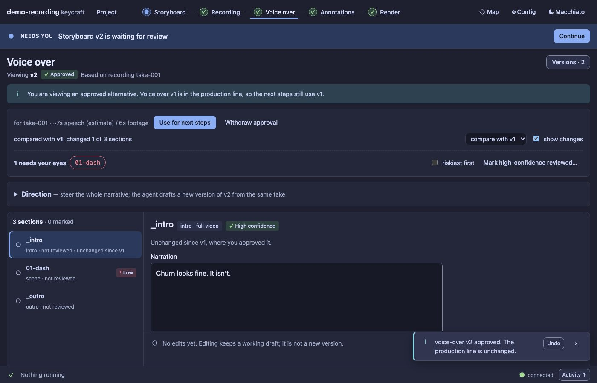

# UX11 report: Undo after an action

Slice UX11 of the [UX pass](../UX.md) (D127). It closes the biggest gap the [UX9c review](UX9c.md) found: no screen
could score 3 on *recovery*, because nothing could be reversed in one click.

## What it does

The confirmation toast of **Approve & use**, **Approve only**, **Use for next steps** and **Withdraw approval**
now has an **Undo** button.

- **Exact.** Undo restores the approvals, the production line and the phase from just before the action. A
  withdrawn approval comes back with its original time, not as a new approval.
- **Safe.** The server keeps, per action, the state before and a fingerprint of the approvals and the line right
  after. Undo runs only while that fingerprint still matches, so it can never undo over a later change made in
  another tab or by the Director. Otherwise it is refused with the reason and nothing is written: "The approvals
  or the production line changed since, so Undo is no longer safe. Use Withdraw approval or Use for next steps
  instead."
- **Once, and not forever.** An entry is used up by one Undo and expires after two minutes (in memory only). The
  toast lasts about 12 seconds and does not disappear while the pointer or the keyboard focus is on it (WCAG 2.2.1).
- **The Director is told in a note, never a new turn:** "The user UNDID their last action …: approving and using
  storyboard v2. The approvals and the production line are back to … Disregard that action; if you started work
  because of it, stop and continue from this line." Approve & use starts a turn when it is pressed, so the note
  is how the agent learns it was reverted.
- **The log keeps both** the action and the undo (`undone` in `state.json`'s history, and a `line.changed` event
  that says what was undone).
- **Delete files has no Undo.** The files are removed for good; its two dialogs stay the safeguard. A trash folder
  was considered and rejected: it changes retention and disk use.

## Evidence

`test/ux11-undo.test.ts` (7 tests): every approve / use / withdraw returns a one-time Undo; Approve only is
restored exactly (approvals, line and phase) with a note and no turn; Approve & use is restored and the turn it
started is answered by a note; Use restores the line and Withdraw restores the approval with its original time;
Undo is refused when something else changed, only works once, rejects unknown ids and expired ones, and a
refused Undo writes nothing; Delete files and a refused action offer no Undo; and in the real panel the toast
offers Undo, the screen follows, and after another change Undo says why it is refused. The new route is classified
`none` in the cost table, which a test enforces.

## Left out

- No Undo for the draft actions (Save new version, Discard draft): they have their own recovery (a version is never
  changed; a discard names what is lost first).
- No keyboard shortcut (for example Cmd/Ctrl+Z). The toast is reachable by Tab; a shortcut would need a rule for
  when it applies, which the toast's short life makes unclear.
- Undo is not persisted across a restart of the panel server.
