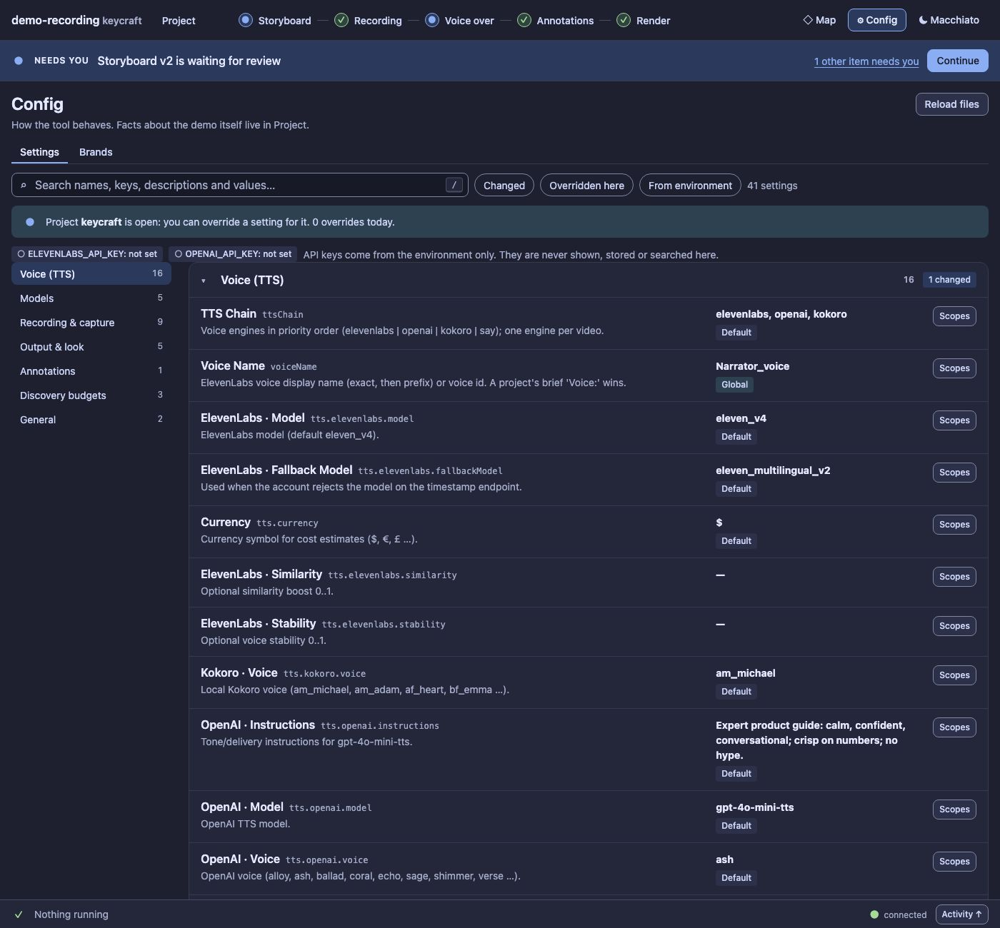

# UX12 report: Config opens light

Slice UX12 (leftovers grill, UX9c follow-up). The UX9c review found Config the one screen that got heavier in the UX
pass: 79 controls when it opened and a page 4,069 px tall (6,161 px at 900 px).

## What changed

- **Only the first group is open** when Config opens. The others are one click on their header (or on the group
  navigator, which opens what it jumps to).
- **A search still opens what matches**, and clearing it goes back to the light view.
- **Each group header says how many settings it holds and how many of them are changed** (differ from the default),
  so a closed group is not a black box: "Voice (TTS) 16 · 1 changed".
- Nothing was removed. Every setting, Scopes, search and filter works as before.

## Numbers

| | before | now |
| --- | --- | --- |
| controls when Config opens (own, at 1500 px) | 66 | 41 |
| page height at 1500 px | 4,069 px | 2,142 px |
| page height at 900 px | 6,161 px | 3,000 px |

The first group (Voice, 16 settings) is still the longest, so the page is halved rather than short. Ordering the
groups by how often they are touched is a possible later change; it was not part of this slice.

## Evidence

`test/ux9a-config-panel.test.ts` now asserts that one group is open and the others closed, that clearing the search
returns to that view, and opens every group where a test needs to read all settings. `s5-config-ui` opens the group
of the setting it edits. The audit baseline was refreshed (serious axe nodes 0).
