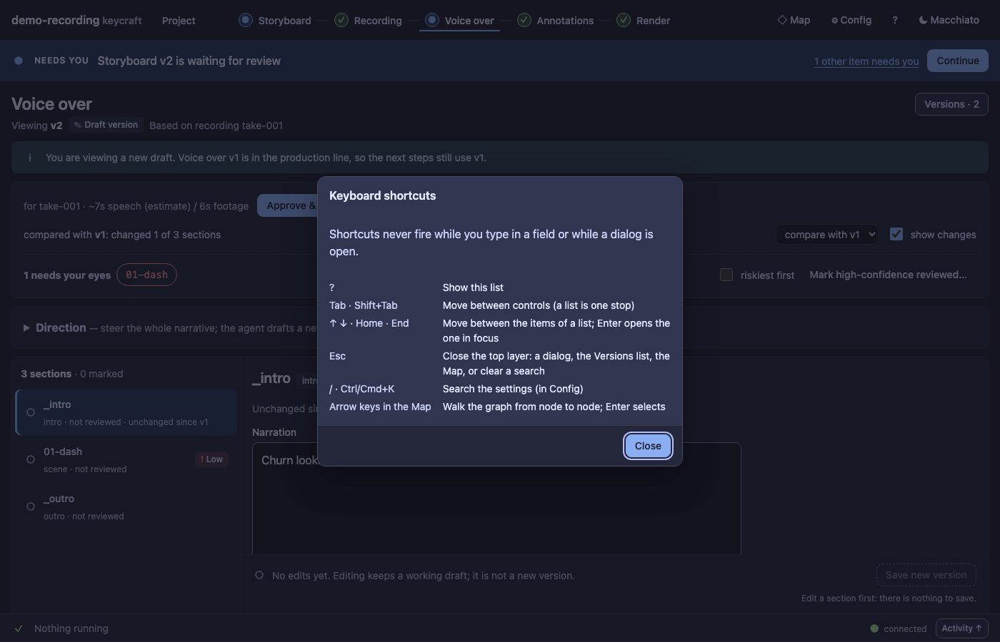

# UX14 report: arrow keys in lists and a shortcut sheet

Slice UX14 (leftovers grill, UX9c follow-up). The review gave *efficiency* a 2 on the stage screens: a list was walked
by Tab only and there was nowhere to learn what keys exist.

## What changed

- **A list is one tab stop.** Every list (sections, scenes, annotation items, render runs) has its current item (or
  the first) in the tab order; the others are reached by arrows.
- **↑ ↓ Home End move the focus** between the items; **Enter** opens the one in focus. Moving focus never selects:
  selecting changes the address and loads the item (a render, a preview), so it stays a deliberate Enter or click.
  The Versions list takes the arrow keys too (Escape still closes it).
- **`?` opens a sheet of the shortcuts that exist**, and so does the new **?** button in the header (it is a control,
  so every screen has one more). The sheet reads from one list, `shortcuts.js`, which a test checks against the
  places that handle those keys.
- **It stays out of the way:** nothing fires while you type in a field, while a dialog is open, or with Ctrl, Cmd or
  Alt held. The sheet has one Close button; Escape closes it and focus returns to what opened it.

## Evidence

`test/ux14-keyboard.test.ts` (4 tests): one tab stop per list; ↑ ↓ Home End move focus and stop at the ends without
changing the address; Enter opens; Tab leaves the list; the Versions list takes arrows and Escape; `?` is typing in a
field and opens the sheet otherwise, lists every shortcut with what it does, is ignored over an open sheet, and the
header button opens it and gets focus back; and the shortcuts the sheet promises exist in `config.js`, `map.js` and
`keys.js`. The audit is unchanged (0 serious axe nodes, 0 small targets, 0 tab stops without a focus indicator).

## Left out

- No shortcut per action (go to Voice, approve, undo): each would be a new thing to learn and to keep true, and
  Approve and Undo are consequential enough to want a deliberate click.
- Selection does not follow focus (see above).
