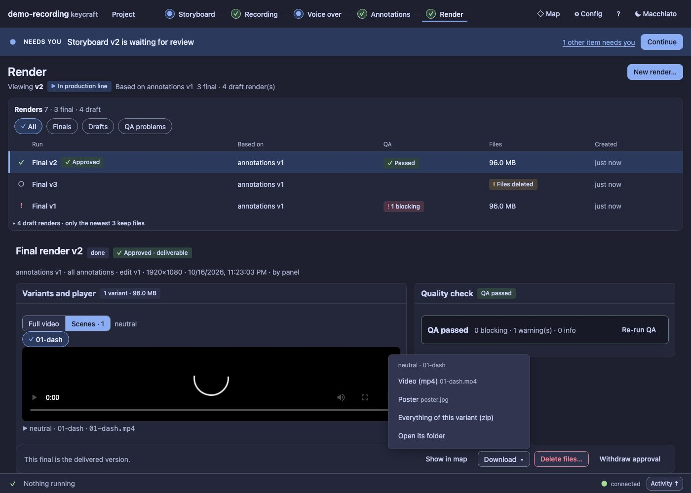

# UX15 report: Render finish

Slice UX15 (leftovers grill). The [UX10 report](UX10.md) listed what the Render screen still lacked compared with the
UX0 mock; two of those are built here.

## What changed

- **A Full video / Scenes switch above the player.** Full video plays the variant's main file; Scenes plays one scene at a
  time, with one chip per scene. The disclosure rows ("scenes (N)") in the variants table are gone, because the
  switch does the same thing next to the picture. A variant without per-scene videos has *Scenes* disabled, with the reason.
- **A Download menu in the decision bar** that follows what is playing: the video file, its transcript, the callouts
  and the poster, *everything of this variant (zip)* (built on the first request, then cached) and *open its
  folder*. It opens upward from the bar and closes with Escape. A run without files has no Download.
- The table's own download links and zip button stay (they are per variant; the menu is per what you watch).

## Not built

- **Kind and Status columns** in the runs table. The badges (Approved, In production line, QA, Files deleted) and the
  detail already carry them, and two more columns would drop out at narrow widths anyway.

## Evidence

`test/ux15-render-finish.test.ts`: the switch (full by default, scenes one click away, chips, the table has no
disclosure rows), the menu (opens upward, lists what is playing, follows the switch, Escape closes it, zip and folder
go through the same routes as the table's buttons) and a run without files has no Download. The Render tests of UX7
and UX10 pass unchanged.
