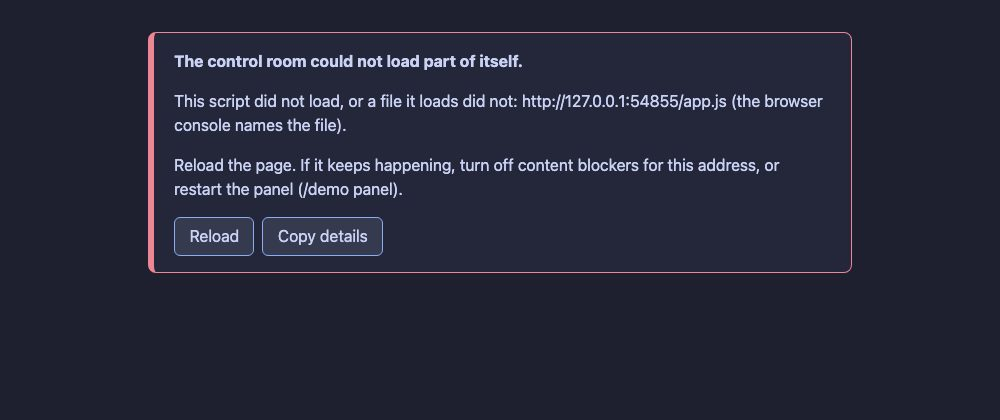

# UX16 report: a visible notice when the panel cannot load

Slice UX16 (leftovers grill). If a panel file failed to load (a content blocker on `localhost`, a bad cache, a broken
file) the page stayed blank or half-built and said nothing; the only clue was the browser console.

## What changed

A small guard script is the first thing in `index.html`. It watches for:

- a stylesheet or script that failed to load,
- a script that throws while the panel is starting,
- a panel that has not started after ten seconds (`app.js` sets `window.__panelUp` when it has).

and shows one notice, announced as an alert:

- **What happened**, in plain words and with the file. For the entry script the browser reports only `app.js`, not the
  module under it that failed, so the notice says "this script did not load, or a file it loads did not" and points to
  the console for the exact one.
- **What to try:** reload; turn off content blockers for this address; restart the panel (`/demo panel`).
- **Reload** and **Copy details** (the message, the file and the browser) buttons.
- **It does not depend on the stylesheet.** It uses inline styles on purpose, because the stylesheet may be exactly
  what failed. This is the one place in the panel where colours are not tokens.
- A normal start shows nothing.

## Evidence

`test/ux16-load-notice.test.ts`: a normal start has no notice and `__panelUp` is true; a blocked script shows the
notice with the failing script, the content-blocker advice, a Reload button and an alert role; a blocked stylesheet
still shows it; a broken script (a syntax error) is said too.

## Not built

- Naming the exact module of a failed import graph (the browser does not report it).
- A notice for a failure after the panel is up and running; those are shown as the existing error toasts.
