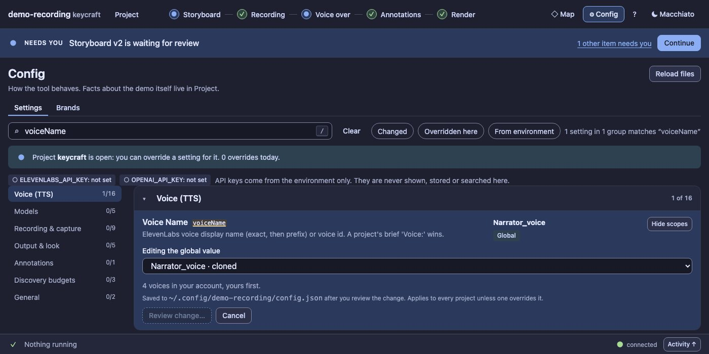

# UX17 report: a voice picker

Slice UX17 (leftovers grill). `voiceName` was a free-text field, and the brief's Voice could only be set by editing
`brief.md`; a typo was found when synthesis failed.

## What changed

- **A select of the account's voices** in Config → `voiceName` and in a new **Voice** field in the Project facts form
  (the "Set voice" link of the Project summary used to point at a field that did not exist). Yours first, then the
  library; a current value that is not in the account stays selectable and says so; *Type a name or voice id…* is
  the way out.
- **A text fallback** when there is no list: the field it always was, with the reason ("ELEVENLABS_API_KEY is not set",
  a key that may not read voices, or no network) and a *Try again* button.
- **`GET /api/voices`**: read-only and free (no credits), cached for five minutes (`?refresh=1` asks again). It returns
  `{ available, voices: [{ id, name, category, own }] }` or `{ available: false, reason }`, so a failure is data and
  the picker degrades instead of breaking.

## The key

The key stays in the environment and on the server. It is not in the reply, the cache (a digest, only to know a cache
belongs to this key) or any message (a message that mentions it is cleaned). **`DEMO_REC_NO_VOICE_LIST`** makes the
route report "not set" whatever the environment holds; `seedPanelProject` sets it, so tests, the screenshot scripts and
the audit never list a real account (a committed screenshot must not show someone's cloned voice names).
`scripts/panel-seed.ts` removes it, so trying the panel by hand uses your own key.

## Evidence

`test/ux17-voice-picker.test.ts` (4): the list shaped for a picker, yours first, cached, refreshed and expired; no key,
a refused key and a network failure as data, with the key never in a reply or a message; a seeded panel never lists a
real account even when a key is in the environment; and in the browser: Config and the brief show the select (groups
Yours and Library, a value outside the account kept and said), a pick is saved through the same diff as before (global
file and `brief.md` change), *Type a name* gives the text field, and with no list the field falls back with its reason.

## Left out

- A preview of the voice (playing a sample). The list does not carry one for every voice and a sample costs nothing but is
  a different feature.
