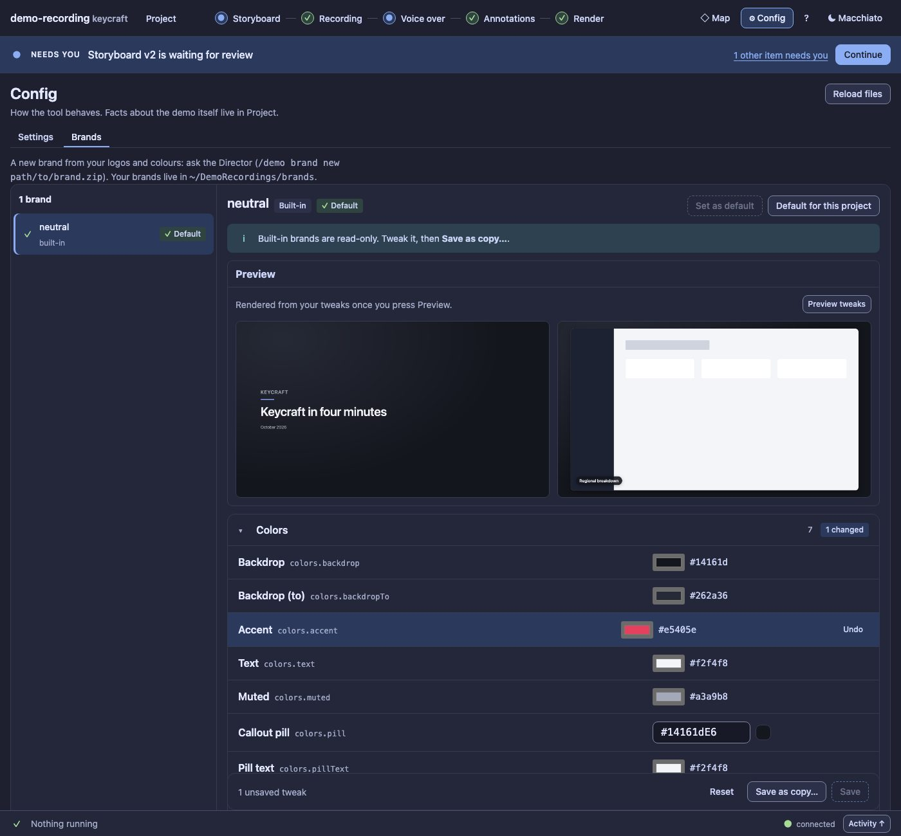

# UX18 report: the Brand editor on the Config pattern

Slice UX18 (leftovers grill). The [UX9a report](UX9a.md) left the Brands tab with its old look (it worked, the user
accepted it for then); the [UX9c review](UX9c.md) scored it lowest (19 of 30, consistency 1) because nothing about it
matched the rest of the panel.

## What changed

- **A list of brands and one inspector**, like the stages. The list marks the default, the built-in and the invalid
  brands. Below the narrow threshold the list is a select.
- **The inspector:** the brand's name with its badges and the two default actions; a notice for a built-in ("read-only:
  tweak it, then Save as copy") or an invalid brand; a **Preview** section (title card and a framed sample frame);
  the fields in groups that open and close; and a **pinned bar** with the unsaved count, Reset, Save as copy… and Save.
- **Each field is a row** with its label, its dotted path and one control: a colour, a hex value with a swatch, a switch,
  a select, or a slider with its value. A changed field is marked, its group counts it ("1 changed"), and a per-row
  **Undo** takes just that one back.
- **Same routes, same confirmations:** a diff before Save and before setting a default; Save as copy keeps the tweaks
  and selects the copy. Messages are toasts instead of a line in the page.
- **Brands is in the audit** now (four more pages: both themes at both widths): 0 serious axe nodes, 0 small targets,
  focus visible everywhere.

## Numbers

| | before | now |
| --- | --- | --- |
| controls when Brands opens (own, at 1500 px) | 28 | 33 (the list and the per-group controls are visible together) |
| legacy markup (`brand-*` classes, bare buttons and inputs) | all of it | none |

The count went up a little because the brand list, the two default buttons and the action bar are all visible at once
instead of one select and a card; each is a single, labelled control.

## Evidence

`test/ux18-brand-editor.test.ts`: the list with the default and built-in marks; the groups and a row per field; Save
and Set as default disabled where they cannot apply; a tweak marks the row, the group and the bar, and Undo clears it;
a group closes and opens; Save as copy keeps the tweaks (the file on disk has the new colour) and selects the copy;
setting it as the default goes through the diff and writes the global config; and the narrow select. The control-room
test's Brands step follows the new structure. The audit baseline was refreshed (56 to 60 pages).

## Not changed

- What a brand contains, and how a new one is made (ask the Director with `/demo brand new`): see BRANDS.md.
- The scores in the UX9c review are not re-scored here: they were the author's, and this slice was checked by the audit
  and by comparing screenshots, not by a person.
