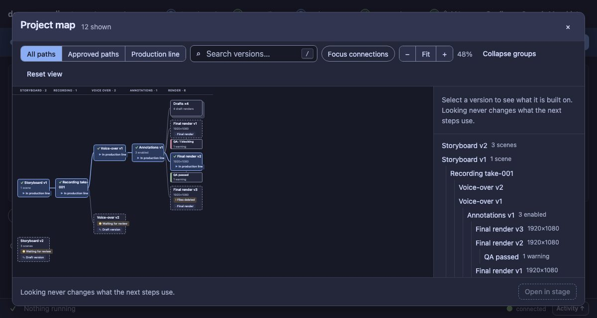
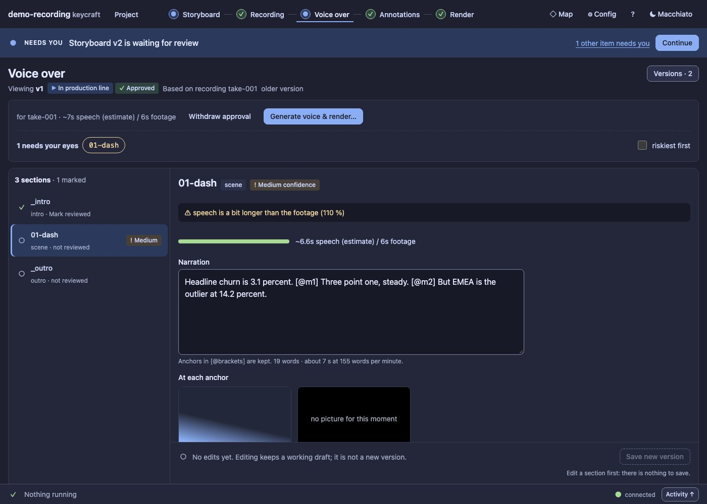

# UX19 report: map zoom and the picture at each anchor

Slice UX19 (leftovers grill): the two niceties that were on the "never built" list since the first map.

## 1. Map zoom and Fit (D132)

The map's toolbar has **−**, **Fit** and **+**, with the level shown beside them.

- **Fit** picks the zoom at which the whole graph is in the window (never above 100 %, never below 30 %). The
  picture shows a 1200 x 640 window at 48 %.
- **Keys:** `+` `−` `0` (zoom in, zoom out, fit) when you are not typing in a field; **Ctrl + wheel** (a trackpad pinch)
  zooms, a plain wheel still scrolls. All of it is in the `?` sheet.
- **Reset view** goes back to 100 %. Zoom is a view setting: not in the address, and it never changes which versions are shown.
- The scaled graph is laid out by the browser (CSS `zoom`), so scrolling, the sticky stage headers and clicking a node
  still work when zoomed (a test clicks a node at the Fit level).
- **Not built:** dragging to pan and a minimap. The graph scrolls inside the overlay and Fit shows all of it.

## 2. The picture at each anchor in the Voice inspector (D133)

Under the narration of a section, one card per `[@mark]` it speaks: the keyframe the take's analysis took at that mark,
the time into the take, and a line of what the page said then.

- In spoken order, once each. A section without anchors (an intro, an outro) shows nothing.
- Where the analysis has no keyframe for a mark the card says "no picture for this moment" and still shows the page text.
- The server only offers files inside the project. It renders nothing itself: the keyframes are the ones the take's
  analysis already wrote.

## Evidence

`test/ux19-map-zoom.test.ts`: Fit puts the whole graph in a short window; the buttons and the keys zoom and stop at 30 %
and 160 %; typing `0+-` in the search does not zoom; a plain wheel does not zoom and Ctrl + wheel does; Reset view returns to 100 %;
the address never changes; a node can still be selected when zoomed. `test/ux19-anchors.test.ts` (3): anchors in spoken
order with the keyframe path and page text; none for a section without a scene or anchors, an unknown take, mark or a
picture outside the project; and the Voice inspector shows the picture, the "no picture" card, and nothing for `_intro`.
`test/ux14-keyboard.test.ts` checks the sheet's new line against `map.js`.
