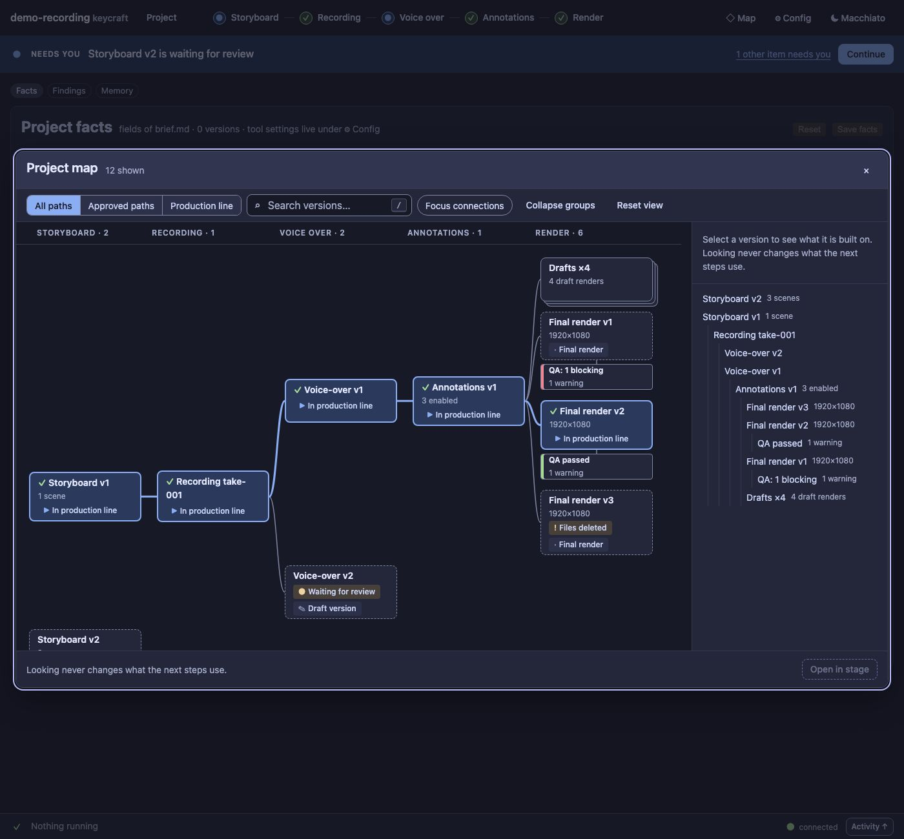
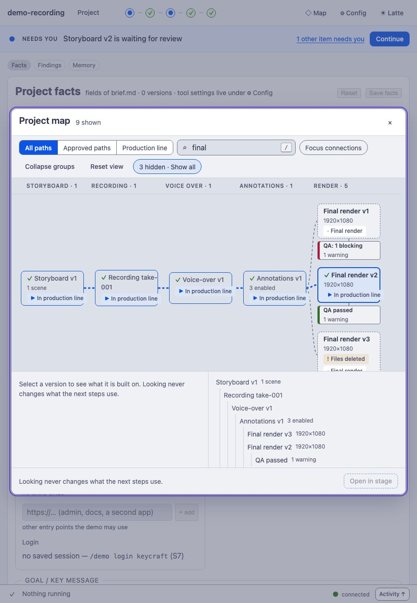
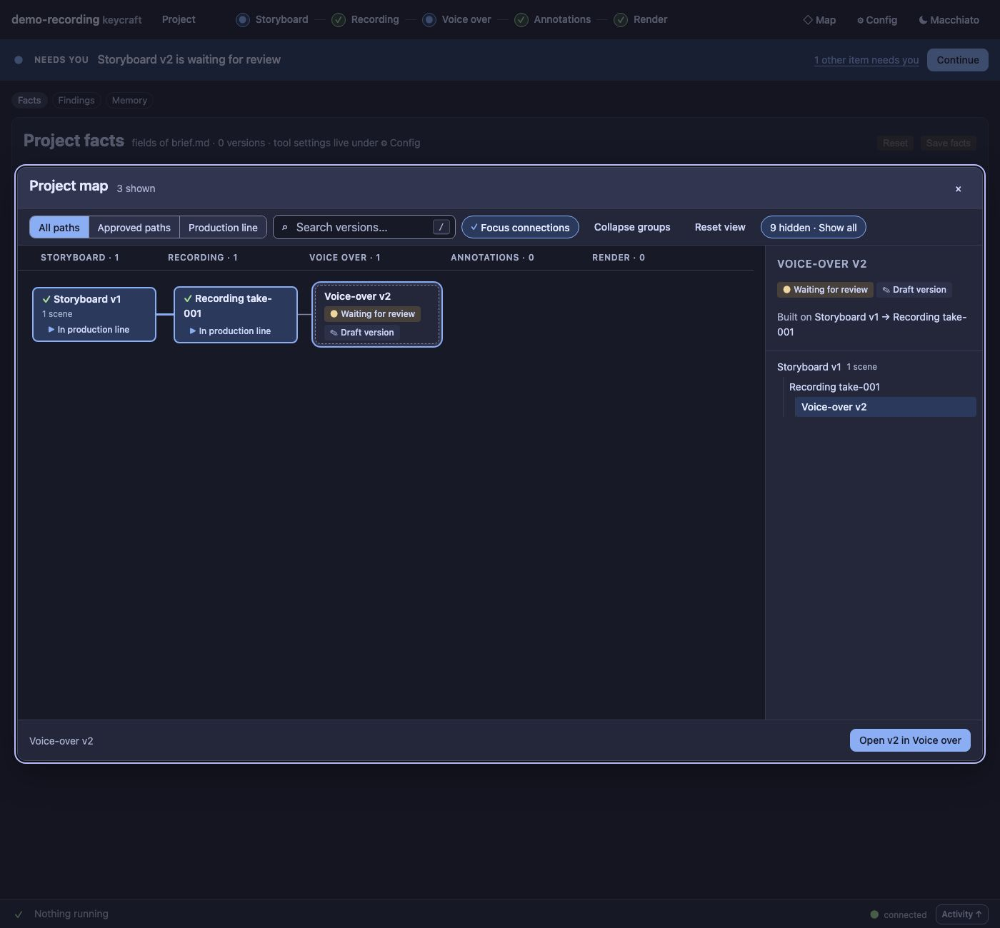
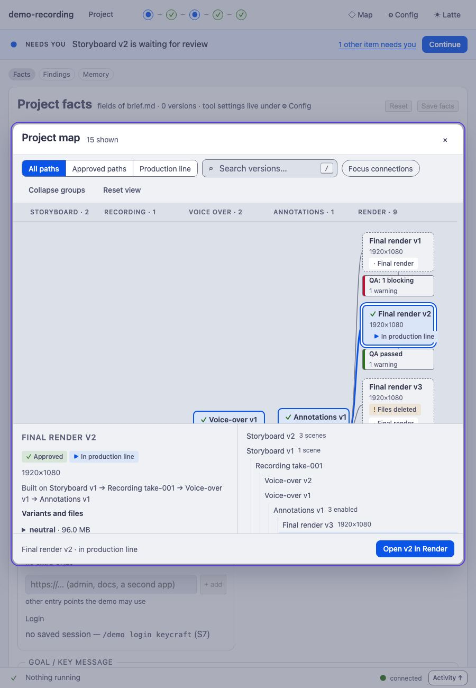
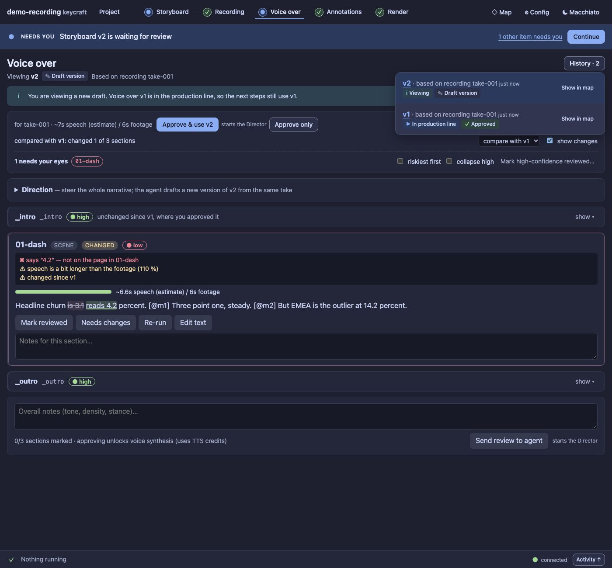

# UX4 report: the project map

Slice UX4 of the [UX pass](../UX.md) (D100, D112, D119, D120). Engine half: `GET /api/graph` (UX4a, #60).
Panel half (this report, UX4b): the project map as an overlay on whichever screen you are on.

## What it does

- **Every version of every stage as one connected graph**, a column per stage, branches top to bottom.
  A parent is centred on its children; a final's QA node sits directly under it. Only *recorded* links
  are drawn. A version whose parent was never recorded gets a *Link unknown* badge and a short stub, not
  a guessed edge. A draft made before annotations existed links straight to the voice-over it recorded.
- **Draft renders fold into one stacked node per dependency** (*Drafts ×4*). Click it to open the group in
  place (up to eight members, then *+ N more*), *Collapse groups* folds them back.
- **Status is an icon and a word, never colour alone**, and the four statuses stay separate: ✓ approved,
  ▶ In production line, ! Blocked by dependency, ● Waiting for review, ✎ Draft, plus *Files deleted /
  pruned*. A QA node shows its verdict and counts.
- **Three paths:** *All paths*, *Approved paths* (approved and usable all the way down), *Production
  line*. **Search** takes every word in any order and understands status words (*waiting for review*,
  *blocked*, *final*, *draft*). Matches are prominent, what they depend on stays as **dim context**,
  the rest is hidden and counted (*3 hidden · Show all*). A group never hides a match: a matching draft
  opens its group and shows only the matching members.
- **Focus connections** keeps the selected version, everything it is built on and everything built on it.
- **Selection details:** what it is built on (a chain, with the unapproved link named), its badges, for a
  render the variants and their files, for a QA node the counts. *Open v2 in Render* goes to the exact
  version (`#/render/v2`); Back returns to the map.
- **A synced outline** of exactly the shown nodes, as a nested list by dependency: the accessible twin of
  the drawing. The drawing is a single scrollable region; every node is a button with a full spoken
  label.
- **Keyboard:** ← a dependency, → a dependent (the topmost; a final goes on to its QA node), ↑ ↓ the
  neighbour in the column, `/` the search, Esc clears the search, then closes the map. Tab stays inside
  the dialog; the page behind is inert; focus returns to the opener.

## Entry points (D119)

The header **◇ Map** button, **Show in map** on every History row, and on the **blocked next-action band**
(when the blocked step is a version, it names that version). Not on every card.

## The map is part of the address

`#/map?view=approved&q=final&sel=vo:3&focus=1&open=drafts:render:annotations:1`. Defaults are left out.
Filters replace the history entry, so **Back closes the map** instead of stepping through them; a reload
brings the same map back; *Open in …* pushes, so Back returns to the map. Opening the map from the header
restores the view you left (per project). The screen underneath stays your current screen and the one
remembered as your last place.

## Looking never changes anything

Selecting, searching, filtering, focusing and opening groups write nothing (a test compares `state.json`
before and after). When the project changes while the map is open (a new render, a new approval), the map
**does not move**: a *The project changed · Refresh the map* chip appears and one click redraws. A
selection that the view or search hides is said, with the reason and *Show it*; an unknown one is
explained.

## How it is built

- `src/panel/public/graph-model.js` is **pure** (no DOM, no imports; typed by `graph-model.d.ts`):
  route state, `indexGraph`, `visibleNodes` (view, search, focus, groups), `layoutMap`, `outlineOf`,
  `neighbour`, `detailsOf`, `hiddenSelection`. Tested in Node on the seeded project and on a generated
  324-node project (model plus layout in a few milliseconds).
- `src/panel/public/map.js` draws it with Preact and **its own SVG**: no graph library. Nodes are
  absolutely positioned buttons over an SVG of curves. Nodes that draw taller than the default (wrapped
  badges or titles) are measured after the first draw and laid out again; heights only grow, so it settles
  in one extra pass.
- `src/panel/public/ds/map.css` is the one stylesheet for both the panel and the UX0 prototype pages.
  Narrow containers put the details and outline *under* the graph instead of hiding them.
- The route screen `map` is an overlay (`route.js`); `App` keeps the screen under it.

## Guards

| Guard | What it checks |
| --- | --- |
| `test/ux4-map-model.test.ts` (12) | route state round trip and defaults, views, search and dim context, a group never hides a match, focus, group cap and *+ N more*, layout (columns, centring, QA under its final, unknown stub, direct edge, no overlap), keyboard, outline, hidden selection, 324-node performance |
| `test/ux4-map-panel.test.ts` (6) | entry points and closing (Map button, History row, blocked band, Esc, Back, reload), views/search/focus/groups against the real page and `state.json` untouched, keyboard and *Open in stage*, layering with a dialog and the *changed* chip, remembered view, no overlap and no clipped content at 1400, 900 and 700 px |
| `scripts/panel-audit.ts` | two new pages (`map`, `map-focus`) in both themes and widths: **0 serious axe findings, 0 tab stops without a focus indicator** |
| `scripts/ux-ratchet.ts` | unchanged: the map adds no colour, font-size or radius literals |

## Screenshots

| | |
| --- | --- |
|  |  |
| Search "final" at 900 px, Latte: matches, dim context, details under the graph | Focus connections on a draft voice-over |
|  |  |
| A draft group opened in place, a final selected | *Show in map* on every History row |

Regenerate: `node extensions/demo-recording/scripts/panel-shots.ts --out /tmp/p --map`.

## Left for later

- Pan and zoom controls (the region scrolls; fit-to-width is the column width).
- Dragging, minimap, and a path picker between two chosen versions.
- Showing media files as nodes (they are listed in the selected render's details).
