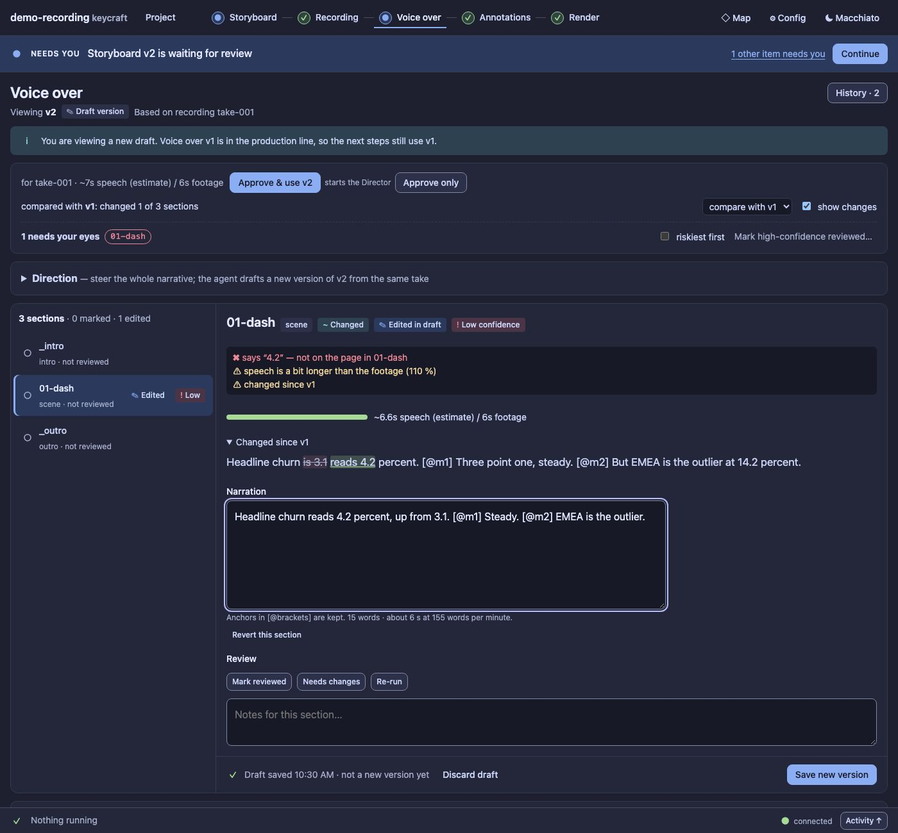
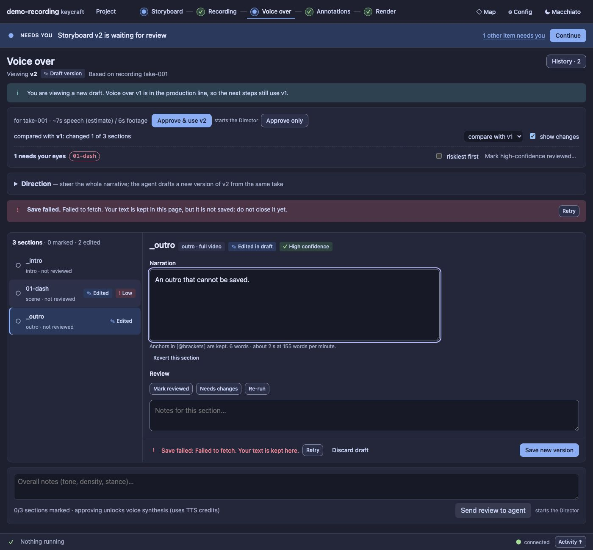
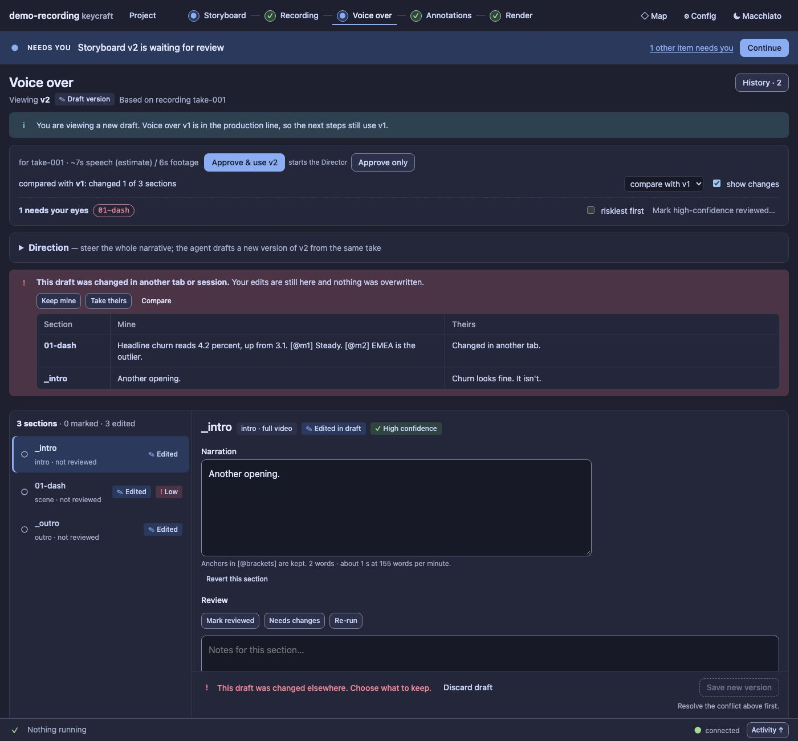
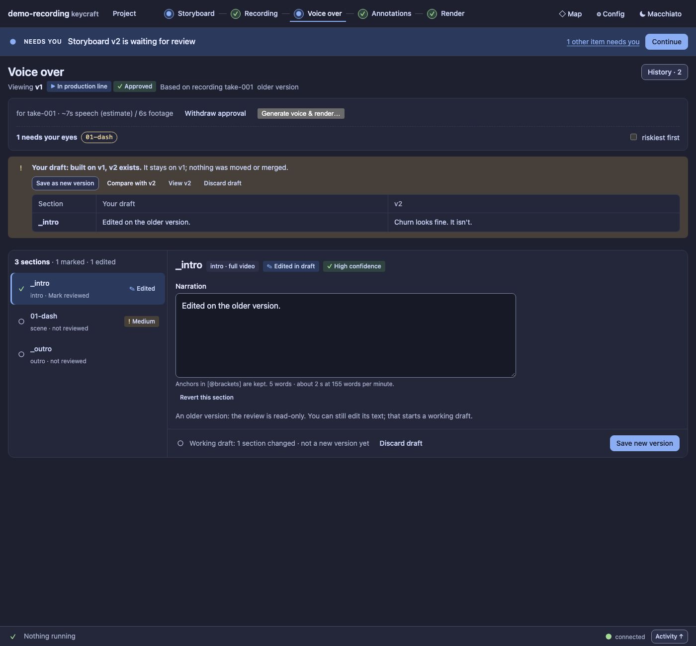
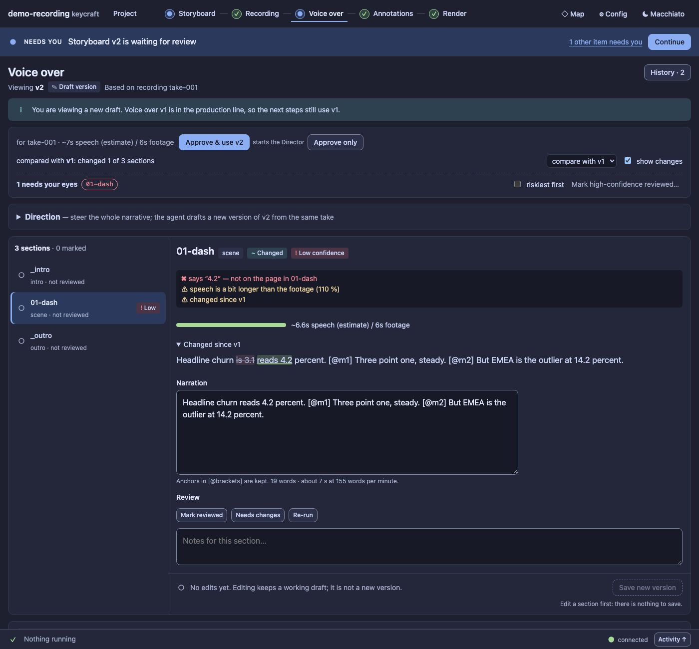

# UX5b report: Voice over as list + inspector, with working drafts

Panel half of slice UX5 of the [UX pass](../UX.md) (D100, D115, D121), on the engine of
[UX5a](UX5a.md). The Storyboard screen keeps its cards for now and moves to list + inspector in UX5c.

## What changed

- **A section list and one inspector.** Each section is a row: review status (icon and word), kind,
  *Edited* and confidence badges. The inspector shows the selected section: confidence reasons, footage
  timing, what changed since the compared version, the **narration** (a textarea, always editable), issues,
  the audio, and the review buttons and note. The selection is in the address (`#/voice?section=01-dash`):
  a reload keeps it, and Back leaves the screen instead of stepping through sections. Below 52 rem the
  list folds into a *Section* select. "N need your eyes" chips select the section.
- **Editing keeps a working draft.** Typing autosaves after a short pause (**Saving… / Draft saved 12:41 ·
  not a new version yet / Save failed**). No version per edit; the old *Save as new version* per section is
  gone. **Save new version** (sticky bar, always visible) flushes what is pending and creates exactly one
  version, then shows it. With nothing edited it is disabled and says why. *Revert this section* and
  *Discard draft* (which names what it drops and can be cancelled) undo edits.
- **A failed save never loses text.** The text stays in the page, the bar and a notice say *Save failed:
  … Your text is kept here*, with **Retry**. The page warns before it is closed with unsaved text; it does
  not claim to recover after a reload (a draft that did save comes back from the project).
- **A conflict is a choice.** If another tab changed the draft, nothing is overwritten: *This draft was
  changed in another tab or session. Your edits are still here*, with **Keep mine**, **Take theirs** and
  **Compare** (mine against theirs, section by section). Another tab's save is adopted automatically while
  nothing of yours is at stake.
- **A draft whose base moved is flagged, never moved** (D121): *Your draft: built on v1, v2 exists; v1 was
  approved since you started this draft. It stays on v1; nothing was moved or merged.* with **Save as new
  version**, **Compare with v2**, **View v2** and **Discard draft**.
- **Review, editing and approval are three separate acts.** Marking a section never touches the draft,
  editing never marks it reviewed, and neither approves anything; approval stays in the stage summary.
  Nothing in this screen tells the Director anything until you press *Send review to agent* or *Approve & use*.

## Also in this slice

- `core.js`: every route hook follows a *replace* (it fires an event), so the section in the address and the
  remembered last place stay in step.
- The activity log and `/api/state` ignore `draft.changed`, so autosaves are not news and do not refetch.
- `NeedsEyes` takes an `onJump` (used here); the Storyboard still scrolls to a card.
- `ds/components.css`: `.ds-split` clips instead of hiding overflow (so the action bar can stick to the
  window), the action bar sits above the activity strip, `.ds-inspector`, `.ds-compare`.
- `useApi` ignores a reply that is for a path no longer asked for, or older than the latest request. Found
  by the tests: after *Save new version* a late refetch of the old version overwrote the new one.
- `app.js` loses its Voice code (it lives in `voice.js` now), and `drafts.js` holds the draft hook.

## Guards

`test/ux5-voice-panel.test.ts` (7): list and inspector with the selection in the address and the narrow
select; autosave states, no version, reload restoring the draft, revert, and exactly one version from Save
new version with no Director turn or note; a failed save and Retry; a conflict with compare, keep mine and
take theirs; another tab's save adopted; a moved base with compare, a cancelled and a confirmed discard,
and Save as new version; review and editing kept apart and the old `vo-edit` route not used.

Audit and ratchet: the Voice page has **0 serious axe findings** in both themes and widths (was 3–18);
the total went from 436 to 430 serious and 900 to 896 small targets; no new colour, font-size or radius
literals. Baselines updated.

## Screenshots

| | |
| --- | --- |
|  |  |
| A failed save keeps the text and offers Retry | A conflict: keep mine, take theirs, compare |
|  |  |
| A draft whose base has a newer version | The list and the inspector |

Regenerate: `node extensions/demo-recording/scripts/panel-shots.ts --out /tmp/p --voice`.

## Left for later

- Storyboard as list + inspector (UX5c). The footage keyframe at an anchor in the inspector (the UX0 mock
  shows it) needs a media route and is not part of this slice.
- The `vo-edit` route (a version per edit) is unused by the panel; it stays for older callers until UX9.
