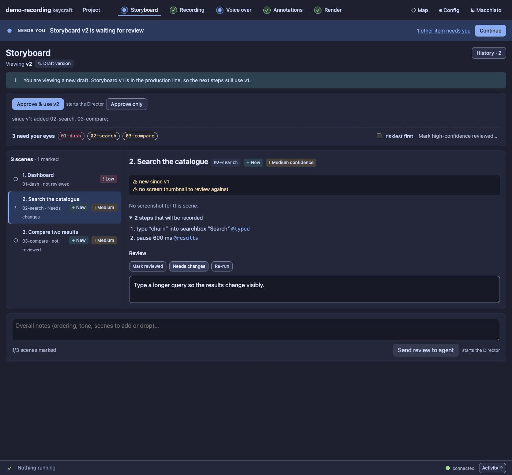

# UX5c report: Storyboard as list + inspector

Last part of slice UX5 of the [UX pass](../UX.md) (D100). Voice over moved in [UX5b](UX5b.md); this moves the
Storyboard to the same layout. The Director writes storyboards, so there is no draft here: you review the
scenes, and review stays a separate act from approving the version.

## What changed

- **A scene list and one inspector.** Each scene is a row: review status (icon and word), number and title,
  scene id, *New* / *Changed* since the compared version, and a confidence badge when it is not high. The
  inspector shows the selected scene: confidence reasons, a carried-over note ("Unchanged since v1, where
  you approved it"), the screenshot, takeaway, the director's emphasis, the narration outline, **the steps
  that will be recorded** (with their marks), and the review: *Mark reviewed*, *Needs changes*, *Re-run*
  (pressing the same one again clears it) and a note.
- **The scene is in the address** (`#/storyboard?scene=02-search`): a reload keeps it, and Back leaves the
  screen instead of stepping through scenes. Below 52 rem the list folds into a *Scene* select.
  "N need your eyes" chips select the scene; *riskiest first* orders the list.
- **Older versions are read-only** and say so; a version that does not exist is explained.
- **Review stays apart from approval.** Marking a scene sends nothing to the Director; *Send review to agent*
  does. Nothing on this screen approves the version or moves the production line (a test checks that no
  approve, select or action request is sent).
- **The collapse of high-confidence cards is gone**: a list row is already one line. The shared pieces
  (review and confidence vocabulary, list rows, the narrow select) moved to `inspector.js` and Voice over
  uses them too.
- `app.js` no longer holds any review code (`storyboard.js`, `voice.js`, `inspector.js`, `drafts.js` do).

## Guards

`test/ux5c-storyboard-panel.test.ts` (3): the list, selection in the address, steps with marks, the diff
badges, the narrow select; review as its own act (mark, note, clear, send; no approval, no line change, no
Director turn before sending); older versions read-only and a missing version explained.

Audit: Storyboard 0 serious findings in Macchiato and 1 in Latte (was 2–3); total 430 → 422 serious, 896 →
892 small targets; no new literals. Baseline updated. The legacy card CSS (`.scene`, `.compact`, `.thumb`) is
now unused by these two screens and goes with the legacy CSS at UX9.

Regenerate the screenshots: `node extensions/demo-recording/scripts/panel-shots.ts --out /tmp/p --storyboard`.
