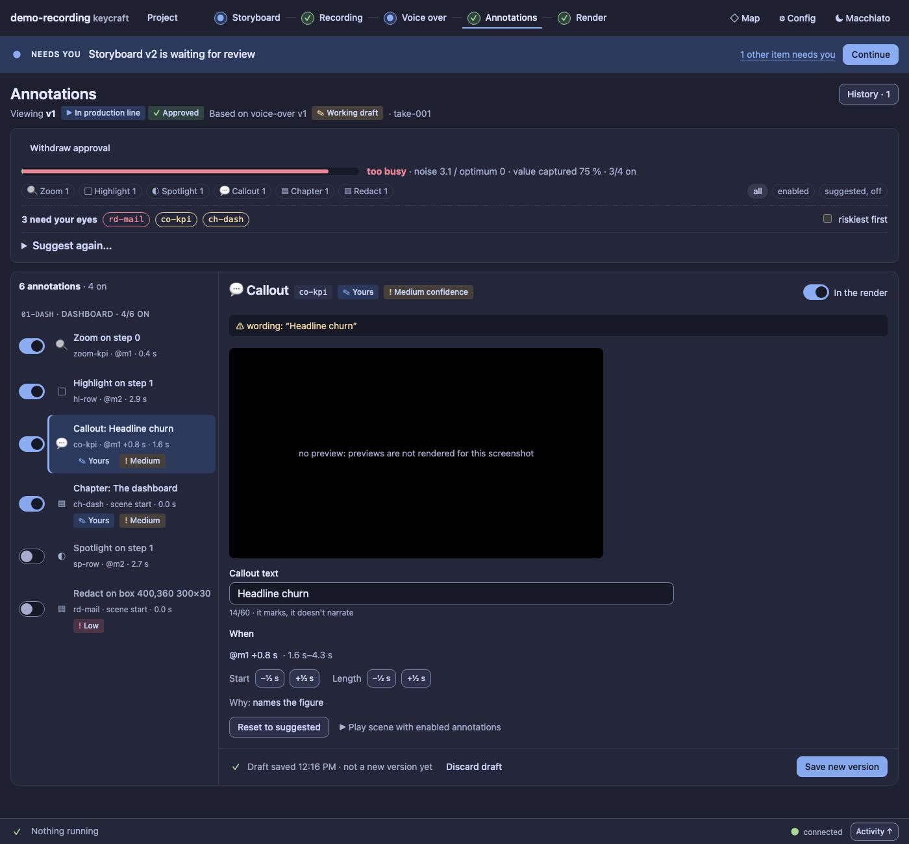
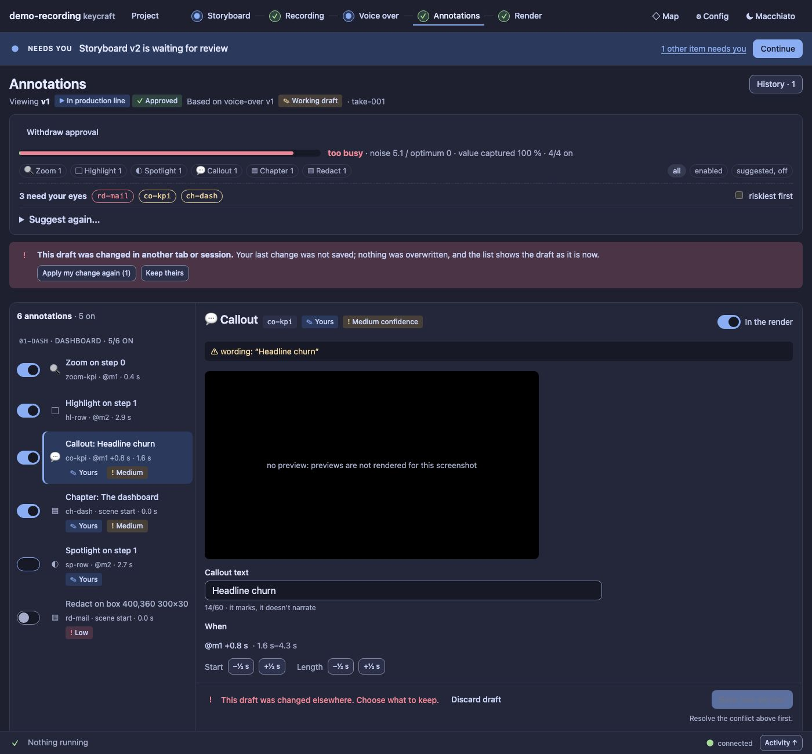
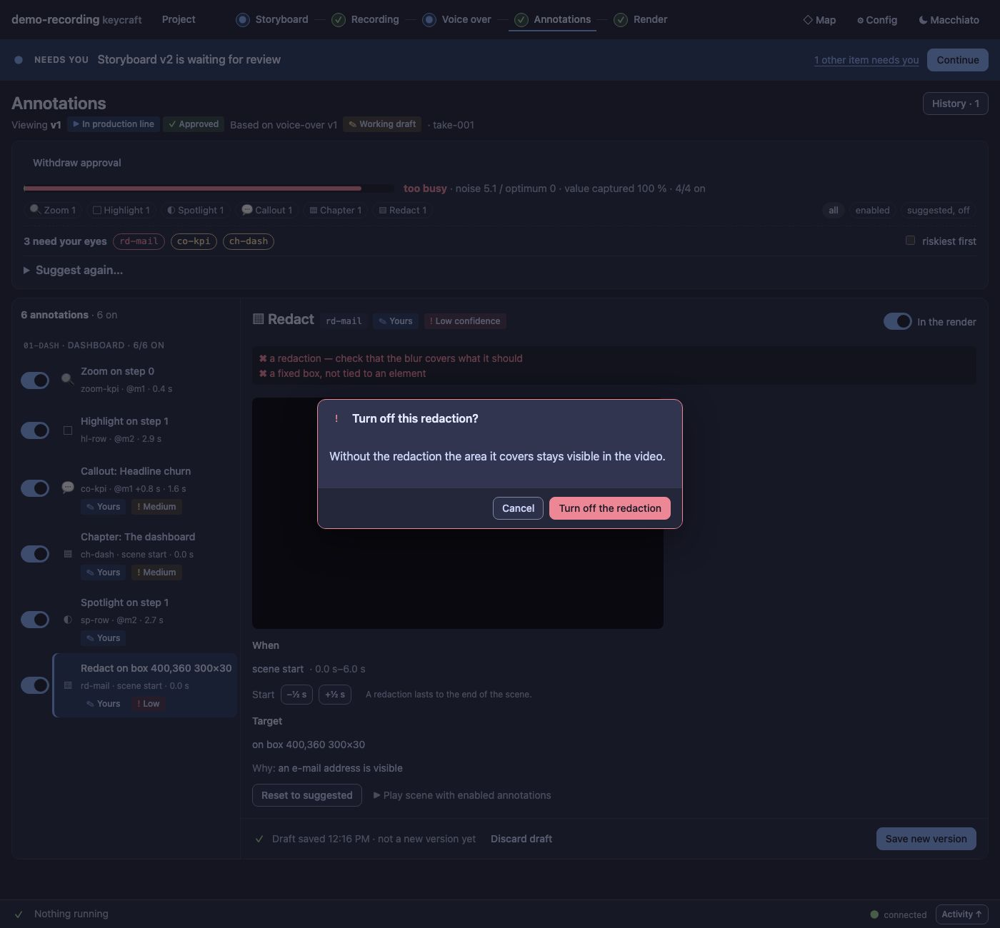

# UX6b report: Annotations as a list by scene + inspector

Panel half of slice UX6 of the [UX pass](../UX.md) (D100, D122), on the draft engine of [UX6a](UX6a.md).

## What changed

- **A list grouped by scene, and one inspector.** Each scene has a header ("01-dash · Dashboard · 4/6 on"); each
  annotation is a row with its **enable switch** right in the row, its title (type and text or target), its id,
  when it happens and where it starts, and badges: *Privacy* (found by the scan), *Yours* (you changed it),
  *Can't place*, and a confidence badge when it is not high. Filters for type and state (all / enabled /
  suggested, off) stay, and so do *riskiest first* and the "need your eyes" chips (they select).
  Below 52 rem the list becomes an *Annotation* select. The selection is in the address
  (`#/annotations?item=co-kpi`): a reload keeps it.
- **The inspector** shows the selected annotation: type, id, badges, the enable switch, confidence reasons, why
  it cannot be placed (if so), the **preview** (still, click for the large popup and the clip), the **text** of a
  callout or chapter (kept as you type, 60 characters), **When** (the anchor, the resolved start and end, ±½ s
  buttons for start and length; a redaction has no length), the **target** with the designer's other targets as
  choices, the designer's reason and weights, **Reset to suggested**, and *Play scene with enabled annotations*.
- **Edits are a working draft, saved as you go** (Saving… / Draft saved 12:41 · not a new version yet / Save
  failed). A switch, a nudge, a target or a text is one edit; they are sent one at a time, each carrying the
  revision of the last answer. **Save new version** (the sticky bar) makes exactly one version and shows it;
  **Discard draft** names the annotations it drops ("1 change to ch-dash") and can be cancelled.
- **A failed save keeps your change** and says so, with **Retry**; the page warns before it is closed with an
  unsaved change.
- **A conflict is a choice.** If another tab or session changed the draft, your change is *not* written, the
  list shows the draft as it is now, and you pick **Apply my change again** (on top of theirs) or **Keep
  theirs**. A refused edit (a text that is too long, a third zoom) is said and dropped; the rest goes on.
- **A draft whose base moved is flagged, never moved:** *built on v1, v2 exists* with **Save as new version**,
  **Compare with v2** (your changed annotations next to the newer version's), **View v2** and **Discard draft**.
  Drafts on **other versions** are listed and kept: editing v2 never replaces the draft on v1.
- **Turning off a redaction asks first**, once per redaction ("Without the redaction that value stays visible in
  the video"). Turning it on does not ask; the render stage still confirms an unredacted render.
- **Reset to suggested** puts one annotation back the way the designer suggested it (every change of it
  undone); it is offered only on annotations you changed.
- **Kept:** the noise budget meter, the version summary and approval, and *Suggest again…* (re-suggest with
  instructions and its cost dialog, the separate designer run, and *Use no annotations*) as a disclosure in the
  head.
- Review, editing and approval stay separate: nothing here approves a version or tells the Director anything.

## Guards

`test/ux6b-annotations-panel.test.ts` (7): the list grouped by scene, selection in the address and the narrow
select; a switch, a nudge and a text going into the draft with the saved version untouched, reload keeping it,
and Reset to suggested; a failed save and Retry; a conflict with apply-again and keep-theirs; the redaction
question asked once; Save new version (one version), Discard naming what it drops, another version's draft
kept and the base-moved note with Compare; the filters. Previews are stubbed there (rendering stills is
covered by the preview tests).

Audit: the Annotations page has 0 serious findings in Macchiato and 1 in Latte (it had 6 and 42 small targets
before the pass); the total went from 422 to 412 serious and from 892 to 780 small targets. No new literals.
Baseline updated.

Regenerate the screenshots: `node extensions/demo-recording/scripts/panel-shots.ts --out /tmp/p --annotations`.

## Screenshots

| | |
| --- | --- |
|  |  |
| A conflict from another tab: apply mine again, or keep theirs | Turning off a redaction asks first |

## Left for later

Bulk options (turn a type on or off for a scene) and showing the legacy card CSS's removal (UX9).
