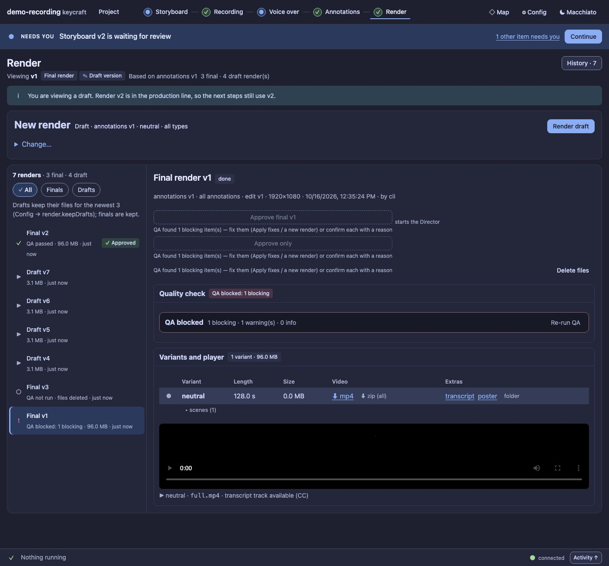
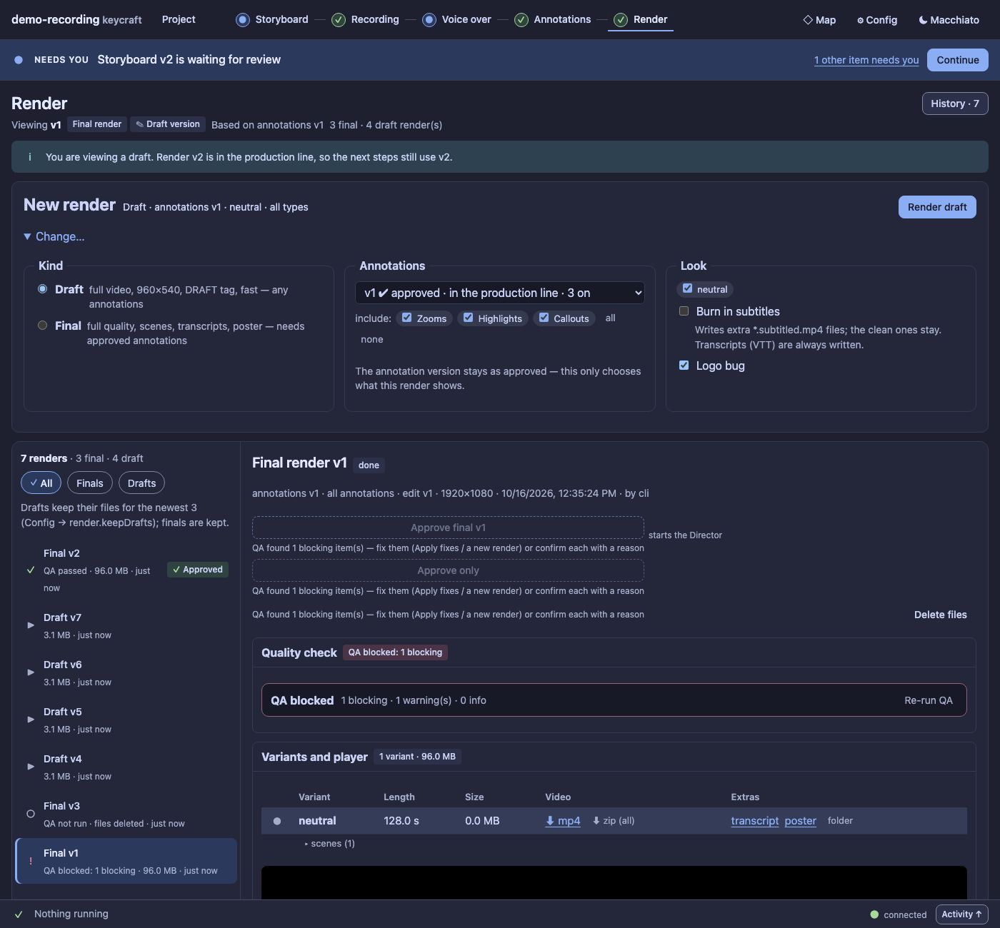
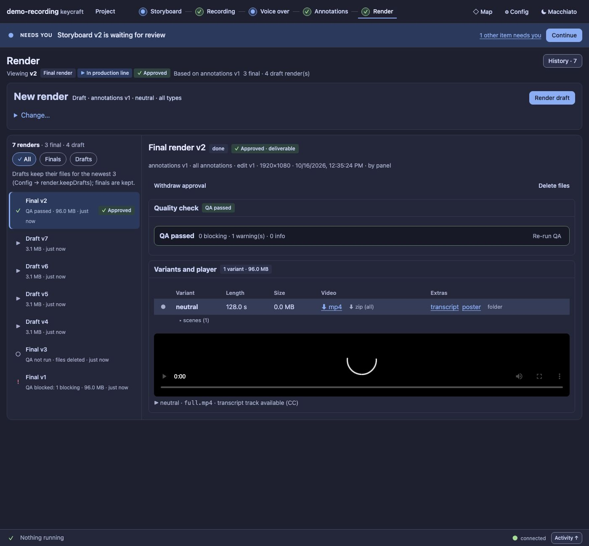

# UX7 report: Render as a runs list + inspector

Slice UX7 of the [UX pass](../UX.md) (D100, D123). Panel only: the engine already had everything this
needs (`GET /api/renders`, `render`, `render-delete`, the per-draft `annotations` + `fromDraft` request).

## What changed

- **One list of runs.** Approved first, then newest first. Each row says, in words and an icon, what the run is
  and where it stands: *Final v2 · QA passed · 96.0 MB · just now · Approved*, *Final v1 · QA blocked: 1
  blocking*, *Final v3 · files deleted*, *Draft v7 · 3.1 MB*. Filter chips **All / Finals / Drafts**. Draft
  renders whose files are gone fold into "N older drafts without files". Below 52 rem the list is a *Render*
  select.
- **The selected run is the *viewed* version** (`#/render/v4`): a click shows it and writes nothing (viewing is
  not using, D118); a reload keeps it.
- **One inspector of sections in decision order.** The summary (kind, status, approval, where it came from,
  edit, size, time, who) and the actions (*Approve final…*, *Approve only*, *Delete files*), then **Quality
  check first for a final** (it gates approval) with its state in the header, then **Variants and player**
  (the existing variant table, player, subtitled versions, scenes, downloads), then **Warnings**. No tabs, so
  a blocker is never one click away; the reason a final cannot be approved stands beside the disabled button.
- **New render is a summary line and one button.** *Draft · annotations v1 · neutral · all types* and a
  primary **Render draft** / **Render final** that uses those defaults. **Change…** opens the form (kind,
  annotations, included types, brands, subtitles, logo bug). A blocked final shows its reason beside the
  disabled button ("no edit yet", or why the annotations cannot make a final). Progress and Cancel appear in
  the same place while a render runs.
- **Rendering unsaved changes** stays, as **one option per annotation draft** ("unsaved changes on v1 (1)",
  "on v2 (1)"). Drafts only: a final still needs a saved, approved version.
- **The gates stay where the action happens:** the redaction question when excluded types leave redactions,
  the two-step delete of an approved deliverable ("Delete the approved deliverable?"), the final's QA blockers.
- Legacy renders (before the Render stage) stay as a disclosure under the list.

## Guards

`test/ux7-render-panel.test.ts` (4): the list order and filters and the selection as viewing (state untouched,
reload, narrow select); the sections in order (QA first for a final, none for a draft, a run without files
says so and offers no delete) and the gate stated beside the disabled approve button; New render (summary,
Render now with the defaults, the form closed until Change…, one option per draft with `fromDraft` and the
right base, no unsaved options for a final, a blocked final with its reason that does nothing); the
two-step delete. Starting a render and deleting files are intercepted there; the engine jobs have their own
tests. `ux3-panel` (a disabled approve says why) moved to the new layout.

Audit: the Render page has 0 serious findings in Macchiato and 5 in Latte (it had 18 at 900 px) and 15 small
targets per page (it had 58); the total went from 412 to 378 serious and from 780 to 608 small targets. No
new literals. Baseline updated.

Regenerate the screenshots: `node extensions/demo-recording/scripts/panel-shots.ts --out /tmp/p --render`.

| | |
| --- | --- |
|  |  |
| *Change…* opens the form | The approved deliverable |

## Left for later

A runs *table* with sortable columns (the list rows carry the same facts), and a bulk delete of old drafts.
