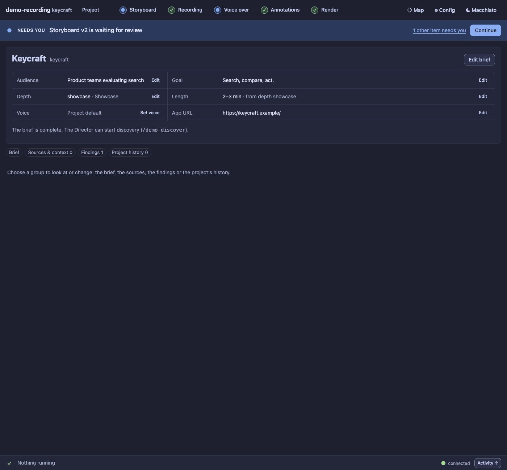

# UX8 report: Project opens on a summary

Slice UX8 of the [UX pass](../UX.md) (D100, D124).

## What changed

- **The Project screen opens on a summary of the brief in human terms:** audience, goal, depth, length, voice
  and the app URL, each with an **Edit** link that opens the Brief group on that field (a missing one says
  **Set goal**, **Set audience**, …). Length is never "missing": it falls back to the depth default and says
  so (*2–3 min · from depth showcase*); an unset voice is *Project default*.
- **Missing essentials are persona, goal, depth and the app URL** (what the demo-brief skill asks for first),
  shown with a *Missing* badge, never as a gate: nothing is blocked or changed by what is missing.
- **A NEXT line says what to do:**
  - a new project: *Describe the demo to the Director, or fill the brief in yourself*, with
    **Ask the Director to draft it** (an agent turn: it makes the Director use the demo-brief skill, draft first
    and ask only for the gaps; the button shows the usual "starts the Director" hint and then says *Asked the
    Director*; asking writes nothing) and **Fill it in myself** (opens the Brief on the first missing field);
  - some missing: *Complete the missing brief details: Goal, Depth*, with **Fill them in** and **Ask the
    Director to help**;
  - complete: *The brief is complete. The Director can start discovery.*
- **One group open at a time, in the address:** **Brief** (the existing form, closed until chosen, saved as a new
  brief version after the diff as before), **Sources & context**, **Findings**, **Project history** (the
  production line, brief versions with their diff, the input log with mark outdated / restore). The chips carry
  counts, the same chip closes its group, `#/project?group=findings` survives a reload.
- New route `POST /api/brief-draft` (cost class `turn`) and `summary` in `GET /api/project`
  (`briefSummary`, a pure function in `workdir/brief.ts`).

## Guards

`test/ux8-project.test.ts` (4): the summary of a new, partly filled and complete brief, the depth default and
its note, a missing URL, and `brief-draft` (one turn, the demo-brief instruction, nothing written, cost class
`turn`). `test/ux8-project-panel.test.ts` (4): the new-project summary and what is closed; Ask the Director
(one turn, brief untouched) and Fill it in myself (the field is focused, in the address); a fix link, filling
the essentials in and the summary turning complete with the depth's length; one group at a time, closing,
reload, and no overflow at 700 px. `s5-project` follows the new default (the form is a group).

Audit: two pages added (`project-brief`, `project-history`) so the form stays covered now that it is not the
default view. Project summary: 0 serious findings in both themes; the form page still has 2 (Macchiato) to 4
(Latte), the legacy form, which UX9 takes on. The total went from 378 to 346 serious and from 608 to 408 small targets (with the two added pages counted); no new literals. Baseline updated.

Regenerate the screenshots: `node extensions/demo-recording/scripts/panel-shots.ts --out /tmp/p --project`.

## Left for later

The Brief form itself (title card preview, length picker) keeps its legacy styling until UX9, and the Voice
field is still a plain text field rather than a picker of the account's voices.
