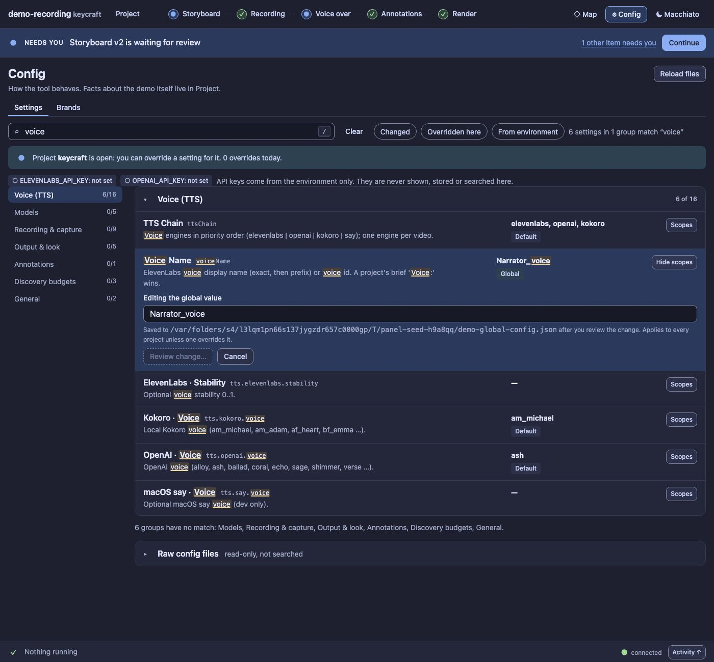

# UX9a report: Config search and settings with their layers

Slice UX9a of the [UX pass](../UX.md) (D100, D125).

## What changed

The first cut of this slice looked nothing like the [UX0 mock](config.html) (tall cards with both layers always
open). The Config screen now **is the mock**: its markup, its classes and its stylesheet, which moved from
`docs/ux/config.css` into the panel as `ds/config.css` (the mock page links to the same file, so the two
cannot drift apart again).

- **The page:** a *Config* head with what it is for and **Reload files**, then **Settings | Brands** as tabs
  (also in the address: `#/config?view=brands`), a wide **search** with the `/` hint, a notice about the open
  project (*Project keycraft is open: you can override a setting for it. 2 overrides today*, or *No project is
  open, so only global values can be edited*), and the API-key badges (a ✓ or ○ and a word, "never shown,
  stored or searched").
- **A group navigator on the left** (with counts, and *6/16* while searching; groups with no match are muted)
  and **collapsible groups** on the right, each with its count.
- **One compact row per setting:** label, key and description on the left; the **effective value with where it
  comes from** (Default, Global, Project, or *Environment (DEMO_REC_VOICE)*) in the middle; **Scopes** on the
  right. **Scopes** opens the four layers of that setting, each with its own action: *Environment* (read-only,
  *wins over both files*), *Project override* (**Override for this project** / **Edit project** / **Remove
  override**), *Global value* (**Edit global** / **Reset to default**) and *Default*. Editing opens under the row
  and says what it edits (*Editing the project override (keycraft)* / *Editing the global value*), where it is
  saved, and ends in **Review change…** and the diff dialog. If an environment variable wins, the editor and the
  dialog say *this change has no effect right now*. There is no page-level Global / Project switch.
- **The gaps are said:** without a project the override action is disabled with *Open a project to override*;
  a global-only setting says *Global only*.
- **Search covers settings only** (key, label, description, non-secret values and source words; every word, any
  order), highlights the matches, shows *6 settings in 1 group match “voice”*, mutes the other groups, lists the
  groups with no match, and has its own *No settings match* state with **Clear search**. Brands is a separate
  view and the raw files (read-only, not searched) sit in a collapsible group at the end.
- **Quick filters** beside the search: **Changed**, **Overridden here**, **From environment**.
- **Shortcuts, only inside Config:** `/` and Cmd/Ctrl+K focus the search, never in an editable control or over
  a dialog; Escape clears it. The query and filters are in the address (`#/config?q=voice&filter=changed`).
- **Secrets never appear:** API keys stay *set / not set*, are not settings, are not searched, and a setting
  whose key looks like a secret has its value left out of the index and the row.
- Messages (*saved*, *config reloaded*) are toasts now, like on the other screens.

## Guards

`test/ux9a-config-search.test.ts` (8, pure): matching on every field and word, group collapsing and counts,
the quick filters and their combinations, secrets never indexed or shown, value formatting, highlighting, the
state in the address. `test/ux9a-config-panel.test.ts` (7): search, highlight, collapse, reload, Escape and the
no-match state; each layer's action writing the right file (global, project, removal, cancel) with the diff
dialog, with Scopes closed until asked for and no page-level scope switch; disabled override actions with the reason; the environment card and its
dialog warning; the filters; the shortcuts staying out of editors and dialogs; the secrets. They point
`DEMO_REC_CONFIG` at a temp file: the real config is never touched. `s5-config-ui` follows the new layout.

Audit: **Config has 0 serious findings in both themes and widths (it had up to 82 at 900 px)**: every editor
has a label, the API-key badges are design-system badges. The total went from 346 to 30 serious and from 408
to 396 small targets; no new literals. Baseline updated.

Regenerate the screenshots: `node extensions/demo-recording/scripts/panel-shots.ts --out /tmp/p --config`
(it uses a temp config file, so no personal path or value gets into an image).

## A fix on the way

The UX1 report images `panel/before-config-light-1400.jpg` and `panel/after-config-light-1400.jpg` showed the
author's home path in the Settings text; that text is now covered in both. `panel-shots.ts` always uses a temp
config from now on.

## Left for later

The Brands view keeps its legacy styling until UX9b, and so does the Brief form's Voice field (a text field,
not a picker of the account's voices).
